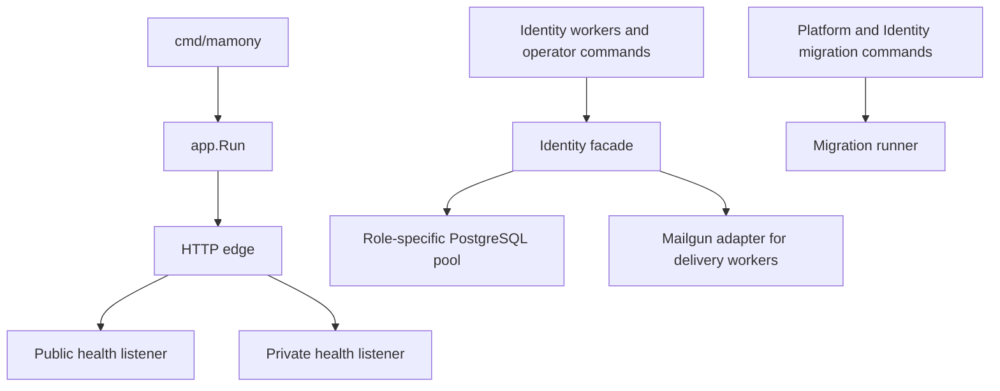

# Architecture

## Running packages

The default HTTP run starts only `cmd/mamony`. Each other command requires a separate invocation. See [current state](current-state.md#what-actually-runs) for deployment and capability status.

### Command entry points

| Command | Delegates to | PostgreSQL role | Observable effect | Evidence |
|---|---|---|---|---|
| [`mamony`](../cmd/mamony/main.go) | `app.Run` | None | Starts the public and private health listeners. Handles process signals. | [Listener startup, shutdown, and isolation](../internal/app/app_test.go) |
| [`mamony-identity-mail-worker`](../cmd/mamony-identity-mail-worker/main.go) | `identity.RunDelivery` | `mamony_identity_delivery_runtime` | Polls the email proof outbox and submits eligible messages to Mailgun after explicit opt-in. | [Worker startup and secret handling](../cmd/mamony-identity-mail-worker/main_test.go) |
| [`mamony-identity-maintain`](../cmd/mamony-identity-maintain/main.go) | `identity.PurgeRetention` | `mamony_identity_maintenance_runtime` | Runs one bounded retention purge batch after explicit opt-in. | [Maintenance opt-in and secret validation](../cmd/mamony-identity-maintain/main_test.go) |
| [`mamony-identity-reconcile`](../cmd/mamony-identity-reconcile/main.go) | `identity.InspectEnrollmentBacklog` and `identity.ReconcileEnrollmentOnce` | `mamony_identity_verifier_runtime` | Reads the enrollment backlog. Approved repair issues missing first proofs in one bounded pass and reads the backlog again. | [Reconciliation CLI behavior](../cmd/mamony-identity-reconcile/main_test.go) · [Operator runbook](runbooks/identity-reconciliation.md) |
| [`mamony-identity-notice-health`](../cmd/mamony-identity-notice-health/main.go) | `identity.ReadSecurityNoticeHealthAsMonitor` | `mamony_identity_notice_monitor_runtime` | Reads security-notice aggregates once and reports the threshold result. | [Notice-health call path](#identity-notice-health-call-path) |
| [`mamony-identity-security-notice-worker`](../cmd/mamony-identity-security-notice-worker/main.go) | `identity.RunSecurityNoticeDelivery` | `mamony_identity_security_notice_runtime` | Polls the security-notice outbox and submits eligible messages to Mailgun after explicit opt-in. | [Worker opt-in and credential validation](../cmd/mamony-identity-security-notice-worker/main_test.go) |
| [`mamony-migrate`](../cmd/mamony-migrate/main.go) | `migration.Run` | `mamony_platform_migrator` | Applies Platform migrations and verifies their fingerprints against the Platform history. | [Migration file checks](../internal/platform/migration/repository_test.go) |
| [`mamony-identity-migrate`](../cmd/mamony-identity-migrate/main.go) | `migration.RunIdentity` | `mamony_identity_migrator` | Applies Identity migrations and verifies their fingerprints against the Identity history. | [Migration file checks](../internal/platform/migration/repository_test.go) |

### Internal packages

| Package | Responsibility |
|---|---|
| `internal/app` | Start and stop the two HTTP listeners; contains an unmounted Ledger reference composition helper, not called by `Run`. |
| `internal/platform/httpedge` | Serve liveness and readiness. |
| `internal/platform/migration` | Standalone versioned platform and Identity migration verification, with separate schema roles and migration histories; never invoked by HTTP startup. |
| `internal/platform/postgres` | Bounded runtime-only pgxpool plus transaction primitives; Identity uses a dedicated least-privileged pool, not wired to HTTP. |
| `internal/platform/reference` | Curated immutable synthetic currency/country reference catalog; not mounted. |
| `internal/modules/identity` | Internal enrollment, authentication, sessions, recovery, security notices and one-use passkey possession verification. The default HTTP process mounts health endpoints only. |
| `internal/modules/ledger` | Isolated monetary domain and USD-only reference admission. The separate [Ledger storage fixture](proposals/ledger-k2a-isolated-persistence.md) runs in disposable PostgreSQL. Posting and runtime wiring remain planned. |

| Listener | Default | Routes |
|---|---|---|
| Public | `127.0.0.1:8080` | `GET /livez` |
| Private | `127.0.0.1:8081` | `GET /livez`, `GET /readyz` |

Set `MAMONY_PUBLIC_ADDR` and `MAMONY_PRIVATE_ADDR` to override the addresses. The private listener accepts `127.0.0.1` and `::1`. It maps `localhost` to `127.0.0.1`. Readiness reports only HTTP process readiness.

### Identity notice-health call path

1. The CLI parses `--check-security-notices` and the thresholds, reads a private DSN file, and calls the Identity facade with an eight-second deadline. [CLI package](../cmd/mamony-identity-notice-health/)
2. `identity.ReadSecurityNoticeHealthAsMonitor` opens a one-connection pool configured for `mamony_identity_notice_monitor_runtime`. The Platform pool checks the actual PostgreSQL role before use. [Identity facade](../internal/modules/identity/security_notice_health.go) · [Pool role check](../internal/platform/postgres/pool.go)
3. `SecurityNoticeHealthStore.Read` calls `mamony_identity.security_notice_health()` in a transaction. The facade returns aggregate counts to the CLI. [Repository query](../internal/modules/identity/internal/repository/postgres/security_notice_health.go) · [Monitor grant](../db/migrations/identity/000018_notice-health-readonly-runtime.up.sql)
4. The CLI writes a redacted JSON report. Exit code `0` means all monitored counts were within their thresholds, `2` means at least one threshold was exceeded, and `1` means the probe failed. [Probe behavior and operating limits](adr/0017-read-only-notice-health-probe.md)

The [CLI unit tests](../cmd/mamony-identity-notice-health/main_test.go) cover threshold classification, configuration rejection, and error redaction. The [monitor-role integration test](../internal/modules/identity/internal/integration/security_notice_health_integration_test.go) exercises the aggregate read and checks that the role cannot run purge functions on disposable PostgreSQL.

## Capability packages

[ADR-0001](adr/0001-go-modular-monolith.md) describes the planned package structure. Add each capability as work reaches it.

- Place the capability facade at `internal/modules/<capability>`.
- Keep the domain, use cases, repositories, and handlers private under the capability's `internal/` directory.
- Place cross-capability adapters in `internal/app`. Keep domain rules independent of HTTP and SQL. Give use cases their own ports.
- Add a feature subpackage when it has a distinct responsibility. Run `make architecture` after an import change.

See the [data ownership decision](adr/0002-ledger-and-data-ownership.md), [public HTTP contract](adr/0003-public-http-contract.md), and [roadmap](roadmap.md) for planned work.

## Service extraction

The repository has one root Go module. A separate command defines an entry point. An independently deployed service also needs an owned runtime and a contract for its callers. See the [criteria for process, network, database, and Go module changes](adr/0001-go-modular-monolith.md#when-to-separate-a-boundary).

Use a narrow interface in the consuming use case and map input and output in the app adapter. For example, a future Payments use case can request a Ledger posting through an in-process adapter. If Ledger moves to its own process, the Payments-side adapter can call the remote Ledger operation. Ledger owns posting authorization and the local posting transaction. Payments owns its workflow progress. If a call times out, Payments resolves the result through the Ledger contract using the same operation ID. The [Ledger contract](contracts/ledger.md) defines the intended posting and replay behavior.

## Security authority and trust boundaries

**Current HTTP implementation:** only the health listeners run. Internal Identity enrollment, sessions, recovery, notices and one-use passkey possession verification are merged for synthetic use. Identity routes remain unmounted. No deployed Mailgun worker, end-to-end tenant/resource authorization, passkey login, or financial approval/posting enforcement is established. The wider security boundaries below remain design contracts, not deployed controls. Mamony uses synthetic identities, balances and providers; these requirements do not imply regulatory compliance or production readiness.

The initial modular-monolith security model assumes the application runtime and its authoritative database remain trusted (**Profile A**). It does **not** claim to resist an arbitrary writer to that authority database or complete application compromise. Before claiming stronger protection (**Profile B**), choose and verify independently controlled identity, approval, and execution authority, including their persistence, deployment administration, key-operation permissions, and recovery roots. Signed rows, checksums, and KMS alone cannot establish fresh, authorized current state when the signing caller or current-state authority is compromised. Multi-region fencing (**Profile G**) is deferred.

| Boundary | Authority and obligation | Never trust solely |
|---|---|---|
| Public HTTP edge | Parse bounded inputs; authenticate the channel; pass a verified caller context | Client tenant, role, account-owner, verification flag, proxy headers |
| Identity capability | Authoritative subject, session, credential, recovery and revocation state | Business read projection or an old signed credential record |
| Owning capability | Authorize **subject + action + resource + tenant + context** on every operation | Successful login, possession of an object ID, or RLS alone |
| Ledger | Sole authority for immutable journals, balance updates, posting replay and monetary constraints | Provider callback, business balance projection, or caller-supplied approval flag |
| Financial workflow | Immutable intent, applicable policy and approval, recipient and outcome transitions | A generic OTP success or a timed-out provider request |
| Provider connector | Per-provider signed-message verification, durable operation identity and bounded egress | Arbitrary callback data or user-selected outbound URL |
| PostgreSQL | Limited runtime grants, capability schema boundaries and tenant-table RLS where applicable | A global superuser, owner role, or client-supplied tenant context |
| Security audit / notification | Durable evidence and required security-event obligations; enforce access separately | Mutable marketing preferences or best-effort application logs |
| CI, deployment and keys | Least-privilege build, runtime, migration and key-purpose capabilities | The assumption that a scanner or KMS blocks an already-privileged caller |

Threat-driven checks are owned by the affected contract rather than by a generic security module:

- **Cross-tenant access, BOLA/BFLA, mass assignment:** [identity](contracts/identity.md#authorization-and-approvals) and [PostgreSQL](contracts/postgresql.md#tenant-isolation)
- **Credential substitution, stale sessions, recovery bypass:** [identity lifecycle](contracts/identity.md#authentication-and-lifecycle)
- **Replay, balance races and altered financial intent:** [ledger](contracts/ledger.md#posting-and-replay) and [payments](contracts/payments-and-payouts.md)
- **Forged callbacks, ambiguous dispatch and SSRF:** [provider](contracts/provider.md)
- **Secret misuse, audit suppression, restore rollback:** [platform](contracts/platform.md), [operations](contracts/reconciliation-and-events.md#operator-workflow-and-audit) and [recovery procedures](runbooks/recovery.md)

Document the attacker foothold, surviving trusted authority, expected refusal, and concrete test for every new security claim. The [verification rules](engineering.md#security-verification) require evidence for implemented capabilities and `NOT RUN` for unimplemented controls. Record unresolved choices in the [decision register](open-decisions.md#security-architecture-decisions).

### Identity HTTP enrollment candidate (Draft PR #31)

PR #31 is merged; the historical heading is retained for deep links. `internal/modules/identity/internal/handler/enrollment_http.go` is a nonmounted, manually constructed `http.Handler` for two proposed JSON endpoints. It requires direct TLS (no trusted `X-Forwarded-Proto`), exact operator-configured Origin/Host, strict 2KB JSON without duplicate/unknown keys, no cookies or Authorization, and already implemented anonymous HMAC admission. Internal `EnrollmentFlow` connects new pending subjects to the encrypted proof issuer and restricts resend to server-resolved UNVERIFIED subjects. No public listener routes changed. The optional browser-facing workflow is **not safe to deploy** until a reviewed TLS proxy boundary, blocklist, latency obfuscation, async reconciliation/monitoring, real provider quota and frontend proof-consumption flow exist.
