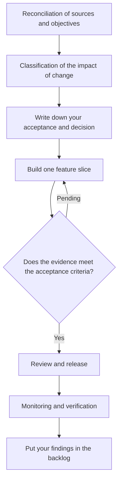
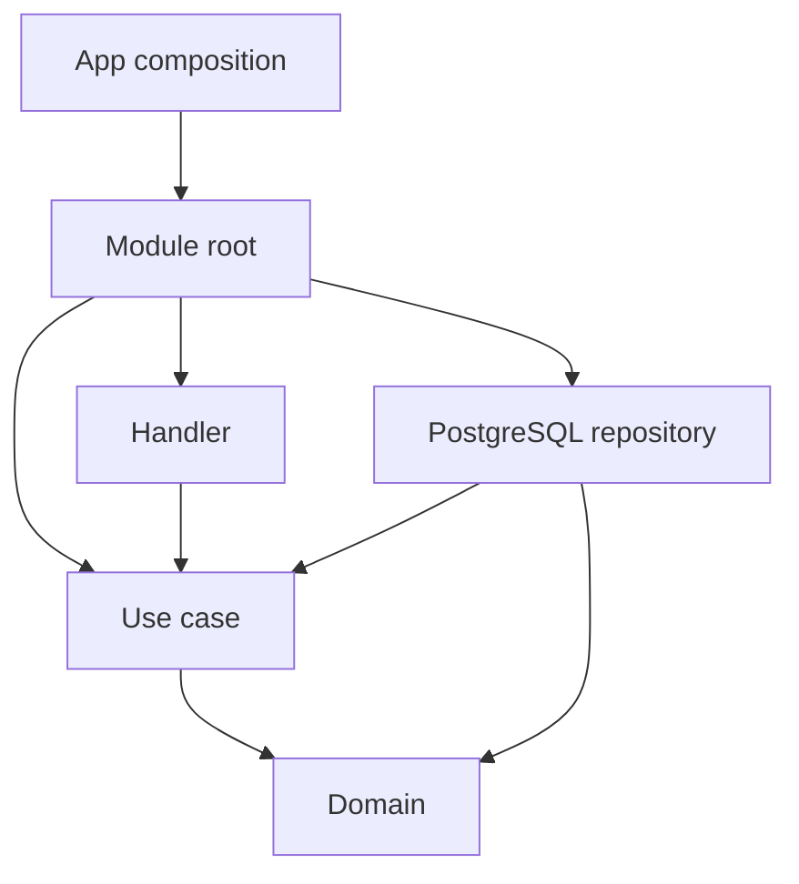

# Mamony Go — Production Engineering Workflow v5

**Status:** Draft research v5, plus engineering principles, refactoring, design patterns, system design, backend, and DevSecOps · Date: 21 November 2026

This workflow is for Go projects where AI implements most changes. The core standards apply to every change. Scale design, testing, and rollout to the impact. Give the agent a concise ticket, a route to the relevant rules, and a way to produce verifiable evidence.

This is an engineering research draft. Use the [Mamony Go documentation index](../index.md) for current requirements and implementation status.

See the [local product scope](../product.md) for simulator boundaries and delivery gates.

For layout decisions, read [§9](#9-organization-by-capability-layer-and-feature). For tool selections, configuration examples, and CI jobs, read [§10](#10-static-analysis-security-and-ci). For AI skills and token saving strategies, read [§11](#11-agent-skills-tooling-and-token-efficiency). For the principles of design and SOLID/YAGNI, read [§12](#12-software-engineering-principles-and-how-to-apply-them); refactoring [§13](#13-refactoring-code-smells-and-change-discipline); patterns [§14](#14-design-patterns-for-idiomatic-go); system design [§15](#15-system-design-for-a-financial-modular-monolith); DevSecOps [§16](#16-devsecops-security-engineering-and-operational-fundamentals); and application to AI [§17](#17-using-the-engineering-principles-in-ai-assisted-coding).

## 1. Decisions to confirm

| Topic | Proposed baseline | What would change the choice |
|---|---|---|
| Architecture | Use one Go module and one process with two listeners. Preserve capability boundaries. `cmd/mamony` runs the composition root, which wires adapters and jobs explicitly. | Extracting a worker or service requires operational evidence and an ADR for ownership, deployment, and the cross-process protocol. Follow the [local runtime decision](../adr/0001-go-modular-monolith.md). |
| Go and tooling | Candidate Go 1.27.4 based on release history at research date. Pin the patch in CI/build, test the compatibility of the analyzer, and schedule the patch upgrade. | Use the latest patch of a line that's still supported when the toolchain deployment or analyzer isn't ready. Write down the reason and date of review. |
| HTTP | Candidate: `net/http`. Keep the REST/JSON contract, problem details, and public/private listener. Use the local OpenAPI document when it exists. | The spike router/validator/generator must prove that the metadata of permissions and routes listed is consistent, listener limits tested, and the tooling accepts the spec as well as features used. |
| Storage | PostgreSQL 18 follows the quickstart source, one DB with schema and role per capability. Candidate `pgx/v5` for driver/pool, SQL explicit, and `sqlc` for query type after proven by role and transaction. | Runtime role testing after reuse pool, tenant transactions, rollback, and SQLSTATE. Document the global pool budget before adding a capacity pool. |
| Migrations | One tool and SQL version, candidate Goose. The runner must be able to execute DDL, trigger, and PostgreSQL Mamony functions in the correct sequence of bootstraps, roles, and grants. | Compare Goose and an alternative runner to the migration fixture C01. Lock tests, transactions, histories, file controls that have been released, and updates to supported schemes. |
| Quality gate | Use one runner `golangci-lint` v2 for gofmt, govet, Staticcheck, gosec, and selected linters. Run test, build, and govulncheck as separate gates. See §10 for profiles, exclusions and candidate versions. | Extend the analyzer after a proven case, measure noise and duration, as well as check toolchain compatibility with each upgrade. |
| Deploy | One OCI image for the simulator. PostgreSQL outbox from the beginning when there's a lasting event. Use dev and isolated staging with synthetic fixtures. | Consider brokerage through ADR when there are measurable outbox needs that are not addressed, including ordering, throughput, retention, or consumer isolation. |
| Product | Simulated pay-in and pay-out, a USD → IDR pilot, and double-entry ledger from the foundation phase. The proposed Go delivery starts with a foundation slice and then proceeds to Gate B. | Full port, compatibility of all APIs, reuse of historical schema, and post-Gate B feature coverage require a separate project decision. |

The baseline column records research candidates. The [local decision index](../adr/README.md) gives their current status.

| Local reference | Application to Go |
|---|---|
| [Runtime and package boundaries](../adr/0001-go-modular-monolith.md) | Use explicit constructors and small composition adapters. Test the routes and jobs that the application starts. |
| [Ledger and data ownership](../adr/0002-ledger-and-data-ownership.md) | Use the C01 invariants, schema grants, and atomic outbox. |
| [Event delivery](../adr/0002-ledger-and-data-ownership.md#event-delivery) | Keep per-account ordering and consumer deduplication. Set published event retention in the relay contract. |
| [Public HTTP](../adr/0003-public-http-contract.md) and [PostgreSQL isolation](../contracts/postgresql.md#tenant-isolation) | Test resource authorization, runtime grants, and tenant scope. Bind operator approval to the approved payload for configuration changes. |
| [FX and ledger precision](../adr/0002-ledger-and-data-ownership.md#ledger-ownership) | Use an independent numerical oracle. Test large values, currency exponents, and rounding ties. |
| [Local decision records](../adr/README.md) | Link a requirement to its design and acceptance checks. Give each durable decision a local ID. |
| Go implementation choices | Test support for the driver, migration runner, API tools, and application lifecycle before adopting a dependency. |
Sources: [Go module layout](https://go.dev/doc/modules/layout) · [Go release history and support](https://go.dev/doc/devel/release) · [net/http](https://pkg.go.dev/net/http) · [Using Go and pgx with sqlc](https://docs.sqlc.dev/en/latest/guides/using-go-and-pgx.html) · [Goose](https://pressly.github.io/goose/) · [OpenAPI 3.1](https://spec.openapis.org/oas/v3.1.1.html) · [RFC 9457](https://www.rfc-editor.org/rfc/rfc9457.html).

## 2. Workflow from intake to operations



| Stage | Input and work | Exit evidence |
|---|---|---|
| 1. Intake | User identification, problems, desired results, scope limits, and sources. Link each requirement to a decision or contract in this repository. | Project summary or PRD, list of requirements and open questions. |
| 2. Triage | Determine the S/M/L class of blast radius, data type, compatibility, and recovery. Tickets refer to contracts, ADR, modules, and related standards. | Acceptance criteria that can be tested, working class, decision owners, and a list of influential assumptions. |
| 3. Design | Choose one vertical slice. For the new boundary, specify contract, data, failure, verification, and rollout. Make ADR when you have a long-term decision. | A design that can be reviewed. Product decisions such as the meaning of balances and access permissions require source or owner approval. |
| 4. Build | Starting with the admissions case. Make the smallest complete change from entry point to data when relevant. Run a guided check on the iteration. | Diff that can be reviewed, risk-related tests, and contract updates or referenced documents. |
| 5. Review | Check the contract, auth, data integrity, failure path, and scope diff. Make a distinction between checks that have passed, failed, or not been executed. | PR with the link requirements, check results, remaining risks, and release plans if relevant. |
| 6. Release | Build once per commit, deploy the same image via digest, run compatible migration, smoke test, and evaluate metrics or invariants. | Commit/digest, migration results, deployment time, success signals, further decisions or rollback/roll-forward. |
| 7. Operate | Monitor error and latency as well as domain signals such as mismatch reconciliation if applicable. Simulate the recovery on isolated data prior to production. | Tested runbooks, backlog of incidents, and RPO/RTO evidence when set. |

Document conflict as a decision to be resolved. Use PRD for behavior and outcome, ADR for approved architectural decisions, OpenAPI for contract form HTTP, and migration for built schema. If two sources contradict each other, record both and the impact. Existing production codes also need to be checked for risk of compatibility. Work the independent part while waiting for a blocking decision.

### Impact determines S, M, and L

| Classroom | Triggers and examples | Minimum documentation | Evidence and gate |
|---|---|---|---|
| **S — Local and easily reversible** | Repair of documentation, validation message without change of error code, internal refactor with fixed contract. | A concise ticket contains outcomes, scope, 1–3 acceptance criteria, and commands. | Regression tests or targeted checks according to diff then base CI. |
| **M — One feature or contract with limited impact** | An endpoint recording with a new additive schema, changing the report query, or a new adapter without moving money. | Feature specs are concise. Add tech design when touching multiple boundaries and ADR when changing the default architecture. | Unit + HTTP/contract + real DB integration according to boundary, fresh migration and upgrade path when the schema changes, smoke staging and recovery plans. |
| **L — High impact or difficult to recover** | Changes in the meanings of balances, funds flows, cross-user permissions, sensitive data, destructive migration, external integration with financial effects, or cutovers between systems. | PRD or approved requirements, tech design, ADR for durable decisions, threat models, rollout/restore and runbooks. | Human review according to domain, test invariant, concurrency and replay where relevant, rehearsal migration/restore, reconciliation signal, and go/no-go decision before release. |

Take the highest class triggered. Changes to one line on dismissal or authorization could be class L. Large features are broken down into small PRs that can be reviewed and remain consistent with their parent design. Standard exceptions include owner, reasoning, replacement controls, and evaluation dates.

| Hypothetical example | How to run it |
|---|---|
| S · Fix links to the runbook ledger | Ticket signals alert and runbook. Run a link check as well as verify that the triggers and actions are consistent with the source. |
| M · Port statement read to C02 | Take range filters, pagination, and auth from the design. Test the ledger read, fix a timestamp at the limit, tenant scoping, and response from an applicable listener. Go up to L when the tenant isolation changes. |
| L · Port C01 Post and reverse | Prove atomicity, currency, balance floor, replay, reverse once, and ordering at DB. Prove the restore verifier and wiring through an approved caller before evaluating Gate A. |

## 3. Engineering standards and their verification

| ID | Standard | Proof of application |
|---|---|---|
| GO-01 | One Go module. Capabilities like C01 and C03 have root packages in `internal/modules/` and private details nested in `internal/`. Capability to separate `domain`, `usecase`, `repository`, and `handler` as needed. | Compilers nested `internal/`, check imports enforcing permissible directions, and Postgres grants enforcing ownership data. Details in section 9. |
| GO-02 | `gofmt`, short and descriptive packet names, consistent domain names, exported comment identifiers follow the Go doc when it appears in the API package. A small interface is on the user package if needed. Injection lewat constructor. | CI for the format. Review for naming, boundaries, and interfaces that facilitate actual testing or integration. |
| GO-03 | `context.Context` first parameter on the I/O line and cancelable work. Spread out the deadline for requests and give outbound budgets. Reverse the error with context, classify via `errors.Is/As`, and map to a stable public response. Every routine run by an app has a clear owner and stop condition. | Unit and integration tests for error mapping and cancellation. Race detector for the track actually executed. |
| GO-04 | Type configuration and file speed at startup. Secret from the secret store in production. Cap request body sizes, HTTP timeouts, and database pool capacity. Graceful shutdown has a deadline. Liveness tests the process and readiness tests the ability to receive traffic quickly. | Tests for config invalid and lifecycle. Smoke test for readiness, start-up and shutdown. |
| GOV-01 | README for bootstrap and navigation, `AGENTS.md` for stable AI rules, issue for change scope, PR for evidence, and ADR for long-term decision making. | Relative links, the reviewer checks for path/contract changes accompanied by updates to relevant documents. |
| DES-01 | Apply KISS/YAGNI/DRY/SoC and SOLID as engineering judgments tailored to the Go; invariants and security are more important than code conciseness. Don't build a speculative abstraction. | PR describes the needs of abstraction, simplest alternatives, costs, and evidence; check through reviews, not flash claims. See section 12. |
| DES-02 | Use design patterns only when the problem is concrete and trade-offs are clear. Refactor in small, behavior-preserving steps and test the affected contracts. | The PR/ADR review mentions triggers, contract tests, and boundary checks; see §13–§14. |
| SYS-01 | M/L design changes identify functional/nonfunctional requirements, consistency, concurrency, failure modes, recovery, and observability. | Tech design + failure-matrix + tests according to the blast radius; see §15. |
| SEC-03 | Secure SDLC and threat models based on asset/trust boundaries, runtime least privilege, dependency/supply-chain hygiene and control verification. | Selected and tested evidence NIST SSDF/ASVS; see §16. |
| API-01 | Use OpenAPI for the API consumed by the client. Document the auth, field, error code, pagination, status, compatibility and version strategy. Use `application/problem+json` for public error with safe detail. | Lint and compatibility diff for changing specs. Handler/contract test for status, schema, and authorized caller. |
| DB-01 | SQL parametrik. Define the PK/FK/unique/check and nullability of an invariant. The use case transaction includes all local write that must be atomic. Determine the isolation/lock order according to invariant, document retry for permissible transient error. | Integration testing with PostgreSQL and migration repo. For a change in concurrency, use some deterministic connections and barriers. |
| DB-02 | Migration ever released is immutable. Use expand → backfill → switch → contract if two versions of the app are running simultaneously. Measure the lock and backfill duration with representative data. | CI testing fresh setup and upgrades of relevant schemes. Deployment prepares rollback applications or a realistic roll-forward scheme. |
| FIN-01 | An amount ledger is an integer minor units and a currency explicit with checked arithmetic. Posting doesn't do rounding. FX follows the [ledger and data ownership decision](../adr/0002-ledger-and-data-ownership.md). Set the wire amount mapping by contract decision in §8. | Boundary test for overflow, exponent, currency mismatch, sign, rounding ties, and full round-trip from HTTP to DB. |
| FIN-02 | To write that can be re-transmitted and has a material effect, set the idempotency scope, fingerprint payload, replay results, and in-flight request behavior. Keep proof of uniqueness and local results atomically. For external effects, specify ambiguous status, verification and reconciliation before retry. | DB tests for simultaneous requests, replay after commits, different payloads, rollbacks, as well as timeout from external boundaries if applicable. |
| FIN-03 | C01 has an immutable double-entry journal, one currency per journal, balance floor, atomic posting, tied reversals, derivative balances from entries, and a daily verifier. C05 gives results to the orchestrator. The reconciliation correction is through approval and contract C01. | Integration model test, one reversal, replay, transaction rollback, recompute, and reconciliation with simulation provider reports. |
| SEC-01 | C08 disconnects access by default. Apply tenant context derived from identity, transaction-local RLS, separate roles, and log allowlist. Operator control follows the maker-checker as well as approval binding content. | A/B tenant testing uses runtime role, empty context, leakage during reuse pool, inventory route/permission, public/private listener, and apply to approved payloads. |
| SEC-02 | Pin version of the toolchain, analyzer, actions, and image. Run gosec for risk patterns at source and govulncheck for known vulnerabilities Go. Use least-privilege CI tokens. | `go mod verify`, review `go.mod`/`go.sum`, lint source, vulnerability scan, and examination of image/secrets according to deployment stage. Details in section 10. |
| OPS-01 | Log JSON with `slog`, correlation ID, route/status/duration, measured business signals, as well as the limit of metric cardinality. Cross-border trace with OpenTelemetry as needed. | Smoke staging, dashboards, actionable alerts and runbooks. SLO is determined from user needs and operational data. |
| OPS-02 | Backup and restore, patch schedule, rollback/roll-forward, secret release, and incident handling have owner-tested procedures. RPO/RTO confirmed through drill. | Restore proof, deploy digest, incident/recovery records, and reconciliation post-restore if the domain needs it. |

Sources: [Go Code Review Comments](https://go.dev/wiki/CodeReviewComments) · [Go transactions](https://go.dev/doc/database/execute-transactions) · [PostgreSQL isolation](https://www.postgresql.org/docs/current/transaction-iso.html) · [PostgreSQL constraints](https://www.postgresql.org/docs/current/ddl-constraints.html) · [PostgreSQL numeric types](https://www.postgresql.org/docs/current/datatype-numeric.html) · [PostgreSQL point-in-time recovery](https://www.postgresql.org/docs/current/continuous-archiving.html) · [OWASP ASVS](https://owasp.org/projects/asvs) · [NIST SSDF](https://csrc.nist.gov/pubs/sp/800/218/final) · [GitHub Actions secure use](https://docs.github.com/en/actions/reference/security/secure-use) · [slog](https://pkg.go.dev/log/slog) · [OpenTelemetry Go](https://opentelemetry.io/docs/languages/go/) · [Google SRE Workbook SLOs](https://sre.google/workbook/implementing-slos/).

### Example of a testable decision

Use two contracts for idempotency. The [public HTTP contract](../adr/0003-public-http-contract.md#http-idempotency) scopes keys to the caller and defines a replay window. The [ledger contract](../contracts/ledger-gate-a.md#posting-and-replay) keeps keys for the life of the journal.

1. Take the scope key from contract capability and ADR. The API searches for the key along with the caller's identity and has different results for missing keys, changing payloads, and requests running. The ledger sets replay according to the calling capability and journal key. Authorization is done before returning the replay results.
2. Keep records of idempotency and data changes in the same PostgreSQL transaction to write locally. Unique constraints become the safeguard for simultaneous execution. Document the response if payload is different or if an implementation scheme allows in-flight status.
3. If the connection breaks after commit, the client can repeat with the same key. The test must prove a stable result and only one local effect is recorded.
4. Simulation providers can produce unknown outcomes. C03 and C04 investigate status using the C05 contract and reconciliation. Use transactional outboxes, consumer deductions, and proof that events don't appear if rollbacks are posted.
5. For transaction isolation, select constraint, row lock, or serializable based on the invariant you want to keep. When the system uses retry for serialization failure, repeat all local transactions bounded. External side effects are managed through his own contract.

Sources: [HTTP Semantics](https://www.rfc-editor.org/rfc/rfc9110.html) · [PostgreSQL isolation](https://www.postgresql.org/docs/current/transaction-iso.html) · [PostgreSQL constraints](https://www.postgresql.org/docs/current/ddl-constraints.html).

## 4. Scaffolding and incremental CI

The following structure is the target shape when the component already has content. The first bootstrap is enough to create repo guides, AI instructions, entry point Go, health/test minimum, local commands, and CI.

```text
AGENTS.md
README.md
Makefile
go.mod
cmd/mamony/main.go
internal/app/
internal/platform/
internal/modules/ledger/
internal/modules/payment/
db/bootstrap/
db/migrations/
docs/api/openapi.json
docs/events/
docs/index.md
docs/standards/
docs/prd/
docs/adr/
docs/design/
docs/runbooks/
.github/pull_request_template.md
.github/workflows/ci.yml
```

| Standing order | Content when implemented | When is it run? |
|---|---|---|
| `make check` | Verify the lint configuration, run `golangci-lint run ./...`, check the import boundary, `go test ./...`, and `go build ./...`. | After targeted testing locally and on every PR. |
| `make integration` | Real DB with Testcontainers or PostgreSQL service CI, official migration and synthetic fixtures. The suite uses the `integration` tag when it wants to separate the default `go test`. | When DB becomes part of the scaffold. Run for PR that affects data and on the game. Early in CI adoption, running a short suite on every PR may be simpler. |
| `make verify` | Call basic checks and applicable gates, including race, vulnerability, contract, and integration checks once the components are in place. CI can run it in separate jobs with a stable check name. | Before merging under policy and before being ready for release. |
| `make smoke` | Start service, verify health/readiness, run a representative trail on the staging, and verify stop. | After deployment staging and before promotion deployment. |

Add a target `make docs` when bootstrapping for ID and link checks, status ADR, traceability MUST→TD→task, and capability dependency graph. Contract drift testing, event schemes, grant/schema ownership, and inventory route/job after the components are in place. Use the same dependency/tool version locally and CI. Keep the lock/version file in the repo. Workflow PR doesn't require secret production. Use action pin SHA and read-only tokens when the job is read-only. For private repo, the availability of native branch protection depends on a plan GitHub. If available, mandate PR and status checks as well as a ruleset test with minor PR. The CI workflow reports check results. The merger protection must be verified separately.

| Type of testing | Tested target | Practical standards |
|---|---|---|
| Unit | Invariant domain and transition status. | `testing`, table-driven when multiple inputs have a similar structure, explicit clock when relevant, synthetic fixtures, and fail message that can be followed. |
| HTTP/contract | Binding, validation, auth, status/error, and JSON. | Use `httptest`. Use the same specs for consumer and producer, test contracts that are deliberately approved, and verify API compatibility if there is a consumer. |
| Integration | SQL, row constraints, locks, migrations, transactions, and retries. | PostgreSQL major is the same as target deployment. Isolation test via DB/schema per worker if needed. Setup file CI clearly when DB is unavailable. |
| Race and concurrency | Data race at Go, write collision in DB, and cancellation. | The race detector is testing the execution tracks. Use a separate DB concurrency test to show the invariant remains valid. Use the barrier, deadline, and final status assertion. |
| Fuzz/property | Parser and invariant that accept many variations. | Start with inputs like a decimal/CSV parser if features exist, with synthetic seed corpus and measured budget. Maintain the relevant regression reproductive input. |
| End-to-end, load and recovery | Core user flow, data and cross-border deployment. | Choose a little smoke scenario. Add load/restore/cutover drills based on risk, SLO, RPO/RTO, and evidence of staging. |

Prioritize financial case coverage and critical access. Percentage coverage matches as a review signal of the measured baseline. Merge requests require evidence for relevant scenarios, such as replay, timeout, rounding boundary, unauthorized resource, and migration.

Sources: [Staticcheck](https://staticcheck.dev/docs/) · [Go race detector](https://go.dev/doc/articles/race_detector) · [Go fuzzing](https://go.dev/doc/security/fuzz/) · [Go vulnerability management](https://go.dev/doc/security/vuln/) · [Testcontainers PostgreSQL](https://golang.testcontainers.org/modules/postgres/) · [GitHub protected branches](https://docs.github.com/en/repositories/configuring-branches-and-merges-in-your-repository/managing-protected-branches).

## 5. Documents an agent reads for each change

| Document | When to use | Minimum content |
|---|---|---|
| README | Bootstrap and repo orientation. | Goals, local needs, first orders, and index links. |
| AGENTS.md | When AI goes into the repo. | The source sequence, the S/M/L trigger, the limit of assumptions, the commands, and the evidence format. Shell commands and fixed versions are sourced from the repo configuration. |
| Issue / change brief | All the classes. | Results, scope, relevant sources, grades, acceptance criteria, blocking questions, checks. |
| PRD | New products, changing outcomes of features, or high-impact product decisions. | Problems, users, scope, successful/failed behavior, constraints, success goals, acceptance criteria, open questions, approve. |
| ADR | Long-lasting or expensive reverse impact cross-module options. | Status, context, alternatives, decisions, consequences, triggers of evaluation, superseded relationships. |
| Tech design | Boundaries, schemes, integrations, or risky operations that need design before coding. | Sequence, ownership, API/schema, invariant, transaction/failure table, observability, verification, rollout and recovery. |
| Runbook | There's operational action that should be repeatable at the time of the incident. | Signals, impact, diagnosis, action, recovery checks, escalation and owner. |
| PR | All the changes are in play. | What changes, why, requirement/ADR, actual checks, remaining risks, and releases when relevant. |

Maintain the templates PRD, ADR, TD and task brief that Mamony already has. The brief examples in this document are for issue and prompt Go, whereas decision changes and requirements follow the source lifecycle. Save one rule in the canonical source and refer to it with a link and heading. Organize documents by domain and purpose. `AGENTS.md` roots can start with a size of about 1–2 short pages, as a local editorial target. Subdirectory rules are used when there is a local rule. The Codex contains instruction based on scope and has a configurable boundary combination.

Sources: [OpenAI AGENTS.md](https://learn.chatgpt.com/docs/agent-configuration/agents-md) · [Documenting Architecture Decisions](https://cognitect.com/blog/2011/11/15/documenting-architecture-decisions).

### Reusable prompt format

```text
Issue: [ID and link]
Outcome: [Changes in behavior]
Scope: [modul/boundary]
Sources: [the relevant heading PRD/ADR/spec link]
Acceptance: [AC-1 ...]
Risk: [class and the trigger]
Evidence: [Applicable verification commands]
```

1. Starting with `AGENTS.md`, issue, called path, and relevant contract pieces. The old documentation says `tools/context.py` and `tools/validate.py`. The command referred the source without a file tool in the archive. Propose a Go pack per task mode that contains rows TD, requirement IDs, applicable heading ADR, interface, and proof. Find the symbol and caller with `rg`. Expand the context if boundary or evidence requires it.
2. For the S change, do a targeted check and CI baseline. For M/L, write a short plan linking the AC, file/boundary, and evidence. Answer the question if the source of the conflict is money, permission, retention, public contract, or irreversible data change.
3. Use the diffarah and a concise command output. If it fails, take the error and context sufficiently from the failed phase. Keep a complete log as an artifact if needed for reproduction.
4. Handoff uses issue/PR, commit or branch, latest decisions, checks actually executed, blockers, and next steps. Enter the durable decision into ADR so that the next session can start from a link.
5. For major changes, prioritize review by boundary. Give the reviewer acceptance criteria, changed files, invariants, and results CI. If you're using an API with prompt caching, put the stable context first and the volatile part back. Savings are measured on the stream that provides token data and cache hits.

Measure the first few changes by class with review duration, revisions rounds, CI runtime, and issues that qualify for staging/production. If available, record the input/output token and cache hit. Compare the class changes. Add rules if similar issues recur and automate before extending the prompt.

Sources: [OpenAI prompt caching](https://developers.openai.com/api/docs/guides/prompt-caching).

### Starter AGENTS.md instructions

```markdown
# Engineering instruction

- Read the linked issue and heading. Use docs/index.md to find additional rules.
- Use an approved requirement, ADR Accepted status, and a valid contract.
- Take note of the technical assumptions that are easily reversed in PR. Raise a conflict or open decision about
  questions of money, permissions, public compatibility, or data that is difficult to recover with the decision owner.
- Determine the S/M/L class of impact. Follow the relevant acceptance criteria and test failure path.
- Look for capabilities and layers that have changes. Start with the files in the same package.
  Create a new package if there are separate boundaries defined in the structural standard.
- When you change behavior, tie the changes to acceptance criteria.
- Run targeted checks during iterations and run the valid repo command before review.
- Report the brief diff, actual check results, and unfinished blockers.
```

This template came into use after `docs/index.md`, gate lists, and repo commands became available.

## 6. Minimum document templates

### Issue or feature brief

```markdown
## Outcome
[Behavior, users and reasons]

## Scope and sources
[Boundary touched, link PRD/ADR/contract and heading]

## Acceptance
- AC-1: Given ..., when ..., then ...
- AC-2: Failure/retry/cancellation that needs to be proven.

## Risks and verification
[Class, reasoning, test/check in force]

## Open decisions
[Decisions, owners, effects when delayed]
```

### ADR

Use the ADR outline below. Give the decision a local ID. Record its status in the [decision index](../adr/README.md).

```markdown
# ADR-NNNN: Title of decision

- Status: Proposed
- Date: YYYY-MM-DD

## Context
[Constraints and Problems That Require Choices]

## Alternatives considered
[Options, benefits, operating costs and spike results]

## Decision
[Selected rules and decision owners]

## Consequences
[Trade-offs, review triggers, and connections to previous ADR]
```

### PRD

Use this outline for a product requirement. Put the agreed behavior and its acceptance checks in a local contract.

```markdown
# Summary of intake
PRD: PRD-NN
Status: Draft | Approved
Owner: [decision owner product]
Sources: [version/commit, path or heading]

## Problem and users
[Who's in trouble, what the impact is, how do you know?]

## Behavior and scope
[Success and failure streams, actors and permissions, domain/data limits]

## Acceptance and success criteria
[Stable Requirement ID, concrete examples, metrics and baseline sources]

## Open questions
[The decision, the owner, when it's needed, the work that keeps going]
```

### Technical design and pull request

```markdown
## Tech design
Requirement IDs | boundary | contract | data ownership | invariants
Flow success/failure | transaction/retry | concurrency | security/privacy
Verification matrix | rollout | rollback/roll-forward | observability

## Pull request
Issue/AC | summary of changes | change of contract/migration
Evidence per AC | passing checks/failures/not yet executed
Rollout/recovery if applicable | The risk is still open
```

## 7. Mamony bootstrap sequence

| Stage | The job | Exit evidence |
|---|---|---|
| 0 · Contracts and tools | Record decisions in this repository. Test the Go runtime, database driver, migration runner, API tools, and analyzers. Resolve the wire-amount question before publishing a route that uses amounts. | Verify a clean checkout and record the decisions and tests. |
| 1 · Foundation | One process Go, two listeners, config, graceful lifecycle, error catalog, migration runner, tenant-specific transaction helper, and test DB with role runtime. Add an outbox, audit, and backup/restore to the slice that wears it. | Health/route inventory, runtime role, rollback, schema fresh/upgrade and restore check. |
| 2 · Gate A ledger | Bring a minimum of C01 through the synthetic fixture. Starting with the `Post` internal, database invariants, replay, reversal, verifier, and outbox. | Go units, PostgreSQL integration, property/model, race, concurrency, fault and restore tests that are connected to PRD. |
| 3 · Gate B pilot | Build a pay-in and pay-out pipeline on the source corridor, including C08, policies, screening, FX, simulator providers and reconciliation. Add one endpoint slice at a time, then exercise operators and failure paths. | End-to-end line with provider unknown outcome, recovery, daily reconciliation, DR, and runbook. The owner evaluates Gate B using evidence from the Go implementation. |
| 4 · Continue after Gate B | PRD and wiring matrix for business/risk as well as expansion. Consider separating deployment by data latency, backlog, ownership, or blast radius. | Metric-based decisions, documented scope, and tests that cover new risks. |

Register each Go API route in the local OpenAPI document when the route exists. Check that the route and its declared contract agree.

### Initial evidence for Gate A

| Source requirement | The preliminary tests must be | Proof of graduation |
|---|---|---|
| LGR-01 and LGR-02 | Check journal size, totals, currency, and overflow. Run a PostgreSQL rollback test. | The journal, entries, balances, and outbox commit or roll back together. |
| LGR-02 and LGR-03 | Test the balance floor under contention, concurrent replay, conflicting payloads, and replay after a lost response. | At most one posting applies for the same caller and key. A refused posting makes no change. |
| LGR-04, LGR-05, and LGR-07 | Compare balances with a model. Race two reversals. Test the verifier with controlled drift. | The model and database balances agree. One reversal wins. The verifier reports drift. |
| LGR-06 | Test event ordering and interrupted delivery. | Events arrive in order per account. A repeated event has one consumer effect. |
| Tenant data access | Use runtime roles to test two tenants, missing tenant context, and pooled connections. | Tenant data stays isolated. The database catalog matches the approved grants. |
| Gate A restore | Make a backup of the logs that were actually posted, restore them to an isolated PostgreSQL, compare states and run verifiers. | Pass with good data and detect defects. Measure the time on a dataset referred to in evidence. |

Local contracts: [ledger requirements](../contracts/ledger-gate-a.md) and [PostgreSQL](../contracts/postgresql.md). Engineering references: [PostgreSQL row security](https://www.postgresql.org/docs/18/ddl-rowsecurity.html) · [Transaction-local settings](https://www.postgresql.org/docs/18/sql-set.html) · [PostgreSQL locking](https://www.postgresql.org/docs/18/explicit-locking.html) · [pgxpool](https://pkg.go.dev/github.com/jackc/pgx/v5/pgxpool) · [Goose SQL annotations](https://pressly.github.io/goose/documentation/annotations/).

### Example of a concise handoff for one Go task

```text
Task: Verify replay after the C01 posting path and PostgreSQL migrations exist.
Requirements: LGR-03. Test the balance floor separately under LGR-02.
Read: docs/contracts/ledger-gate-a.md, Posting and replay.
Scope: C01 test in the Go and fixture PostgreSQL test used.
Done: parallel same key → one journal and one outbox row, result of replay according to contract.
      same key + different payload → rejected, balance and journal unchanged.
Evidence: The name of the test, command, result, and constraint that proves atomicity.
```

Task brief takes a subset of task design. The parent issue keeps track of floor, cancellation, reversal, and other requirements until the entire table is complete.

## 8. Source conflicts and open decisions

The [decision index](../adr/README.md) records the current architecture choices. Review these questions before implementing their features.

| Question | Local contract or decision |
|---|---|
| Which JSON type carries an amount? | Choose the route type and range under the [public HTTP contract](../adr/0003-public-http-contract.md#open-decision-on-wire-amounts). |
| Which tables use tenant RLS? | Classify them under the [PostgreSQL contract](../contracts/postgresql.md#tenant-isolation). Include the actual runtime roles in the tests. |
| Which checks qualify for Gate A? | Record the tests and recovery evidence under [ledger requirements](../contracts/ledger-gate-a.md#gate-a-evidence). |
| What belongs to the first pilot? | Use the [delivery gates](../product.md#delivery-gates). Confirm the corridor and observation window before the pilot. |

## 9. Organization by capability, layer, and feature

### Package organization options

| The Choice | When is the right time? | Effects on Mamony |
|---|---|---|
| Global layers, for example `internal/handlers`, `internal/usecases`, `internal/repositories` | It's a small app with one domain area and few entry points. | One change C03 moves between global folders. Ownership and rules C01/C03/C05 are hard to read from the path. |
| Capability first, the layer inside | Modules have different models, operations, contracts and data. | **Mamony proposal.** The locations of C01 and C03 are clear at a glance. The layers are formed from the dependence and real test needs. |
| Capability then the workflow/subfiture that has the entire layer | One capability already has several workflows with a lifecycle and quite independent models. | It can be used when it's mature, for example when payment processing and configuration operators have different needs. Check the ownership schema and import directions first so that write models and joint transactions remain intact. |

Go rules on package visibility and naming conventions. The layer below is an architectural choice Mamony, with boundaries set in the [local architecture](../architecture.md). Sources: [Go module layout](https://go.dev/doc/modules/layout) · [Go internal packages](https://go.dev/doc/go1.4#internalpackages) · [Go package names](https://go.dev/blog/package-names) · [Go interface guidance](https://go.dev/wiki/CodeReviewComments#interfaces) · [Example Go service with an application layer and adapters](https://threedots.tech/post/introducing-clean-architecture/).

### Target layout after the ledger and payment slices exist

```text
cmd/mamony/
  main.go
internal/
  app/
    app.go
    listeners.go
    adapters/
      payment_ledger.go
      payment_provider.go
  platform/
    httpedge/
    dbtx/
    events/
  modules/
    ledger/                              # C01: API Go for composition root
      module.go
      posting.go
      internal/
        domain/
          money.go
          journal.go
          reversal.go
        usecase/
          post.go
          post_test.go
          reverse.go
          verify.go
          ports.go
        repository/
          postgres/
            journals.go
            accounts.go
            verifier.go
        handler/
          jobs/
            verify.go
    payment/                             # C03: API Go for composition root
      module.go
      contract/                          # if the type port needs to be implemented app
        ledger.go
        provider.go
      internal/
        domain/
          payment.go
          attempt.go
          state.go
        usecase/
          create.go
          confirm.go
          confirm_test.go
          cancel.go
          handle_provider_result.go
          ports.go
        repository/
          postgres/
            payments.go
            attempts.go
            idempotency.go
            outbox.go
            queries/
              payments.sql
              attempts.sql
              idempotency.sql
        handler/
          httpapi/
            routes.go
            create.go
            confirm.go
            get.go
          events/
            provider_result.go
          jobs/
            process_steps.go
db/
  bootstrap/                             # roles, schemes, selected extensions
  migrations/                            # One sequence of migrations to release DB
docs/
  index.md
  capabilities/
  adr/
  prd/
  design/
  api/
  events/
  runbooks/
```

This example shows a possible package layout after the payment capability starts. See [package boundaries](../architecture.md#packages) and [capability ownership](../product.md#capability-ownership).

| Layer | Content and boundaries | Example |
|---|---|---|
| Module root | Constructor, lifecycle surface, used contract `app`, local adapter/entry point registration. | `ledger.New` assembles the use case and repo C01. `payment.New` receives ports already filled by the app. |
| `domain` | Type and invariant domain, state transition, exact calculation. It can be tested without a server or DB. | Journal and currency validation, as well as the `created` and `processing` transition rules on payment. |
| `usecase` | Business actions, rules sequencing, transaction boundary selection and failure path. Defines the interface it uses, including internal ports for the repository. | `confirm.go` coordinates the steps according to TD-06. `post.go` coordinates posts and replay results. |
| `repository/postgres` | SQL, mapping rows, query types and implementation of I/O transactions. The schemes and grants remain the property of capability. | `attempts.go` works with state provider attempt, `idempotency.go` orders a request key, and the repository C01 can call the posting function SQL if the design maintains it. |
| `handler` | Entry point and transition boundary. Read principal/metadata from middleware, parse request or event, call use case, response map and error catalog. | `httpapi/confirm.go`, `events/provider_result.go`, and `jobs/process_steps.go`. |
| `app` | Connecting inter-capability ports, listeners, lifecycles, job runners and relay. The cross-module adapter translates the interface type and error. | `payment_ledger.go` bridging the port belonging to C03 to contract C01. |
| `platform` | A shared facility that's free of domain capabilities, with API-enabled targets. | HTTP middleware, transaction plumbing and event envelope. |

Select the `usecase` layer name consistently. When multiple operations share dependency, combine as a method on the service use case in that package. A new additional `service` package is needed if it holds different responsibilities and its boundaries can be stated.

### When to introduce a package

| The section | Default | Rise to the current package |
|---|---|---|
| Handler HTTP | One packet `httpapi`, files per operation and route registration combined. | The route group has a different contract, permission, or listener and the dependencies can stand on their own. Example `httpapi/merchant` and `httpapi/console`; make this split consistent with the route inventory. |
| Handler non-HTTP | `handler/jobs` or `handler/events` when that entry point is there. | Interface runtime or lifecycle is different. Webhook HTTP went into the HTTP handler capability owner. The internal consumer event can be accessed by the event handler that receives it. |
| Repository | Files per group of data, such as payment, attempts, idempotency, and outbox in `repository/postgres`. Separate the query SQL with a similar name. | Aggregate/schema ownership, connection type, or lifecycle adapter is completely separate. Repository C03 that participates in the same transaction shares a restricted transaction object C03. |
| Use case | File per action at `usecase`, test nearby. | There are action groups with clear rules and contracts, such as self-developing configuration operators. Add packs after the direction of dependency can be drawn without cycles. |

The `confirm.go` file is already an AI-traceable navigation unit. The `confirm/` folder brings new packages, new imports, and the need to export inter-package types. Make a split if the change can explain the benefits of that boundary. Use a specific and concise package name. Avoid folders `common`, `utils`, `interfaces`, empty folders, and layered patterns that are not used by active slices.

### Verifiable dependency and transaction boundaries



The `repository → usecase` arrow means that the repo can import a type of contract belonging to the use case when necessary for port implementation. Small ports with domain-type signatures can be filled without importing them because the interface Go is implicit. In runtime, the use case calls a repo function through an injected port. Runtime call directions and import dependency directions need to be verified separately.

1. Boundary compile-time. Go restricts import under `internal/` to code in the tree rooted in that parent folder. The nested `internal/modules/ledger/internal/` protects C01 domain, repository, and handler packages from C03 **and** app. Therefore, the app creates C01 through `ledger.New` and the registration method provided by the root module. Apply a similar structure to C03.
2. A port repository can be defined in `usecase/ports.go`. When an app needs to implement a port C03 with a request/result type, put the part that needs access in `payment/contract`. Use case and app import contract packages owned by C03. The contract contains only type and interface. This avoids a `payment → usecase → payment` import cycle. Avoid additional contract packages when existing facades and ports already meet the requirements.
3. `payment` doesn't import `ledger` directly. `app/adapters/payment_ledger.go` imports both facades at the composition root. `platform` does not import package capabilities. Check the import graph reading direct imports through `go list -json ./...`. Add a test check and build an integration tag when that entry point is available. Test the checker with both allowed and forbidden imports. `depguard` can enforce a small set of explicit prohibitions. A checker graph is suitable when the rules depend on a pair of modules and layers.
4. Inter-layer directions. Handlers may import use cases or contracts, repositories may use the type of domain or small contract that needs to be implemented, and free domains HTTP/SQL/pgx. Use case-free concrete adapter. The root module holds the local wiring. The handler uses its own DTO transport and mapping so that the generated type SQL or pgx does not leak into OpenAPI.
5. **Data access.** The C03 runtime role reads and writes the C03 schema. Cross-capability access through an approved port/event, plus a clear extension point. C01 offers `TxParticipant` for the consumption of quotes C06 which must indeed accompany a postal transaction. That design needs a Go design with explicit grants and tests. Treat it as a named extension point, with scope that can be audited.
6. Use a transaction per unit of work that has to be atomic. For use cases that touch multiple repo one capability, inject a unit-of-work contract that gives the store the scope of the transaction. The pgx adapter holds start/commit/rollback and mapping SQLSTATE. On the tenant table, set tenants transactionally-local before tenant-scoped access. At C01, DB's design keeps the invariant at post boundaries. Provider calls, local transaction retry, and relay outboxes have their own lifecycle. Concurrent retry test and known/unknown outcome in real connection test.

Sources: [Go internal packages](https://go.dev/doc/go1.4#internalpackages) · [Go interfaces](https://go.dev/wiki/CodeReviewComments#interfaces) · [pgxpool](https://pkg.go.dev/github.com/jackc/pgx/v5/pgxpool) · [PostgreSQL transaction-local settings](https://www.postgresql.org/docs/18/sql-set.html). See [architecture](../architecture.md) and the [PostgreSQL contract](../contracts/postgresql.md).

### Example changes as a test of the structure

| Change | Files likely to change | Tests that verify the boundary |
|---|---|---|
| Change C03's confirmation response format | `handler/httpapi/confirm.go`, DTO, OpenAPI, and contract testing | Use cases can still be tested with typed input. The HTTP test checks the route, status, schema, money format and permissions. |
| Cancellation or replay confirm change | `usecase/confirm.go` and `confirm_test.go`, plus domain when the state rule changes. The repository comes along when there's a persistence change. | Use case test for state, replay and failure path. Integration proves the state/idempotency of a single transaction. |
| Add a simulation adapter provider | C05 adapters, C05 tests, `app` wiring that is relevant. | Contract test for success, failure, and unknown. The C05 test runs without C01 schema access or a connection to a real provider. |
| Fix a race in C01 balance updates | C01 use case or repository/migration according to the root of the problem, concurrency tests, and Gate A evidence. | Some PostgreSQL connections post while maintaining the floor. The race detector Go provides separate evidence for the memory race. |

Starting with a traceable capability from the entry point to DB. Adding a group of files after the second operation requires the same structure. As some capabilities increase, enforce imports and grants before optimizing the package. Process extraction requires proof of scaling or operational isolation, cross-process contracts, and redesigns for `TxParticipant` that still rely on a single database transaction.

## 10. Static analysis, security, and CI

### Tools and the layers they check

| Tool | What it catches | How Mamony uses it |
|---|---|---|
| `gofmt` | Consistent Go formatting. | Make the baseline formatter through golangci-lint. Add goimports only if import management needs its own standards. |
| `govet` / `go vet` | Bugs that can be detected by the analyzer, such as an inappropriate string format. | Activate `govet` on the runner. `go test` also runs a high-confidence vet subset by default. |
| Staticcheck | Bugs and problematic API use, such as invalid arguments or obsolete API usage. | Run `staticcheck` off the runner. Start with `SA*` and use `unused` separately. Additional style checks may be proposed later. |
| `errcheck`, `ineffassign`, `unused` | Missed errors, assignments without effect, and unused declarations. | It is mandatory for the starter, especially so that error write, commit, query iteration, or parsing are not delayed. Review `Commit` and `Rollback` semantics in database tests. |
| `gosec` | Security patterns at the source, such as risk of integer conversion, random use that is not suitable for security, misuse of TLS, or SQL built-in risk. | Activate on the runner. Start with the production scope and check results at nominal boundaries, databases and HTTP. Triage each finding before changing or excluding the check. |
| `golangci-lint` | Run the linter and formatter selection in a single process CI with the repo configuration. | Use the v2 version and explicit list. The same release specifies the analyzer version of the bundle. |
| `govulncheck` | Advisory Go known to the stdlib/module, with source analysis using symbol use information if available. | Separate gates and scans are scheduled on the default branch to catch new advisories even when the source is unchanged. Scan the configuration or build relevant production tags. |
| Architecture checks and tests | Boundary import, route and permission wiring, RLS, race, rollback, invariant, and failure provider. | Make the check explicit. Combine compile-time, lint, and testing with the actual database/runtime role. |

Gosec and govulncheck cover two different risks. The code can escape the vulnerability scan while still having a risky nominal conversion bug or SQL pattern. gosec can pass while a dependency has a new advisory. Don't use two separate binaries Staticcheck and gosec on a job that already enables both in golangci-lint. Standalone gosec makes sense for a specific output or scope and has been compared to existing checks. Save the report as a regular artifact if native code scanning for private repo is not yet available.

Sources: [Golangci-lint linters](https://golangci-lint.run/docs/linters/) · [Staticcheck checks](https://staticcheck.dev/docs/checks/) · [Gosec rules](https://github.com/securego/gosec#available-rules) · [Go command and test vet](https://pkg.go.dev/cmd/go) · [Govulncheck](https://pkg.go.dev/golang.org/x/vuln/cmd/govulncheck) · [GitHub code scanning availability](https://docs.github.com/en/code-security/concepts/code-scanning/code-scanning).

### Initial v2 configuration for review

```yaml
version: "2"

run:
  tests: true

linters:
  default: none
  enable:
    - errcheck
    - gosec
    - govet
    - ineffassign
    - nolintlint
    - staticcheck
    - unused
  settings:
    staticcheck:
      checks:
        - "SA*"
    nolintlint:
      allow-unused: false
      require-explanation: true
      require-specific: true

formatters:
  enable:
    - gofmt
```

**Candidate versions.** Go 1.27.4 and golangci-lint v2.15.0. Release golangci-lint v2.15.0 prepares Go 1.27.0 for job release and bundles gosec v2.29.0 as well as honnef.co/go/tools v0.8.2. Prove the acquired binary version and run it on the Go patch that you pin before locking the pair. Select a separate govulncheck version through the spike. Pin in CI/build and use the same local version. For the runner golangci-lint, use a binary release that is pined according to maintainer recommendations.

YAML passed a validation of the JSON Schema from the v2.15.0 tag. When bootstrapping, use `golangci-lint fmt` to correct the format. Run `golangci-lint version`, `golangci-lint config verify`, and `golangci-lint run ./...` to check the configuration and source without writing changes. An isolated test fixture that triggers formatting, an error is ignored, and one rule gosec is selected. Include the gosec fittings that are supposed to be clean. Record the results so the green check has proof that the target rule is actually active.

Sources: [Golangci-lint v2.15.0](https://github.com/golangci/golangci-lint/releases/tag/v2.15.0) · [Release workflow at the tag](https://github.com/golangci/golangci-lint/blob/v2.15.0/.github/workflows/release.yml) · [Dependency versions at the tag](https://github.com/golangci/golangci-lint/blob/v2.15.0/go.mod) · [Golangci-lint install](https://golangci-lint.run/docs/welcome/install/) · [Go version compatibility](https://golangci-lint.run/docs/welcome/faq/) · [Config v2](https://golangci-lint.run/docs/configuration/file/) · [CLI](https://golangci-lint.run/docs/configuration/cli/).

### Exceptions and extensions

- Start with lint on the entire normal package and test. Run the path back with an integration tag when a test or code that's only built with that tag comes in. The generator is dipped and CI checks the generated diff. Use the official generated marker and verify scope analyzer according to configuration runner.
- Triage a real case with a small sample. When `gosec` marks a number conversion, show the range check and nominal limit test before considering suppress. If necessary, suppress the limits on the analyzer/rule and relevant lines, explain the invariant, tie an issue or test, and review any changes. Include the rule ID and a justification for each targeted `#nosec` directive. `nolintlint` checks `//nolint` directives. Review gosec directives as well.
- The next stage candidate is `errorlint` if the error wrapping repeats, `bodyclose` if the adapter HTTP increases, `depguard` if the import ban can be declared without registry duplication, and analyzer query lifecycle if pgx support has been proven. Validation of failed examples and costs CI before changing their status is required.
- Lack of security processes to check when starting packaging are image dependency, secret scanning, licence/SBOM, and provenance supply chain. Schedule at the relevant deployment stage. For one developer simulator project, measure useful findings before adding CodeQL/Semgrep or creating a second lint gate.

Sources: [Golangci-lint false positives and exclusions](https://golangci-lint.run/docs/linters/false-positives/) · [Gosec annotations](https://github.com/securego/gosec#annotating-code) · [Available linters](https://golangci-lint.run/docs/linters/).

### An extensible set of CI checks

| Job | When? | Orders or evidence |
|---|---|---|
| **Lint & boundaries** | Every PR since the bootstrap | `golangci-lint config verify`, `golangci-lint run ./...`, import boundary checker, and doc traceability. Fail the job on lint findings or scanner errors. |
| **Unit & build** | Every PR | `go test ./...`, `go build ./...`, `go mod verify`, and `go mod tidy -diff`. The suite unit runs without an PostgreSQL connection and no internet calls from the test. |
| **Vulnerability** | On PRs and on a schedule for the default branch | `govulncheck ./...` in default mode as a blocking check. Record the tool version and the advisory database used. JSON, SARIF, or OpenVEX mode can come out with code 0 even if it finds an advisory, so if you produce that report, verify gating through default mode or evaluate the results explicitly. |
| **Race & DB integration** | Since the concurrency/DB code entered | `go test -race ./...`. Run the DB suite on real PostgreSQL 18, with the same migration/bootstrap, role runtime, and tag integration if selected. Test restore and upgrade schemes separately on the relevant dataset. |
| **Contracts & wiring** | Since the API, job or event is available | Check OpenAPI/event schema and compatibility, list of route/listener, permission, event ID, job, consumer, and generated diff. |
| **Extended evidence** | Scheduled or for changes in L affecting invariant | Fuzz directed corpus, DB test model, load hot-account, restore drill and recovery provider simulator. Save the seed, version of the schema, build ID, and repeatable results. |

For change S, run the relevant test package during iteration. The usual PR gate is still running. For M, run the integration and contract checks before reviewing. For L, the issue contains invariant, concurrency/replay or failure evidence, and rollback criteria accordingly. As the suite expands, measure duration per job, secure cache dependency, and use parallelism to match isolation data test. Avoid relying on a path filter as the only gate determinant on dependency that crosses capability.

### Verification plan for the spike

1. Make `cmd/mamony`, a façade C01, and one use case with repository port. Add C03 and an adapter to `internal/app` when you need to show the composition. Compile a valid import example and validate that prohibited inter-capability imports have been detected.
2. Show one thread from the simulation entry point to use case C01, repo PostgreSQL, and outbox. Run the unit test, DB integration, and one reproducible replay scenario. PR evidence should mention the requirements and runtime lines tested.
3. Run a v2 profile on the branch spike, prove the lint and scanner are running from clean clones, and measure time and findings per category. Version keys, tree, and rule of exclusion in ADR Go after owner review.

Baseline status §1–§10 (origin v3): the above structures and profiles have been reviewed against Mamony documentation as well as reference tools. Build, linter behavior, and check import graphs need to be run in the Go environment available on the spike.


## 11. Agent skills, tooling, and token efficiency

**Date of examination:** 21 November 2026. Status: Recommendation for evaluation; not installed or tested on Mamony Go. External references are the result of a search for public repository/documentation. The savings from the README project do not automatically apply to Mamony; do not enter it as SLO. Independent research records the benefits of skills highly dependent on the context of the task.

### 11.1 Three kinds of solutions

1. Procedural Skill (`SKILL.md`): directing an agent to perform a specific task. Example: Find the root of a bug, run tests, audit changes. Instructions do not replace compilers, DB tests, or human reviews.
2. Deterministic tools: provide verifiable results. Example: `gopls`, `go-arch-lint`, `oasdiff`, `gotestsum`. It's better as a gate than just having the AI check itself out.
3. Domain context Mamony: rules of PRD/ADR/tech design and proof of implementation. The best form is a small skill that selectively discovers canonical sources and shows evidence; instead of copying all the documentation to prompt.

**Priority rules:** Mamony authorized source status > relevant contract and acceptance criteria > configuration and codebase under construction > generic skill guidelines. Don't secretly change the domain decision because external skill suggests another pattern. If there's a dispute over money, authorization, compatibility, or irreversible data: record the conflict and escalation as a decision.

### 11.2 External tools and skills shortlist

| Candidate | Type | When to use it | Potential benefits | Limits and adoption decision |
|---|---|---|---|---|
| [Ponytail](https://github.com/DietrichGebert/ponytail) | Skill for simpler code changes | Task S/M or refactor after scope and AC clear | Reduce abstractions, files, unnecessary code; keep asking for tests and safety | **Pilot**. On change L do not simplify invariant, transaction, audit, auth, or error handling. The benchmark belongs to the maintainer, not proof for Go Mamony. |
| [RTK / Rust Token Killer](https://github.com/byx-darwin/rtk) | CLI output compression and agent integration | `git`, `go test`, search, high-output lint | Reducing terminal output into context | The JetBrains benchmark on Claude Code found that the cost of a session can be fixed or increased. Save access to the raw log failed. Do A/B on the task Mamony. |
| [ASD-STE100 skill](https://github.com/danyuchn/asd-ste100-skill) | Controlled English writing skills | PRD, AC, runbook, pesan error, tool/agent handoff | Reducing ambiguous sentences and changing terms | Active only when writing/reviewing text. No semantic domain checks; not an ASD-STE100 certification. Re-examine the MUST/SHOULD modality and the meaning of amount/permission. |
| [Superpowers: systematic-debugging](https://github.com/obra/superpowers) | Skill workflow | Failed test, bug race, rollback, duplicate callback, mismatch DB | The root-cause process → hypothesis → reproduction → regression test | High priority. Take selected skills, not all long-term automated methodologies. |
| [Superpowers: test-driven-development / verification-before-completion](https://github.com/obra/superpowers) | Skills workflow | Changes to use cases, bug fixes, PR handover | Test before/during repair; prohibiting successful claims without actual proof of check | High priority. Adjust the depth of testing with S/M/L; PostgreSQL integration remains mandatory for invariant databases. |
| [Trail of Bits: differential-review](https://github.com/trailofbits/skills) | Skill security review | Changes to authorization, ledger, SQL, retries, or external side effects | Review diffs and historical context with a security focus | **On demand M/L**. Continue to run gosec, govulncheck, and database tests as applicable. |
| [Trail of Bits: spec-to-code-compliance](https://github.com/trailofbits/skills) | Skill traceability | Before claiming that acceptance criteria pass | Check if the code/test meets the specification document | **On demand M/L**. Use a local requirement ID and attach the executed Go evidence. |
| [Trail of Bits: sharp-edges / supply-chain-risk-auditor](https://github.com/trailofbits/skills) | Skill security design/dependencies | API dangerous defaults; dependency baru | Finding footguns and supply chain issues worth investigating | On demand; false positive triage; do not duplicate existing job scans without benefit. |
| [Anthropic skill-creator](https://github.com/anthropics/skills/tree/main/skills/skill-creator) | Skills to create and evaluate skills | Creating or changing skills Mamony | Encourage real evaluation, work examples, and progressive disclosure | Use once for authoring/eval, instead of loading to all coding tasks. |
| [ast-grep agent-skill](https://github.com/ast-grep/agent-skill) | Skill + AST search | Looking for calling patterns, cross-package changes, importing hard with `rg` | Structural search without attaching the entire file to AI | **Pilot**. Start `rg`/`gopls` first; `ast-grep` when the query is structural. Verify Go version support and rule coverage. |
| [gopls MCP](https://go.dev/gopls/features/mcp) | Tool Go semantic navigation | Definition, references, diagnostics, caller graph | Go information that understands symbols, not just string matching | High priority if the agent supports MCP. Experimental; set the version and scope. Don't turn on too many duplicate MCPs. |
| [Serena](https://github.com/oraios/serena) | MCP symbol retrieval/editing | Large codebase, multi-file refactor | Directed navigation symbols and edits | Alternative, not default alongside gopls; overhead testing and real benefits. |
| [Context7](https://github.com/upstash/context7) | MCP external docs | You need to verify the API version of `pgx`, `sqlc`, validator, or other dependency | Up to date library documentation, directed | On demand after local/official documentation; outbound control and third party content. |
| [Repomix](https://github.com/yamadashy/repomix) | Repo context packer | Outside auditing sessions when agents can't browse the local repo | Packing subset repo with include/ignore/token budget | **Fallback**. Don't send the entire repo by default; audit config, scope and secret. |
| [Spec Kit](https://github.com/github/spec-kit) / [OpenSpec](https://github.com/Fission-AI/OpenSpec) | Spec-driven development frameworks | Requires a new lifecycle and a measured transition | Template spec → plan → task for team/agent | **Tunda**. Mamony already has PRD/ADR/TD and traceability; choosing a second framework risks duplicating the source of truth. If tested, pick one and make a migration map. |
| [NVIDIA SkillSpector](https://github.com/NVIDIA/skillspector) | Skill security scanner | Third-party skill evaluation before installation | Detects patterns of prompt injection, script fetch and exfiltration | Use for preflight, continue manual review and pin commit; clean results are not guaranteed safe. |

The benchmark note: [SWE-Skills-Bench (March 2026)](https://arxiv.org/abs/2603.15401) reports 39/49 skills didn't improve the pass rate and in some cases there was a huge increase of tokens. [JetBrains (July 2026)](https://blog.jetbrains.com/ai/2026/07/rtk-claude-code-token-savings/) measures RTK on Claude Code: +7.6% cost for low reasoning, about 0% for high reasoning, even if compression tool output is successful. This figure comes from a benchmark with a specific setup, not the results of measurements Mamony.

### 11.3 Deterministic tools that complement skills

| Use case | Tools evaluated | Evidence to be produced |
|---|---|---|
| Modular architecture of monoliths | [`go-arch-lint`](https://github.com/fe3dback/go-arch-lint) or import checker based on `go list -json` in §9 | Breaches of `payment -> ledger` immediately fail CI, while adapters in `app` are allowed. Choose one main implementation so the rules don't double. |
| Navigasi Go | [`gopls` MCP](https://go.dev/gopls/features/mcp) + `rg`; [`ast-grep`](https://github.com/ast-grep/agent-skill) only for the structure | Definition/caller/import locations are sourced from the workspace and build config; avoid sending entire repos. |
| The API contract | [`oasdiff`](https://github.com/oasdiff/oasdiff) | Breaking-change diff at OpenAPI per endpoint/irritation that has been declared supported. |
| SQL & schema | `sqlc generate`, [`sqlc vet`](https://docs.sqlc.dev/en/latest/howto/vet.html), the migration test PostgreSQL is real | Query compile, schema upgrade/fresh, isolation/permission, runtime role, rollback. `sqlc verify` uses cloud services; privacy and cost evaluation before use. |
| The output test is concise | [`gotestsum`](https://github.com/gotestyourself/gotestsum) | Pass/fail summary with full JSON/test log as artifact; do not hide the required stack trace. |
| Ledger invariants | `testing`, Go built-in fuzzing, candidate [`rapid`](https://pkg.go.dev/pgregory.net/rapid) | Replay/double-post/overflow/rounding/reversal/concurrency invariant tested with an independent oracle. PBT is not a substitute for transactional testing PostgreSQL. |
| Security code and dependency | `golangci-lint` with gosec + govulncheck (see §10) | Security lint and advisory results are different; review false positive manual. |
| Security skill supply chain | [`SkillSpector`](https://github.com/NVIDIA/skillspector) + check the manifest files/scripts manual | A list of permissions, networks, hooks, script execution, checksum/commit pin; audit each upgrade. |

### 11.4 Skill triggers by use case

| Task | Always start from | On demand | The final gate |
|---|---|---|---|
| Small task S: internal changes | AGENTS, issue, file sekitar, Ponytail | `gopls` if the caller's not clear | Targeted test + baseline CI |
| Feature M: endpoint payment | Task brief, Mamony context pack, modul, OpenAPI, AC | TDD, ASD-STE100 for error/docs, Context7 for the new library | HTTP/contract, DB if there is persistence, `oasdiff` |
| Ledger C01 L: posting/reversal | PRD/TD/ADR selected, skill ledger invariant, review boundary | Property testing, differential-review, spec-to-code | Real DB, idempotency/concurrent replay, rollback, reconciliation, restore evidence |
| Tenant/authz C08 L | Source/permission/RLS, skill security boundary | Trail of Bits sharp-edges | A/B tenant, role runtime, empty tenant, pool reuse, denied resource, approval binding |
| FX C06 | Rules of rounding ADR and numerical oracles | rapid/fuzz, skill finance review | Exponent mismatch, tie rounding, overflow, quote lifecycle |
| Provider C05/outbox | Outcome matrix, contracts/event schema | systematic-debugging, spec-to-code | Success/failure/unknown, retry, dedup, ordering, callback recovery |
| DB migration | Current schema, migration, rollback/roll-forward plan | skill migration review, sqlc vet, consult docs | Fresh+upgrade, lock budget, runtime grants, recovery |
| Bug/race | Repro, stack trace, `gopls`, systematic-debugging | ast-grep, race detector, DB barriers | Regression test, targeted check, then CI |
| Dependency update | Existing version/config, correct change log | Context7, supply-chain-risk-auditor | Compatibility tests, scanning, diff dependency |
| PR/release | AC checklist, diff, skill pr-evidence | differential-review, spec-to-code | Checks actual PASS/FAIL/NOT RUN, no invented status; release/restore if L |

### 11.5 Mamony-specific skills

**Four starting baselines:**

- `mamony-context-pack`: accepts issue ID/AC, searches for the relevant heading PRD/ADR/TD, displays reference packets and unresolved decisions; does not include all docs.
- `mamony-boundary-review`: check direct imports of inter-capability, direction layer, ownership schema, transaction boundary and facade/adapter; rely on the architecture checker for verdict.
- `mamony-ledger-review`: take the invariant C01 from the source document, compile a test matrix posting, replaying, reversing, overflowing, balance floor, RLS, outbox and restore; stop if the decision regarding the nominal product is still in conflict.
- `mamony-pr-evidence`: check AC → code/test, run available commands according to class S/M/L and report actual PASS/FAIL/NOT RUN status; do not claim pass when failed or not running.

**Additional skills v5, on demand:** `mamony-engineering-review` for review SOLID/YAGNI/SoC, refactoring, pattern selection, and trade-off system design (§17); do not load on each task.

**Next step when necessary:** `mamony-migration-safety`, `mamony-tenant-security`, `mamony-fx-numerics`, `mamony-provider-failure-matrix`, `mamony-doc-clarity`, `mamony-release-readiness`.

The canonical location of the proposal for a client that supports it is `.agents/skills/<name>/SKILL.md`. Make sure the discovery according to the agent used: for example Codex/Gemini CLI supports `.agents/skills`, while Claude Code expects `.claude/skills` or plugin installation. Use a symlink or managed copy when necessary, instead of duplicating documents that drift. `AGENTS.md` only contains global rules and skill indexes. Don't add all the skill content to AGENTS.md root

Each skill should have `name`, `description` containing a positive trigger and when not applicable, short instructions, linked references per use case, and `scripts/` only for deterministic checks. Use three levels of context disclosure (metadata → SKILL.md → special reference). Mamony’s editorial size targets: metadata is very short; SKILL.md about 50–150 lines if enough; details and examples are moved to `references/`. That's a local proposal, not an official format rule. Rujukan: [Agent Skills Specification](https://agentskills.io/specification), [Anthropic skill-creator](https://github.com/anthropics/skills/tree/main/skills/skill-creator), [Codex Build Skills](https://learn.chatgpt.com/docs/build-skills).

### 11.6 Five steps to manage token use

1. **Discovery before reading:** `rg --files`, capability index, `gopls` symbols, and only 1–3 related files. Extend to caller/contract/schema/test once there is evidence needed.
2. **Small and structured context pack:** `[Task, AC IDs, requirement headings, allowed paths, callable ports, unresolved decisions, checks]` write down the location of the document so that the agent can read the details only when necessary. Don't repeat 20 ADR every turn.
3. **Targeted iteration:** run `go test ./internal/modules/ledger/... -run TestPostReplay -count=1` at the case-fixing stage, then lint/check/integration/race based on impact. Save the full output and show failure first. Run all CI checks required by project policy.
4. **Limited roles:** One major agency holds design and diffs, a separate reviewer for class L or specific risk. Don't break it down into many subagents just for the sake of parallelism when each agent has to re-read context.
5. **Handoff kecil:** references issue/commit, changed packages, accepted decisions, executed checks and blocker. Start the next session from a handoff + working tree state; not retransmitting conversation history.

RTK can be specifically tested on long CLI output. Before you activate it as a global hook, try four fixed tasks (S: docs, M: API, L: posting ledger, L: migration) in the same setup, each baseline and experiment. Measure total billable input/output tokens, total cost, elapsed time, AC pass rate, number of tool calls, reruns due to output interruptions, and defects after review. Repeat more than once to reduce variation. Use Mamony's own A/B results when making adoption decisions.

### 11.7 Security review before installing a skill

- Check the original publisher repo, commit SHA, license, `SKILL.md`, all scripts/hooks, permissions, and tool invocations. Don't run `curl | sh` just because it's in README.
- Don't give skill write access to secret, cloud production, or real accounts/providers. Use only the [project synthetic data](../product.md).
- External skills are untrusted instructions. In the context of Mamony, skill cannot change product rules, remove audits/validations, or make test claims without evidence.
- Use a scanner like SkillSpector as an additional signal. Human review, sandbox and least privilege permission remain required; negative scanner results do not prove safe.
- Document `approved`, `trial`, `rejected`, `revisit` per skill in the repo version registry, including reasons and metrics. Pin the version; review it before you update.

### 11.8 Proposed initial evaluation

- **Just give it a try:** custom `mamony-context-pack`, `mamony-boundary-review`, `mamony-ledger-review`, `mamony-pr-evidence`; `mamony-engineering-review` only when there is a design/refactor decision; `gopls` navigation; selected Superpowers debugging/verification; architecture import checker.
- **On demand:** Ponytail, ASD-STE100, Trail of Bits security/differential/spec-review, ast-grep, oasdiff, gotestsum, Context7.
- **A separate experiment:** RTK, Serena when the gopls are short, Repomix for context transfer, skill frameworks Spec Kit/OpenSpec. Don't conclude everything is effective until there are measurements.

**Exit criterion:** Each new skill must demonstrate (1) the same AC quality/better, (2) does not make a past failure path, (3) a measurable token/cost or review time improvement, and (4) rules do not conflict with the baseline Mamony. If not, go back to the repo + deterministic tool instructions.

## 12. Software engineering principles and how to apply them

**Status:** Proposed engineering policy for Mamony Go, pending an Accepted ADR. Scope covers all changes. Source: summary and interpretation for Mamony of [Effective Go](https://go.dev/doc/effective_go), [Go Code Review Comments](https://go.dev/wiki/CodeReviewComments), [Organizing Go code](https://go.dev/blog/organizing-go-code), [Martin Fowler — YAGNI](https://martinfowler.com/bliki/Yagni.html), as well as [Refactoring.Guru](https://refactoring.guru/). This is not an official rule from the same source for all languages; some are specifically proposed policies Mamony.

### 12.1 Priorities when principles conflict

1. **Correctness and domain invariants.** Preserve the approved balance semantics, double-entry rules, idempotency, tenant isolation, rounding, and retry behavior.
2. Do not override access checks, audits, transactions, validations or rollbacks for the sake of a shorter code.
3. Clarity and simplicity. Choose the simplest design that meets (1) and (2); one easy path to follow is better than a new framework with no proven need.
4. Changeability. Keep low coupling and high cohesion at the actual boundary; refactor when change needs to be known.
5. Performance and scalability. Optimization based on budget, profiling, capacity, and proven load, not guesswork.

The principle is a heuristic of decision making, not a keyword that can automatically prove quality. Linters can examine some of the symptoms, but they cannot infer SRP, YAGNI, or semantically correct design patterns.

### 12.2 Core principles with Mamony examples

| Principle | Practical meanings | Applied examples | Misunderstanding | How to review |
|---|---|---|---|---|
| **KISS** (Keep It Simple) | The minimum possible solution is to stay on the contract and fail path. | Starting with `net/http`, SQL clear, explicit constructor, and one binary. | The fewest lines don't mean the simplest; removing DB constraints can change correctness. | Explain why each layer/dep exists; scenario testing is difficult. |
| **YAGNI** (You Aren't Gonna Need It) | Don't build speculative ability just because it might be needed. | No adding Kafka, plugin engine, multi-region, or 5 abstraction providers before there's a trigger. | It does not apply to approved requirements or security controls that are actually needed at this time. | Connect features/abstractions to AC/ADR or real data. |
| **DRY** (Don't Repeat Yourself) | An authoritative domain of knowledge, avoiding biased logic. | The definition of currency exponent and permission comes from a single, clear source. | Two lines SQL similar to not automatic knowledge duplication; shared helper cross-capability can create poor coupling. | Look for rule changes to be edited in many places. |
| **SoC** (Separation of Concerns) | HTTP parsing, business rules, and persistence each have distinct responsibilities. | `handler` parse DTO, `usecase` orchestration, `repository` SQL. | Don't make one package per function if the boundary is not independent. | Look at the change path and import graph. |
| **High cohesion / low coupling** | Parts that change for the same reason are placed together, cross-border dependency is reduced. | Posting/reversal/invariant fixed C01; C03 uses a port, not a query to the schema C01. | Small packages are not always cohesive; many interfaces can add conceptual coupling. | Review dependency direction and change history. |
| **Encapsulation / information hiding** | Changing details are hidden behind a stable surface. | SQL/pgx is not leaking from the façade ledger or payment contract. | Don't hide the domain rules until they can be tested. | Check the exported API and use of external type. |
| **Explicitness over magic** | Important decisions and dependencies can be traced from code and configuration. | Constructor injection; route/permission inventory; transaction stated in use case. | Manual configuration duplication without synchronization is also bad. | Search the entry point → action → DB and check out wiring results. |
| **Least astonishment** | Functional/API behavior according to the expected name, type and contract. | `Post` is not secretly sending callback providers; `GetBalance` is not a mutated operation. | Don't assume the meaning of `amount` without currency, unit, or contract. | Contract tests and API names/descriptions. |
| **Fail fast on invalid setup / fail closed on authorization** | An invalid configuration stops the startup; empty scope/permissions are rejected. | Startup rejects the wrong secret/config; empty tenant context does not read. | Don't be too quick to thwart all requests because of the error of an isolated external provider. | Invalid-config, RLS, permission tests. |
| **Defensive boundaries, trusted internals** | Full validation at the trust boundary, then use domain types that keep invariant. | Parse the nominal number in the handler; `Money`/`Currency` valid in the domain; constraint fixed in the DB. | Repeated validation for any internal function can blur the design. | Input boundary and invariant tests. |
| **Composition over inheritance** | Combine functions, structures, and small interfaces rather than subtype hierarchies. | Middleware `http.Handler`, adapter provider, injected clock/port. | Imitate OOP inheritance with embedded layered structures without need. | Review API Go idiomatik. |
| **Make invalid states hard to represent** | Model transitions, types and constraints to limit unauthorized circumstances. | Status of payment validated; journal balancing in DB; amount not `float64`. | Struct doesn't guarantee all invariants without constructors, DB constraints, and tests. | Property test, invalid transition, DB check. |
| **Single source of truth** | Every requirement, scheme, and contract has an owner and status. | PRD/ADR for policy; OpenAPI for wire; migrations for schema. | Don't multiply the final rules in skill, prompt, README and easily different code. | Traceability, drift check. |
| **Principle of least privilege** | Minimum access to roles/runtime/tools and least privilege at all times. | C03 runtime DB roles can't write ledgers; CI PR has no secret prod. | Internal services are not automatically trusted; authn is not authz. | Grants tests and permission inventory. |
| **Boy Scout Rule** | When changing an area, leave it clearer without expanding the wild scope. | Rename the helper ambiguously, add bug-related reproductive tests. | Do not allow a large refactor to be unrelated to the PR settlement. | Review scope diff and fixed behavior. |
| **Rule of Three** (heuristic) | Consider abstraction after there are several independent cases and proven semantic similarities. | After several adapter providers actually have the same workflow, evaluate shared contracts. | Two cases can suffice when the constraint is clear. A single case can justify abstraction to enable testing or enforce a boundary. | Abstract justification and simple alternatives. |
| **Avoid premature optimization** | Set a target first, measure, then optimize. | Tuning index of `EXPLAIN (ANALYZE, BUFFERS)` in the representative fixture. | Do not delay safety constraints or timeout which are basic requirements. | Benchmark/profiling, baseline, regression. |
| **Keep changes reversible** | Changes to features and schemes are cut into a test phase and can be recovered. | Expandmigrate switch contract; flag for new routing. | Reversal ledgers are a business operation in their own right, not an immutable journal editing. | Migration upgrade, rollout, restore evidence. |
| **Observability as design** | Plan for runtime proof when designing important behaviors. | request correlation, ledger mismatch count, outbox age, status provider unknown. | Excessive financial/PII/secret logs violate the principle of data minimisation. | Check log schema, safe fields, smoke alerts. |

### 12.3 Applying SOLID in idiomatic Go

[SOLID](https://refactoring.guru/) comes from the tradition of object-oriented design. For Mamony Go, translate into packet, function, struct, interface, contract, and dependency direction, rather than forcing inheritance or creating an interface across all layers.

| Letter | Reviewing questions | Recommended Go implementation | Examples of violations |
|---|---|---|---|
| **S — Single Responsibility** | Did this part change for some unrelated reason? | Handler transport, use case business, repo persistence; one capability retains its invariant. | `ConfirmPayment` at the same time parse HTTP, write SQL, specify FX, format JSON, send email. |
| **O — Open/Closed** | Is there any real variation and should it be added without changing the core policy? | Small port + adapter, if the variance is proven (e.g. simulator provider with two implementations). | One big switch in the domain that imports all SDK providers; but a small switch explicitly for 2 status remains permissible. |
| **L — Liskov Substitution** | If port implementations are changed, will the result and error contracts remain valid? | Contract tests across adapters: timeout, status unknown, idempotency, cancellation, retry eligibility. | Fake providers are always successful while production adapters can provide unknowns; use cases assume all errors are safe for retry. |
| **I — Interface Segregation** | Is the consumer forced to know a method he doesn't use? | Small interface on the user side, or concrete function parameters when no interface is needed. | `AllFinancialServices` with dozens of methods imported by each module. |
| **D — Dependency Inversion** | Does business policy depend on SQL or HTTP details? | Use case depends on the contract with domain type, root/app module injects adapter. | `internal/modules/payment/internal/usecase` importing `pgxpool`, HTTP framework, or SDK vendor. |

Example of a minimum port from the consumer side (illustration, not final contract C01/C03):

```go
// The package usecase on the capability payment defines its narrow requirements.
type LedgerPoster interface {
    Post(ctx context.Context, cmd PostCommand) (PostResult, error)
}

type Service struct {
    ledger LedgerPoster
}

func New(ledger LedgerPoster) *Service {
    return &Service{ledger: ledger}
}
```

`PostCommand`/`PostResult` should use the approved type on an app-accessible contract package; This example illustrates the direction of the dependency. An adapter in the composition root implements `LedgerPoster` and translates between the payment and ledger contracts. An interface doesn't need to be created when the consumer only needs a local concrete function and there are no distinct boundaries. Go: [Code Review Comments — Interfaces](https://go.dev/wiki/CodeReviewComments#interfaces), [Package names](https://go.dev/blog/package-names).

### 12.4 Resolving conflicts between principles

| If there is a conflict | Preliminary ruling |
|---|---|
| YAGNI vs security/ledger safeguards | Requirements of integrity, audit, permission, and recovery that have been approved win. YAGNI just rejected the speculative feature. |
| DRY vs module independence | Keep small duplicates that haven't shared invariants; don't connect C01 and C03 via global `utils`. |
| OCP vs KISS | Use clear `switch` for two variations when simpler; extract strategy when the variation and behavior are actually divergent. |
| SRP vs too many files/packages | Use separate files in the same package first; new packages after the owner/test limit is clear. |
| Performance vs correctness | Prove invariant first; optimize only if you maintain semantics, atomicity, and replay. |
| Testability vs dependency injection kompleks | Select the smallest seam (consumer interface, function param, injected clock) without an IoC framework. |

**The decision of AI:** Before adding layer/interface/abstraction/pattern/dep, mention (a) the measurable problem, (b) simpler alternatives, (c) acceptance criteria that benefit, and (d) additional risks. If there's no evidence, don't add to it.

## 13. Refactoring, code smells, and change discipline

**Basis:** [Refactoring.Guru — Refactoring](https://refactoring.guru/refactoring), [Code Smells](https://refactoring.guru/refactoring/smells), [How to refactor](https://refactoring.guru/refactoring/how-to), [Catalog](https://refactoring.guru/refactoring/catalog), [Martin Fowler — Opportunistic Refactoring](https://martinfowler.com/bliki/OpportunisticRefactoring.html). These sources display indications and techniques; not commands to perform each refactor automatically.

### 13.1 Definitions and Mamony guardrails

- Refactoring changes internal structure without intentionally changing observed behavior. Bug fix and feature change are different activities; separate commit or diff if possible to make review easy.
- Protected behavior identification: HTTP status/body, authz, SQL side effects, event schema, monetary semantics, time/retry/idempotency behavior, migration compatibility. For a ledger, even seemingly insignificant internal behaviors can affect financial results.
- Write characterization/regression tests on areas that are still minimal to test; run tests before and after. Keep meaningful snapshots of results; don't use large unvalidated snapshots as the only evidence.
- Make a small change, run `go test` in the affected package, and then check broader risks. Follow up with `gofmt`, `go vet`, lint, and integration tests according to the change class.
- Document behavior changes as decisions or features with their own acceptance criteria.

### 13.2 Code smells, refactorings, and practical limits

| Smell or signal | Candidate engineering | Example Mamony | Don't automate when.. |
|---|---|---|---|
| Long function / deep nesting | Extract function; guard clauses; breakdown of business phase | `Confirm` menyatu validasi, state transition, persistence, response mapping | Break one transaction into a function that hides the boundary commit/rollback. |
| Large package / multiple reasons to change | Move function; extract cohesive package | HTTP DTO and SQL queries are mixed in `payment` | There's a lot of files, but it's still one cohesive business model. |
| Primitive obsession | Introduce domain type; validate constructor | `int64` nominal without currency, `string` any for state or ID | Just an alias with no invariants and instead blurred wire formats. |
| Duplicate *knowledge* | Extract shared rule in owner | A formula for FX rounding is used in quotes, settlements and test oracles | The same code has a different lifecycle/domain owner. |
| Long parameter list | Parameters of small objects, if cleared | `Post(ctx, account, amount, currency, reference, ...)` | Hiding all the dependencies in a map/generic bag. |
| Feature envy / domain logic in the handler | Move logic to the domain/usecase | Handler calculates debits and credits himself | Pure transport mapping is the handler's job. |
| Shotgun surgery | Set the owner to a single policy | One change of permission and need to edit eight unrelated files | Many contracts do have to be explicitly changed because of compatibility. |
| Speculative generality / unused abstraction | Inline/delete dead code, deprecate aman | Generic plugin provider that doesn't have a second provider | There's a real security requirement or extension point. |
| Excessive indirection / middleman | Inline layer or narrow down API | Handler → manager → facade → service → interactor → repo without different functions | The layer is the actual boundary of authorization/transaction or contract. |
| Mixed error handling | Introduce classification at one boundary | SQLSTATE, not-found, retryable and provider-unknown equated to HTTP 500 | Specific mapping per boundary is needed. |
| Hidden mutable global state | Inject dependency or create explicit ownership | `var pool *pgxpool.Pool`, mutable settings, clock global | Static value is immutable and completely without lifecycle. |
| Concurrency without owner | Simplify to synchronous, add cancellation/owner | The routine of the handler processes settlement after a request is completed without durable warranty | There's a job runner/queue/outbox with a clear shutdown and retry. |

### 13.3 Safe refactoring sequence

```text
1. Identify: name the smell, impact, boundary and risk.
2. Characterize: record the behavior to preserve, the baseline tests, and the contract sources.
3. Plan: select the smallest transformation plus rollback.
4. Change: one structural change; avoid changing the domain rules.
5. Verify: run targeted go test checks and any affected integration, contract, or concurrency tests.
6. Review: diff behavior, import graph, DB side effects and relevant performance.
7. Record: record the preserved behavior and evidence in the PR. Update documentation when paths change.
```

**Examples of decisions:** If `confirm.go` has 250 lines, the number 250 is not evidence of foul play. Check if there are different responsibilities, cognitive load, test requirements, and whether extraction hides the transaction. On the contrary, a 40-line file that enters `float64` into the ledger is a serious problem even if it's short.

### 13.4 Refactoring across database and API changes

- Change the name or move a Go function in one package: usually class S if the behavior is fixed and the external contract remains unchanged; upgrade class if it touches permission or transaction path.
- Move business logic from the handler to the usecase: test HTTP contracts and domain errors; make sure you don't change the semantics of the response.
- Move the repository or SQL: testing SQLSTATE, isolation, row lock, `Rows.Close`, `rows.Err`, transaction ownership, RLS, connection reuse, and runtime grants.
- Changing public API/events/DB column: not refactoring purely if the consumer can observe the change. Use a compatibility contract and a rollout/migration plan.
- Refactor critical ledger: run invariants, replay, concurrency, rollback, verifier and outbox tests before claiming behavior-preserving.

## 14. Design patterns for idiomatic Go

**Sources:** [Refactoring.Guru — design patterns](https://refactoring.guru/design-patterns), [Go examples](https://refactoring.guru/design-patterns/go), [Go package design](https://go.dev/blog/organizing-go-code). Use design patterns to name solutions to problems that already exist. The object/class-based example in reference needs to be adapted to the Go composition. Distinguishing Gang of Four (GoF) from a distributed/enterprise system architecture pattern.

### 14.1 GoF patterns that may be useful early

| Pattern | Category | A real need that triggers | Application to Go and Mamony | Risk of overuse |
|---|---|---|---|---|
| **Adapter** | Structural | The C03 contract needs semantics distinct from the C01 API or C05 SDK. | The structure/function adapter in `internal/app/adapters` translates the DTO, error, and result. | Assume every function call needs an adapter. |
| **Facade** | Structural | The subsystem needs a small, stable surface. | `ledger.New(...); ledgerModule.Post(...)` without leaking an internal repo. | Add a tiered façade without boundary rules. |
| **Strategy** | Behavioral | There are some real policies with similar contracts: e.g. FX quote selection or failure mode simulator. | Function type or small interface in consumer; tested as contract. | Creating a registry/plugin engine while implementing one. |
| **Decorator** | Structural | Cross-request behavior: metrics, tracing, logging, auth gate. | `http.Handler` packaging or port implementation with explicit wrapper. | A series of wrappers hide the transaction context or record confidential data. |
| **State** | Behavioral | State payments and transitions are quite complex. | Start with enum + explicit transition function/table + exhaustive tests; object-state only when assigning a value. | One class/struct per status for a simple workflow. |
| **Chain of Responsibility** | Behavioral | HTTP middleware sequences with clear responsibility. | Authentication, body limit, request ID, authorization according to the route policy. | The middleware sequence is wrong so authz can't be executed. |
| **Factory function** / Factory Method sederhana | Creational | Construction needs config validation, dependency, or resource initialization. | `NewService(deps)` or `NewAmount(...) (Money,error)`; not the creator hierarchy of Java. | Factory for every struct without invariant. |
| **Command** | Behavioral | Job/intent needs to be represented in a durable and replayable way. | Struct command + handler; durable commands are only complete if stored in the AC-compliant DB/outbox. | Replace events, commands and transactions with a generic message bag. |

### 14.2 Other patterns and when to consider them

| Pattern | Mamony's current position | When relevant |
|---|---|---|
| Builder | On demand, often enough struct config + `New` validation. | Request/config creation is actually a lot of combinations and there's sequential validation. |
| Abstract Factory | Tunda. | Several adapter families are actually changed together (e.g. one provider provides a client, parser, verifier). |
| Prototype | Tunda. | Cloning expensive/complex objects that appear in profiling, instead of copying simple Go struct. |
| Singleton | Avoid the global mutable singleton; select instance per app in composition root. | The resource of one instance per runtime can still be managed explicitly via constructor. |
| Bridge | There's usually no need for a double hierarchy. | Two independent variations have been realized. |
| Composite | On demand. | Policy tree or recursive rule group. |
| Flyweight | Wait until the profiling. | Data objects are very abundant with a shared immutable state. |
| Proxy | On demand, review security. | Auth/cache/remote access proxy with clear semantics; do not bypass resource authorization. |
| Observer | Watch your step. | Local non-durable events can use callbacks; durable business events use outboxes and deductions, not in-memory callbacks. |
| Iterator | Usually use the `for`/slice/DB cursor with an explicit lifecycle. | Traversal collection is complex and stable. |
| Mediator | Rarely; `app` composition is not a universal domain mediator. | Many components need centralized coordination and real ownership. |
| Memento | Jarang. | Checkpoint states that have size, retention, and semantics are clear; not a replacement for audit ledgers. |
| Template Method | Go doesn't use the inheritance of a GoF class; function/callback composition is often clearer. | Algorithms along with a few steps that do vary. |
| Visitor | Jarang. | Many operations for a stable node/AST structure; not the default fintech domain model. |

Refactoring lists. The Go teachers contain creative, structural, and behavioral patterns, but this catalogue is prioritized rather than porting all the patterns literally. `Repository`, `Unit of Work`, `Transactional Outbox`, `CQRS`, `Saga`, `Circuit Breaker`, and `Bulkhead` are discussed as enterprise/system patterns, not GoFs that should mimic OO classes.

### 14.3 System patterns and initial decisions

| Pattern / approach | Default Mamony | When to use | The main evidence |
|---|---|---|---|
| **Repository** | Yes, the adapter access persistence per owner capability. | SQL needs to be separated from use case policy. | PostgreSQL integration, grants, query/explain when needed. |
| **Unit of Work / Transaction Boundary** | Yes to some write that must be atomic in capability. | Use case needs to combine write and outbox. | Commit/rollback, cancellation, failure tests. |
| **Transactional Outbox** | Yes, for an event that must be durable according to ADR. | DB write should generate an event without the non-atomic dual-write. | The event is present only after commit; retry/dedupe/ordering. |
| **Idempotent Consumer / Inbox** | Yeah, when there's an at-least-once delivery. | The event can be recycled. | Duplicate delivery doesn't have a double effect. |
| **CQRS** | Lightweight read/write separation if complexity demands; don't build two platforms. | The statement/read model is very different from the post immutable. | Consistency and lag read models are measured. |
| **Saga / Process Manager** | Candidates with multi-step external side effects can't have a single transaction. | Payment orchestrates provider unknown, compensation meaning domain. | Failure matrix, reconciliation, timeout and restart. |
| **Circuit Breaker** | Not the baseline for a local simulator. | Downstream remote repeatedly fails and there's a correct fallback/fail fast policy. | Load test, failure simulation, retry budget. |
| **Bulkhead / Worker pool** | On demand with an explicit concurrency limit. | Provider/job overload interferes with other requests. | Queue depth, isolation, goroutine lifecycle. |
| **Cache-Aside** | Delayed for authoritative balance data. | A hot read whose stale tolerance is explicit, key scope correct, invalidation testable. | Consistency/staleness contract, benchmark. |
| **Event Sourcing** | Don't automatically match an immutable ledger with the entire event-sourced app. | There's a need to replay events as the primary state of all aggregates. | Cost model and migration policy. |
| **Hexagonal/Clean Architecture** | Use dependency boundaries, not rigid directory templates. | It needs to separate the core business from the adapter, already filled with modular monoliths. | Import checks, tests, owner graph. |

### 14.4 Template for a pattern decision

```text
Problem: [Real changes that are hard to handle without patterns]
Simplest alternative: [switch/function/struct biasa]
Selected pattern: [name, how to reduce coupling/risk]
Cost: [new types, indirection, tests, ownership]
Proof: [test showing behavior and boundaries]
Revisit trigger: [conditions that change choices]
```

Use a small Go function when it solves the problem. Verify the invariants regardless of whether the design uses a named pattern.

## 15. System design for a financial modular monolith

**Learning references:** [roadmap.sh System Design](https://roadmap.sh/system-design), [roadmap.sh Backend](https://roadmap.sh/backend), [PostgreSQL isolation](https://www.postgresql.org/docs/current/transaction-iso.html), [Go concurrency cancellation](https://go.dev/blog/pipelines), [Google SRE Workbook](https://sre.google/workbook/). The roadmap is a coverage of competence, not evidence that Mamony requires any large-scale component.

### 15.1 Start system design with requirements and failure modes

For each M/L-class boundary/feature, answer briefly:

1. **Functional:** Who is the actor, outcome, command/query, state transition, simulation funding source, owner capability?
2. **Non-functional:** correctness, latency, throughput, concurrency, availability, security, cost, operability, recovery. Unmeasured figures are written as TBD and not presented as actual SLO.
3. **Data:** source of truth, schema, constraints, indexes, migrations, retention, tenant scope, and lifecycle.
4. **Consistency:** When is the state considered committed, who can read out stale data, what invariants cannot be temporarily violated?
5. **Failure:** timeout, duplicate, out-of-order, partial commit, unknown outcome, retry, operator action, restore.
6. **Interfaces:** HTTP/event/query contracts, ownership, authz, versioning, error mapping.
7. **Operations:** metrics/log/trace, alert, diagnostics, rollback, manual recovery.
8. **Trade-off:** At least 1 alternative is simpler; reasons for rejection; cost and revisiting the trigger.

A context diagram (actor → app → DB/simulator), container / process (two listener + jobs / relay), capability graph, then sequence for happy path and failure path. Don't build deployment diagrams that don't match real runtime.

### 15.2 System design fundamentals and Mamony policy

| Concept | The core question | Applications and guardrails |
|---|---|---|
| **Latency vs throughput vs concurrency** | Is the problem slow response, workload per second, or contentment? | Set a budget per dependency; measure p50/p95/p99 and queue at representative loads; don't just rate the average. |
| **Availability vs consistency vs durability** | What happens if the node dies, the message is delayed, or the connection breaks down? | The financial state ledger should not rely on eventual cache as truth. Recovery needs to restore logs and verifiers. |
| **ACID / isolation / locks** | Write where should atomic and can race? | Transaction C01, unique constraint idempotency, lock ordering, deadlock/serialization retry according to the DB invariant. |
| **CAP and PACELC** | What are the assumptions about partitions and replication? | Learn trade-offs for distributed systems; it doesn't mean choosing CP/AP labels for one PostgreSQL and ignoring transaction design. |
| **Scaling vertical/horizontal** | Where's the measured bottleneck? | Start a single process + PostgreSQL; multi-instance only if the session, relay ownership, migration, pool budget, and idempotency are secure. |
| **Sync vs async** | Does the caller have to wait for side effects? | Local DB atomic synchronous; event durable via outbox; provider unknown needs state/reconciliation, not routine fire-and-forget. |
| **Queues / delivery semantics** | Are there any duplicates, changes in order, poison messages? | Assume at least once during relay, dedupe consumer, retry bounded, dead-letter/replay policy if real need be. |
| **Retry, timeout, cancellation** | Is the retry safe? What if the result is remote unknown? | `context.Context`; retry only error safe + idempotency, backoff/jitter and overall deadline; do not retry ambiguous debit provider without inquiry/reconciliation. |
| **Backpressure / rate limit** | What if the traffic exceeds DB/provider's capabilities? | Connection pool budget, bounded workers, overload response; prioritize a clear queue over an unlimited spawn routine. |
| **Caching** | Can data stale and how invalidation? | Do not cache authoritative balance for posting decisions; cache static configuration/FX read when freshness contract is approved. |
| **Partitioning/sharding/replication** | Does the data really go beyond one DB? | Delay; complicate financial transactions and reconciliation. Measure first. |
| **Observability / SLO** | How do you know a system is technically and commercially sound? | Monitor request error/latency, queue/outbox lag, provider unknown, imbalance/reconciliation, retries, restore. |
| **RPO/RTO and restore** | What data can be lost? How long to recover? | Determine the target by need; test restore to an isolated instance with a verifier, not just check for backup files. |
| **Blast radius / graceful degradation** | If the FX/provider simulator fails, what's safe? | Fail closed on authorization and ledger operations. Keep independent status and read endpoints available. Report the actual operation outcome. |

### 15.3 Required failure-mode analysis for money flows

| Point of failure | The risks | Expected design response | The proof |
|---|---|---|---|
| Double request at the same time, same key | Double charge/post | Unique constraint + one replay result according to scope key | DB integration 2+ connection + same-key. |
| Same key, different payload | Reuse is misleading | Reject conflict without changing journal | Fingerprint/unique test. |
| The dead process before commit | Some of the stored data | DB atomic rollback, the outbox does not appear | Fault/transaction test. |
| The responses disappear after commit | The caller repeats | Replay returns committed results without posting again | Simulate the lost response. |
| Outbox relay crash after publishing | Event accepted twice | At-least-once + consumer dedupe | Redelivery test. |
| Provider timeout/unknown | Repeated external transaction errors | Status `unknown/pending`, inquiry and reconciliation | Simulator failure injection. |
| Two posts wrestling balance floor | Negative balance | Lock/constraint/serialization DB, transaction retried safely when correct | The Concurrency DB test is separate from the Go race. |
| Tenant context lost/reuse pool | Cross-tenant leak | Transaction-local RLS and runtime role deny-by-default | Tests tenant A/B/empty + pool reuse. |
| Migration stopped in part | Schema inconsistent | Versioned migration, transactional DDL when possible, staged rollout | Fresh+upgrade test, recovery runbook. |
| Restore from backup | Journal/account mismatch | Restore isolated and recompute verifier | Restore drill with posted journal. |

All final details follow PRD/ADR/TD Mamony; the tables are design review scenarios, not feature claims Go already running.

### 15.4 Frequently overlooked backend fundamentals

| Area fundamental | The minimum that AI needs to understand | Practical check or exercise |
|---|---|---|
| **HTTP/REST semantics** | Method safety/idempotence, status/error, headers, body limits, pagination, content type, caching rules. | `httptest`, OpenAPI contract tests, invalid JSON and duplicate requests. |
| **Networking** | DNS, TLS, timeouts, connection reuse/pooling, request cancellation, failure TCP vs application errors. | Simulated slow/hung provider, TLS errors and shutdown. |
| **Authentication vs authorization** | Caller identity ≠ permission on resource; explicit principal and tenant isolation. | Unauthorized access to another tenant's resource. |
| **SQL & relational modeling** | PK/FK/unique/check, transactions, isolation, MVCC, row locks, indexes, query plans. | `EXPLAIN`, concurrency test real Postgres, migrations. |
| **Data representation** | integer minor units, overflow, currency exponent, timezone UTC, encoding/normalization, IDs, stable ordering. | Edge-case parser, currency mismatch, timestamps near boundaries. |
| **API and event evolution** | Compatibility, schema version, deprecation, consumer-driven risk, backward/forward handling. | oasdiff/contract fixture, event replay with supported schema. |
| **OS/runtime** | Process signals, file descriptors, memory, CPU, goroutines, garbage collection, resource limits. | Graceful shutdown, leak/race tests, load and profiling when needed. |
| **Build & source control** | `go.mod`/`go.sum`, semver, reproducible build, Git discipline, bisectable commits. | Clone-clean `make check`, pinned toolchain, `go mod verify`. |
| **Logging and diagnostics** | Structured logs, correlation, metrics, traces, no PII/secret leakage. | Failure drill produces actionable logs without sensitive fields. |
| **Testing strategy** | Unit vs integration vs contract vs race/fuzz/load/recovery, deterministic fixtures. | Risk-specific evidence matrix; no blanket 100% coverage target. |

### 15.5 Brief design template for M and L changes

```markdown
# [Feature / risk] Design Brief
Owner capability: Cxx | Risk: M/L | Status: Proposed
AC / source links: [...] | Scope / excluded: [...]
Actor → entry point → use case → module owner → DB/outbox/provider: ...
Invariant: ... | Consistency boundary: ...
Data schema/grants/migration: ...
API/event and compatibility: ...
Timeout/retry/idempotency/unknown outcome: ...
Failure matrix + recovery: ...
Observability and rollout: ...
Alternatives and reasons: ...
Verification commands/tests: ...
Open decisions requiring owner approval: ...
```

**YAGNI for system design:** load balancer, CDN, Redis, message broker, Kubernetes, multi-region, sharding, distributed transactions, custom circuit breakers, and service mesh is not a requirement of the foundation Mamony. They become candidates only after the requirement and measurements show benefits beyond complexity.

## 16. DevSecOps, security engineering, and operational fundamentals

**References:** [roadmap.sh DevSecOps](https://roadmap.sh/devsecops) as a competence map, [NIST SSDF SP 800-218 v1.1 (final)](https://csrc.nist.gov/pubs/sp/800/218/final) as a secure SDLC practice, [OWASP ASVS 5.0.0](https://asvs.owasp.org/) as a set of application verification requirements, [GitHub supply-chain security](https://docs.github.com/en/code-security/concepts/supply-chain-security), and [Go vulnerability management](https://go.dev/doc/security/vuln/). It extends SEC/OPS §3 and CI §10; don't make a second pipeline that duplicates the same gate.

### 16.1 Secure-by-design and shift-left policy

| Stage of SDLC | Minimum practice | Evidence | Impact class |
|---|---|---|---|
| **Requirements** | Define the asset, actor, trust boundary, data classification, abuse case and acceptance security. | PRD/TD + security AC. | All M/Ls must be deep. |
| **Design** | Lightweight threat modeling: spoofing, tampering, repudiation, information disclosure, DoS, privilege escalation; control comparison prevent/detect/recover. | Data-flow + threat-to-test mapping. | I auth/ledger/external is mandatory. |
| **Code** | Parameterized SQL, output encoding according to the media, typed config, validations, context deadlines, secure secrets, no hardcoded credentials. | Lint/source review, unit/contract tests. | All of them. |
| **Dependencies** | Update/inventory direct and transitive deps, `go mod verify`, vulnerability scan with triage exploitability. | SBOM or dependency list, govulncheck, reasonable exceptions. | All the dependency changes. |
| **CI** | Least-privilege workflows, SHA pin action, secret scanning according to availability, artifact integrity. | CI logs, permission review, action diff. | All of them. |
| **Build/deploy** | Reproducible-ish pinned toolchain, non-root image, minimal runtime, env isolation, immutable image digest. | Image scan/signature/provenance if the stage is ready, deploy record. | Stage-produced simulator. |
| **Runtime** | TLS, access control, observability safe fields, rate limiting, resource/time limits, backup/restore. | Security integration, smoke, runbook. | According to exposure. |
| **Respond** | Patch/rollback, revoke credentials, incident timeline, postmortem, dependency re-scan terjadwal. | Drill/log incident, restore verification. | Release/operation. |

Verify object-level authorization, amount matching, and prevention of double posting with policy review and domain-specific tests. For ASVS claims, pin the ASVS version, select control IDs, and demonstrate coverage.

### 16.2 Threat review for Mamony

| Asset/boundary | Examples of threats | Primary prevention | test negative |
|---|---|---|---|
| Public API → payment | Caller memanipulasi amount/reference; replay key | Authn/Authz, validation, scoped idempotency, rate budget | Invalid amount, key reuse with different body, unauthorized resource. |
| Private listener → operator | Privilege escalation or maker-checker bypass | Listener network policy + independent authorization + approval bound to exact payload | Approved is the same as maker; payload changed after approval. |
| Application → PostgreSQL | SQL injection, wrong tenant, excessive grants | Parameterized SQL, runtime role, transaction-local RLS, least privilege | RLS empty context, tenant B read, forbidden schema writes. |
| Ledger posting | Rounding/overflow, double post, race | Integer minor units, checked arithmetic, DB uniqueness/atomic transaction | Max amounts, concurrency, cancellation, rollback. |
| Outbox/consumer | Replay, reordering, poison message | Versioned envelope, dedupe, ordering policy, bounded retries | Duplicate/out-of-order event, retry exhaustion. |
| Provider simulator | Unknown outcome, forged webhook, unbounded retry | Authenticate/scope callback if endpoint exposed; idempotent updates, inquiry/reconcile | Forged callback, timeout after remote effect, duplicate callback. |
| Build agent/CI → repository | Malicious skill/plugin, poisoned dependency, secret exfiltration | Pin tools, review third-party scripts, restricted tokens, safe secret handling | Validate permissions and untrusted-input handling. |

Use [synthetic simulator data](../product.md) for threat scenarios.

### 16.3 Minimum quality gates by layer

| Gate | Automated or manual | Scope | The Rules |
|---|---|---|---|
| `gofmt`, `go vet`, `golangci-lint` | Automated | Style, bug patterns, some security checks | Required PR baseline, false positive drives for a reason. |
| `go test`, race, DB integration | Automated | Invariant semantik, goroutine race, SQL concurrency | Race and DB concurrency evidence are different. |
| OpenAPI/contract + dependency graph | Automated | API drift, layer/owner import | Mandatory if boundary exists; not declaring contract valid only from build. |
| `govulncheck`, dependency review | Automated + human triage | Advisory & reachable code | Scanning schedule, exception procedures and upgrades. |
| Secret scan, CI permissions, image security | Automated checks and review | Repository/CI/runtime packaging | Activate when capabilities and stages are relevant; do not claim native tools are available on private plans without verification. |
| Domain + threat model review | Humans are aided by AI | Authz, ledger, recovery, error ambiguity | M/L must be at risk; AC→test evidence. |
| Restore/DR, load, chaos/fault injection | Operational testing | Recovery and behavior when dependency fails | Stage by blast radius, not every typo edit. |

### 16.4 Basics that are costly to overlook

- **Time semantics:** use UTC for storage, timezone only on display; inject clock on test; define timestamp of event vs processing time, and retention based on clear timezone.
- **Numeric semantics:** minor units of type; do not use binary floating-point for posting; `int64` still needs overflow checks and clear currency exponents; FX rounding follows ADR named.
- **Error taxonomy:** classify validation, authorization, not found, conflict, retryable, and unknown outcome; do not display internal stacks/SQL in public responses.
- **Resource hygiene:** shut down body/rows, check `rows.Err()`, defer rollback with a clear lifecycle, set HTTP/server/client timeout, pool budget, shutdown goroutine/worker.
- **Determinism:** Tests are not dependent on a wall-clock, locale, random unseeded, internet provider, or random race scheduling.
- **Data ownership:** there is no cross-schema SQL shortcut; query cross-capability through the façade/port/read model is approved.
- **Schema evolution:** The migration that has been released is immutable, test fresh/upgrade, staged backfill, index builds and lock budget explained.
- **Dependency hygiene:** Minimize new libraries and transitive risks; review licenses, maintenance, binary/build size, and supply chain where relevant.
- **Operational documentation:** Quickstart of clean clones, safe env example, make targets, testable runbooks and clear owner decisions.
- **Developer ergonomics:** actionable error messages, concise logs, small test fixtures, `gopls`/symbol search before reading the entire repository.

## 17. Using the engineering principles in AI-assisted coding

### 17.1 Automated checks and engineering judgment

| Rule | Can CI check it? | How to erect |
|---|---|---|
| Formatting, lint, vulnerable dependency | **Yes** | §10 toolchain is pinned. |
| Import boundary and forbidden package | **Yes** | Import the graph checker + tests for positive/negative fixtures. |
| HTTP/event contract & schema compatibility | **Most of it** | OpenAPI/event validation, contract tests. |
| Ledger invariants/idempotency/RLS | **With executable tests** | DB integrations, concurrent fault tests. |
| Refactoring behavior-preserving | **Partly automated** | Regression/contract tests + diff review. |
| SRP, KISS, DRY, YAGNI, correct pattern | **Not entirely** | Review of real change, reason for the formation of abstractions, minimal alternatives. |
| Proper trade-off / business semantics | **Human decisions** | Requirement/ADR owner, failure matrix, risk evidence. |

### 17.2 Suggested short addition to `AGENTS.md`

```markdown
## Engineering design rules
- Correctness, financial invariants, authorization, and recovery outrank brevity.
- Follow KISS/YAGNI: implement only approved behavior; avoid speculative frameworks,
  repositories, interfaces, factories, caches, brokers, and generic abstractions.
- Apply SOLID as Go dependency boundaries, not class hierarchies. Prefer small
  consumer-owned interfaces when a genuine seam is needed.
- Preserve module ownership; domain/usecase may not import concrete HTTP/DB adapters.
- Before adding a design pattern or dependency, state the problem, simplest alternative,
  benefit, cost, and how to verify the decision.
- Refactors must preserve observable behavior; run targeted regression/contract checks.
- For finance/auth/data changes, enumerate failure, duplicate, concurrency, and recovery cases.
- Report actual checks as PASS / FAIL / NOT RUN. Do not infer proof from code inspection.
- Read relevant headings in docs/standards/engineering-principles.md on demand;
  never paste the full handbook into every task context.
```

### 17.3 Routing to one relevant review skill

Add `mamony-engineering-review` as a skill on demand that is active when there's an architecture/refactoring/pattern decision, including when AI plans to add dependency/package. This skill checks the problem → alternative → chosen design → evidence → risk, then calls `mamony-boundary-review` or `mamony-ledger-review` only if the module/risk really touches it. Do not load the entire §12–§16 in the context of each request.

### 17.4 Short review checklists by change class

| Classroom | Basic design review | Additional evidence |
|---|---|---|
| **S** | Small scope, clear naming, not adding abstractions without need, targeted tests, lint. | If the behavior is unaffected: show relevant tests. |
| **M** | AC, module owner, SOLID/SoC, alternatives, HTTP/DB contract and failure path. | Integration for boundary changes; migration/API drift if any. |
| **L** | All the M+ sources of truth, trust boundaries, recovery, idempotency, transaction/lock, data retention, roll-forward. | Real DB concurrency, fault injection, security review, restore/runbook/reconciliation when relevant. |

### 17.5 Small decision record to prevent over-engineering

Before creating a new dependency, package, pattern, interface, cache, broker or worker, the AI must fill in (maximum 5 lines except L):

```text
Need/AC: ...
Simplest valid design: ...
Why it fails / where it creates risk: ...
Chosen change + what it costs: ...
Proof and revisit trigger: ...
```

If the simplest valid design already meets the acceptance criteria and addresses the risks, use it. Don't expand the design just so that the entire roadmap/GoF catalog is used.

### 17.6 Source map and limits of interpretation

| Sources | What are you wearing? | Limitations of application |
|---|---|---|
| [Refactoring.Guru — Design Patterns](https://refactoring.guru/design-patterns), [Go examples](https://refactoring.guru/design-patterns/go) | Vocabulary, intent and trade-off patterns. | The GoF pattern is not a necessity. The OO sample was adapted, not copied raw. |
| [Refactoring.Guru — Refactoring](https://refactoring.guru/refactoring), [Code Smells](https://refactoring.guru/refactoring/smells) | Small change procedures, testing and smell heuristics. | Smells are not automatic bugs; behavioral changes require specs. |
| [roadmap.sh — System Design](https://roadmap.sh/system-design) | Map the topics of scale, reliability, consistency, infrastructure. | Not a product requirement or recommendation to install the entire component. |
| [roadmap.sh — Backend](https://roadmap.sh/backend) | Curriculum for HTTP, APIs, servers, databases, security, and testing. | Priorities are selected from the scope Mamony. |
| [roadmap.sh — DevSecOps](https://roadmap.sh/devsecops) | SDLC + security lens from code to operation. | For concrete controls, use NIST/OWASP and evidence CI. |
| [Go project — Effective Go](https://go.dev/doc/effective_go), [Review Comments](https://go.dev/wiki/CodeReviewComments) | Idioms, names, errors, interface and packaging. | Not all old advice includes all of the latest Go features; reviews on a pined version of the toolchain. |
| [Martin Fowler — YAGNI](https://martinfowler.com/bliki/Yagni.html) | Delaying speculative capability while facilitating change. | Not permission to eliminate the current requirement or integrity control. |
| [OWASP ASVS 5.0.0](https://asvs.owasp.org/), [NIST SSDF SP 800-218 v1.1 final](https://csrc.nist.gov/pubs/sp/800/218/final) | Requirement security verification and secure SDLC. | Select control IDs/specific versions; do not make a compliance claim without an audit. |

**Summary of application:** Apply §12 to every task and select the relevant material from §§12–16. Use CI to enforce testable rules and let human reviewers judge trade-offs. Prioritize correctness under failure.
