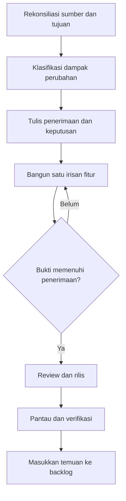
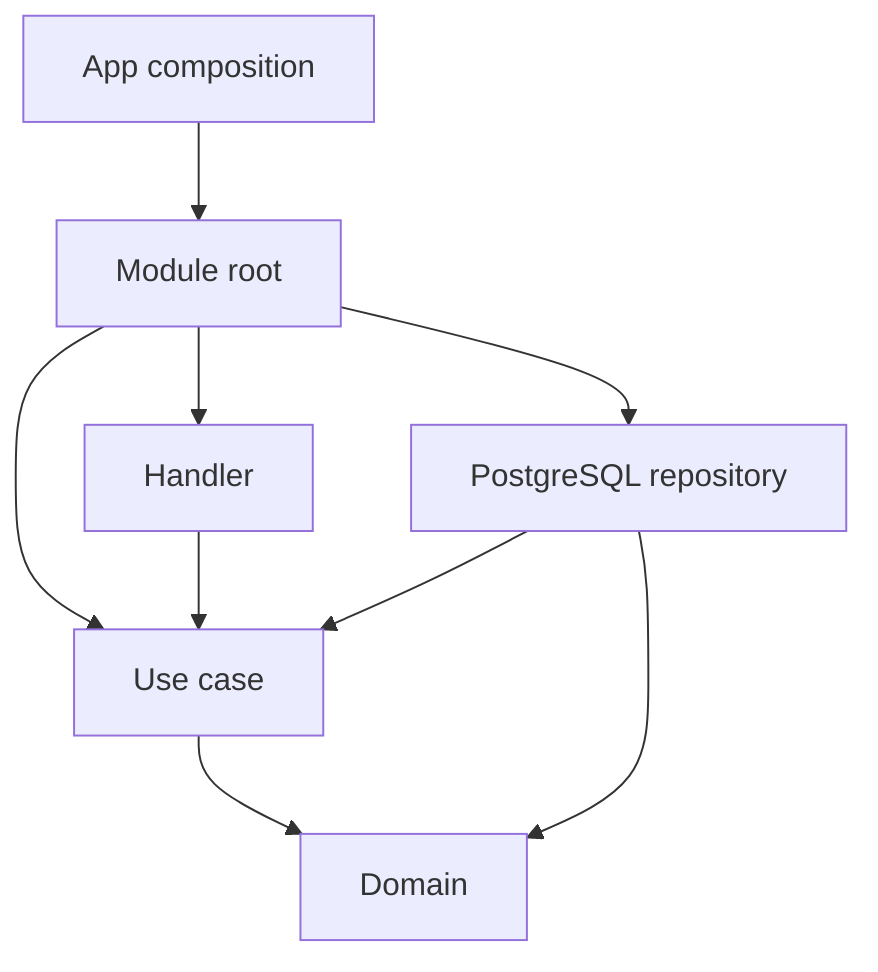

# Mamony Go — Riset standar dan workflow engineering

**Status:** Draft riset v5, ditambah prinsip engineering, refactoring, design patterns, system design, backend, dan DevSecOps · **Tanggal:** 21 November 2026

Workflow ini dirancang untuk proyek Go yang sebagian besar implementasinya dikerjakan AI. Standar inti berlaku pada setiap perubahan. Kedalaman desain, pengujian, dan peluncuran mengikuti dampak perubahan. Tujuannya agar AI bisa mulai dari tiket yang ringkas, menemukan aturan yang berlaku, dan menghasilkan bukti yang bisa diperiksa.

**Sumber produk.** Dokumen ini memakai snapshot `docs.zip` yang diunggah pemilik. Referensi `docs/...` menunjuk file di dalam arsip. SHA-256 arsip adalah `501ec0d095989181c5a3edea3cb03807a32a140b2adc09b138050fb4c4b0f66b`. Arsip berisi dokumentasi, tanpa source code atau hasil CI yang dapat dijalankan di sini. Status pada catatan Rust adalah bukti historis yang dilaporkan oleh sumber. Implementasi Go memerlukan bukti sendiri.

Mamony mensimulasikan **pay-in dan pay-out lintas negara** dengan ledger internal, FX, screening, onboarding, dan rekonsiliasi. Ia adalah proyek belajar untuk satu developer dengan bantuan AI. `ADR-0008` menetapkan identitas, provider, bank, kurs, dan dana simulasi atau sintetis. Kriteria production-ready di dokumen ini berarti kualitas engineering untuk menjalankan dan memulihkan simulator secara andal. C21 dan C22, termasuk billing, cards, dan savings, ditunda. Sumber Mamony: `docs/00-vision-and-scope.md`, `docs/adr/0008-learning-project-no-real-money.md`, `docs/04-roadmap.md`.

Untuk keputusan layout, baca [§9](#9-struktur-capability-layer-dan-fitur). Untuk pilihan tool, contoh konfigurasi, dan job CI, baca [§10](#10-static-analysis-keamanan-dan-ci). Untuk AI skills dan strategi hemat token, baca [§11](#11-agent-skills-tooling-dan-efisiensi-token). Untuk prinsip desain dan SOLID/YAGNI, baca [§12](#12-prinsip-rekayasa-perangkat-lunak--dari-slogan-menjadi-keputusan); refactoring [§13](#13-refactoring-code-smells-dan-disiplin-perubahan); patterns [§14](#14-design-patterns--katalog-selektif-yang-idiomatik-untuk-go); system design [§15](#15-system-design-untuk-modular-monolith-finansial); DevSecOps [§16](#16-devsecops-security-engineering-dan-praktik-operasional-dasar); dan penerapan untuk AI [§17](#17-implementasi-untuk-ai-coding-prinsip-yang-benar-benar-terpakai).

## 1. Keputusan yang perlu dikunci

| Topik | Usulan baseline | Kondisi yang mengubah pilihan |
|---|---|---|
| Arsitektur | Satu Go module dan satu proses dengan dua listener. Pertahankan boundary capability. `cmd/mamony` menjalankan composition root, adapter dan jobs dirakit eksplisit. | Ekstraksi worker atau service perlu bukti operasional dan ADR untuk ownership, deployment, serta cross-process protocol. Rencana pengelompokan deployable tetap merujuk ADR-0004/0027. |
| Go dan tooling | Kandidat Go 1.27.4 berdasarkan release history pada tanggal riset. Pin patch di CI/build, uji kompatibilitas analyzer, dan jadwalkan upgrade patch. | Gunakan patch terbaru dari lini yang masih didukung bila toolchain deploy atau analyzer belum siap. Catat alasan dan tanggal review. |
| HTTP | Kandidat `net/http`. Pertahankan kontrak REST/JSON, problem details, dan public/private listener. Gunakan `docs/api/openapi.json` 3.1.0 sebagai referensi kompatibilitas per irisan yang dipindahkan. | Spike router/validator/generator harus membuktikan bahwa metadata permission dan route terdaftar konsisten, batas listener teruji, dan tooling menerima spec serta feature yang dipakai. |
| Penyimpanan | PostgreSQL 18 mengikuti quickstart sumber, satu DB dengan schema dan role per capability. Kandidat `pgx/v5` untuk driver/pool, SQL eksplisit, dan `sqlc` untuk query bertipe setelah dibuktikan dengan role dan transaksi. | Uji runtime role setelah reuse pool, transaksi tenant, rollback, dan SQLSTATE. Dokumentasikan pool budget global sebelum menambah pool per capability. |
| Migrasi | Satu tool dan SQL berversi, kandidat Goose. Runner harus bisa mengeksekusi DDL, trigger, dan fungsi PostgreSQL Mamony dengan urutan bootstrap, role, dan grants yang benar. | Bandingkan Goose dan runner alternatif dengan migration fixture C01. Uji lock, transaksi, histori, kontrol file yang sudah dirilis, dan update dari schema yang didukung. |
| Quality gate | Gunakan satu runner `golangci-lint` v2 untuk gofmt, govet, Staticcheck, gosec, dan linter terpilih. Jalankan test, build, dan govulncheck sebagai gate terpisah. Lihat §10 untuk profil, pengecualian dan versi kandidat. | Perluas analyzer setelah ada kasus yang dibuktikan, ukur noise dan durasi, serta cek kompatibilitas toolchain setiap upgrade. |
| Deploy | Satu image OCI untuk simulator. PostgreSQL outbox dari awal saat ada event durable. Gunakan dev dan staging terisolasi dengan fixture sintetis. | Pertimbangkan broker melalui ADR bila ada kebutuhan terukur yang tak tertangani outbox, termasuk ordering, throughput, retensi, atau isolasi consumer. |
| Produk | Simulator pay-in/pay-out, pilot USD → IDR, ledger double-entry sejak foundation. Lingkup delivery Go yang diusulkan adalah irisan fondasi lalu Gate B. | Port penuh, kompatibilitas semua API, reuse schema historis, dan cakupan fitur pasca-Gate B memerlukan keputusan project tersendiri. |

Kolom baseline memuat keputusan Mamony yang sudah ada dan kandidat implementasi Go. Kandidat mengikat implementasi setelah ADR Go disetujui pemilik. Nama repo yang diusulkan adalah `herdifirdausss/mamony-go` dengan visibilitas private.

| Keputusan dari sumber | Penerapan pada Go |
|---|---|
| ADR-0004/0027 · Modular monolith, satu binary, public dan private listener, capability ports, composition root, jobs, dan relays | Pertahankan bentuk runtime. Gunakan constructor wiring, adapter untuk menerjemahkan tipe, dan uji route serta job yang benar-benar terdaftar. |
| ADR-0005/0009/0010 · C01 penulis saldo tunggal, immutable journal, transactional outbox, schema per capability | Pertahankan invariant, atomicity, dan grants. Hindari query lintas schema dari runtime role. C01 tidak mengimpor capability lain. |
| ADR-0016/0017/0018 · Versioned event schema, urutan per aggregate, retensi | Pertahankan ordering per account untuk ledger, delivery at-least-once, dan deduplikasi consumer. Bedakan key ledger yang hidup selama jurnal, key HTTP yang punya jendela replay, dan retensi outbox. Angka 72 jam dan 7 hari di ADR dicantumkan sebagai usulan. |
| ADR-0019/0021/0029 · HTTP edge, RLS, approval mengikat isi | Salin perilaku dan acceptance criteria. Uji role/grants, tenant scope per transaksi, otorisasi per resource, serta apply sekali terhadap isi yang disetujui. |
| ADR-0022 · FX dengan integer mantissa dan aturan rounding bernama | Gunakan oracle numerik independen. Tentukan representasi intermediate Go dan bukti batasnya. Uji amount besar, currency exponent berbeda, dan rounding ties. |
| ADR-0006/0011 · Dokumentasi menjadi dasar PRD dan desain | Pertahankan ID dan traceability. Pakai registry sumber untuk membatasi konteks setiap tugas dan memvalidasi chain requirement → desain → test. |
| ADR-0007/0012/0013/0015 dan bagian dari 0019/0023/0027 · Implementasi Rust | Buat ADR Go untuk padanan. Uji transaksi, API tooling, lifecycle dan check parity. Catat Rust ADR sebagai referensi historis. |
Sumber: [Go module layout](https://go.dev/doc/modules/layout) · [Go release history and support](https://go.dev/doc/devel/release) · [net/http](https://pkg.go.dev/net/http) · [Using Go and pgx with sqlc](https://docs.sqlc.dev/en/latest/guides/using-go-and-pgx.html) · [Goose](https://pressly.github.io/goose/) · [OpenAPI 3.1](https://spec.openapis.org/oas/v3.1.1.html) · [RFC 9457](https://www.rfc-editor.org/rfc/rfc9457.html).

## 2. Jalur kerja dari ide sampai operasional



| Tahap | Input dan pekerjaan | Bukti keluar |
|---|---|---|
| 1. Intake | Identifikasi pengguna, masalah, hasil yang diinginkan, batas scope, dan sumber. Cocokkan tiap klaim Mamony dengan file dan snapshot sumber atau commit jika tersedia. | Ringkasan proyek atau PRD, daftar requirement dan pertanyaan terbuka. |
| 2. Triage | Tentukan kelas S/M/L dari blast radius, jenis data, kompatibilitas, dan pemulihan. Tiket merujuk kontrak, ADR, modul, dan standar yang terkait. | Acceptance criteria yang bisa diuji, kelas kerja, pemilik keputusan, serta daftar asumsi yang berpengaruh. |
| 3. Design | Pilih satu irisan vertikal. Untuk boundary baru, jelaskan contract, data, failure, verification, dan rollout. Buat ADR bila ada keputusan berumur panjang. | Desain yang bisa direview. Keputusan produk seperti makna saldo dan hak akses perlu sumber atau persetujuan pemilik. |
| 4. Build | Mulai dari kasus penerimaan. Buat perubahan terkecil yang lengkap dari entry point sampai data bila relevan. Jalankan check terarah saat iterasi. | Diff yang bisa direview, test terkait risiko, dan pembaruan kontrak atau dokumen yang dirujuk. |
| 5. Review | Periksa kontrak, auth, integritas data, failure path, dan scope diff. Bedakan check yang lolos, gagal, atau belum dijalankan. | PR dengan tautan requirement, hasil check, risiko tersisa, dan rencana rilis jika relevan. |
| 6. Release | Build sekali per commit, deploy image yang sama lewat digest, jalankan migrasi kompatibel, smoke test, dan evaluasi metrik atau invariant. | Commit/digest, hasil migrasi, waktu deploy, sinyal keberhasilan, keputusan lanjut atau rollback/roll-forward. |
| 7. Operate | Pantau error dan latency serta sinyal domain seperti mismatch rekonsiliasi jika berlaku. Simulasikan restore pada data terisolasi sebelum produksi. | Runbook yang teruji, backlog dari insiden, dan bukti RPO/RTO bila ditetapkan. |

Dokumentasikan konflik sebagai keputusan yang perlu diselesaikan. Gunakan PRD untuk perilaku dan outcome, ADR untuk keputusan arsitektur yang disetujui, OpenAPI untuk bentuk kontrak HTTP, dan migration untuk schema yang dibangun. Jika dua sumber bertentangan, catat keduanya beserta dampaknya. Kode produksi yang sudah berjalan juga perlu diperiksa untuk risiko kompatibilitas. Kerjakan bagian independen sambil menunggu keputusan yang memblokir.

### S, M, dan L ditentukan oleh dampak

| Kelas | Pemicu dan contoh | Dokumen minimum | Bukti dan gate |
|---|---|---|---|
| **S — Lokal dan mudah dibalik** | Perbaikan dokumentasi, pesan validasi tanpa perubahan kode error, refactor internal dengan kontrak tetap. | Tiket ringkas berisi outcome, scope, 1–3 acceptance criteria, dan commands. | Tes regresi atau targeted checks sesuai diff lalu CI dasar. |
| **M — Satu fitur atau kontrak dengan dampak terbatas** | Endpoint pencatatan dengan schema baru yang additive, perubahan query laporan, atau adapter baru tanpa pergerakan uang. | Feature spec ringkas. Tambahkan tech design bila menyentuh beberapa boundary dan ADR bila mengubah default arsitektur. | Unit + HTTP/contract + integration DB nyata sesuai boundary, migrasi fresh dan jalur upgrade bila schema berubah, smoke staging dan rencana pemulihan. |
| **L — Dampak tinggi atau sulit dipulihkan** | Perubahan arti saldo, arus dana, izin lintas pengguna, data sensitif, migrasi destruktif, integrasi eksternal dengan efek finansial, atau cutover antarsistem. | PRD atau requirement yang disetujui, tech design, ADR untuk keputusan durable, threat model, rollout/restore dan runbook. | Review manusia sesuai domain, test invariant, concurrency dan replay bila relevan, rehearsal migration/restore, sinyal rekonsiliasi, dan keputusan go/no-go sebelum rilis. |

Ambil kelas tertinggi yang terpicu. Perubahan satu baris pada pembulatan atau otorisasi bisa kelas L. Fitur besar dipecah menjadi PR kecil yang bisa direview dan tetap konsisten terhadap desain induknya. Pengecualian standar mencantumkan pemilik, alasan, kontrol pengganti, dan tanggal evaluasi.

| Contoh hipotetis | Cara menjalankannya |
|---|---|
| S · Perbaiki tautan ke runbook ledger | Tiket menunjuk alert dan runbook. Jalankan link check serta pemeriksaan bahwa pemicu dan tindakan tetap sesuai sumber. |
| M · Port statement read untuk C02 | Ambil range filter, pagination, dan auth dari desain. Uji ledger read, fixture dengan timestamp pada batas, tenant scoping, dan response dari listener yang berlaku. Naik ke L bila cara isolasi tenant ikut berubah. |
| L · Port C01 Post dan reversal | Buktikan atomisitas, currency, balance floor, replay, reversal sekali, dan ordering di DB. Buktikan restore verifier dan wiring melalui caller yang disetujui sebelum menilai Gate A. |

## 3. Katalog standar dan cara pemeriksaannya

| ID | Standar | Bukti penerapan |
|---|---|---|
| GO-01 | Satu Go module. Capability seperti C01 dan C03 punya package root di `internal/modules/` dan detail privat di nested `internal/`. Capability memisahkan `domain`, `usecase`, `repository`, dan `handler` sesuai kebutuhan. | Compiler memagari nested `internal/`, check import menegakkan arah yang diizinkan, dan Postgres grants menegakkan ownership data. Detail di §9. |
| GO-02 | `gofmt`, nama paket singkat dan deskriptif, nama domain konsisten, komentar exported identifier mengikuti Go doc bila muncul dalam package API. Interface kecil berada pada paket pemakai jika dibutuhkan. Injection lewat constructor. | CI untuk format. Review untuk naming, boundary, dan interface yang memudahkan pengujian atau integrasi nyata. |
| GO-03 | `context.Context` parameter pertama pada jalur I/O dan cancelable work. Propagasikan deadline dari request dan beri budget outbound. Kembalikan error dengan konteks, klasifikasikan via `errors.Is/As`, dan map ke respons publik stabil. Setiap goroutine yang dikelola aplikasi punya owner dan kondisi berhenti yang jelas. | Unit dan integration test untuk error mapping dan cancellation. Race detector untuk jalur yang benar-benar dieksekusi. |
| GO-04 | Konfigurasi bertipe dan fail fast saat startup. Secret dari secret store di production. Batasi body, timeout HTTP dan pool DB. Graceful shutdown memiliki deadline. Liveness menguji proses dan readiness menguji kemampuan menerima traffic secara cepat. | Tests untuk config invalid dan lifecycle. Smoke test untuk readiness, startup, dan shutdown. |
| GOV-01 | README untuk bootstrap dan navigasi, `AGENTS.md` untuk aturan AI yang stabil, issue untuk scope perubahan, PR untuk evidence, dan ADR untuk keputusan jangka panjang. | Link relatif, reviewer memeriksa perubahan path/kontrak disertai update dokumen yang bersangkutan. |
| DES-01 | Terapkan KISS/YAGNI/DRY/SoC dan SOLID sebagai *engineering judgment* yang disesuaikan dengan Go; invariants dan security lebih penting daripada ringkasnya kode. Jangan membangun abstraksi spekulatif. | PR menjelaskan kebutuhan abstraksi, alternatif paling sederhana, biaya, dan evidence; periksa lewat review, bukan klaim linter. Lihat §12. |
| DES-02 | Gunakan design patterns hanya bila masalah konkret dan trade-off-nya jelas. Refactor dalam langkah kecil yang menjaga perilaku, dengan tests untuk kontrak yang terdampak. | Review PR/ADR menyebut pemicu, contract tests, dan boundary checks; lihat §13–§14. |
| SYS-01 | Perubahan desain M/L mengidentifikasi functional/nonfunctional requirements, consistency, concurrency, failure modes, recovery, dan observability. | Tech design + failure-matrix + tests sesuai blast radius; lihat §15. |
| SEC-03 | Secure SDLC dan threat-model berbasis asset/trust boundary, runtime least privilege, dependency/supply-chain hygiene dan control verification. | Evidence NIST SSDF/ASVS yang dipilih dan teruji; lihat §16. |
| API-01 | Gunakan OpenAPI untuk API yang dikonsumsi klien. Dokumentasikan auth, field, error code, pagination, status, compatibility, dan strategi versi. Pakai `application/problem+json` untuk error publik dengan detail aman. | Lint dan compatibility diff untuk perubahan spec. Handler/contract test untuk status, schema, dan caller yang diizinkan. |
| DB-01 | SQL parametrik. Definisikan PK/FK/unique/check dan nullability dari invariant. Transaksi use case mencakup semua write lokal yang harus atomic. Tentukan isolation/lock order sesuai invariant, dokumentasikan retry untuk error transient yang diizinkan. | Integration test dengan PostgreSQL dan migration repo. Untuk perubahan concurrency, pakai beberapa koneksi dan barrier yang deterministik. |
| DB-02 | Migration yang pernah dirilis bersifat immutable. Gunakan expand → backfill → switch → contract jika dua versi aplikasi hidup bersamaan. Ukur lock dan durasi backfill dengan data representatif. | CI menguji fresh setup serta upgrade dari schema yang relevan. Deployment menyiapkan rollback aplikasi atau roll-forward schema yang realistis. |
| FIN-01 | Amount ledger adalah integer minor units dan currency eksplisit dengan checked arithmetic. Posting tidak melakukan rounding. FX menggunakan aturan ADR-0022. Tetapkan pemetaan wire amount lewat keputusan kontrak di §8. | Boundary test untuk overflow, exponent, currency mismatch, sign, rounding ties, dan round-trip penuh dari HTTP hingga DB. |
| FIN-02 | Untuk write yang bisa dikirim ulang dan punya efek material, tetapkan idempotency scope, fingerprint payload, hasil replay, dan perilaku request in-flight. Simpan bukti uniqueness dan hasil lokal secara atomic. Untuk efek eksternal, tentukan status ambigu, verifikasi dan rekonsiliasi sebelum retry. | DB tests untuk request serentak, replay setelah commit, payload berbeda, rollback, serta timeout dari boundary eksternal jika berlaku. |
| FIN-03 | C01 memiliki jurnal double-entry immutable, satu currency per journal, balance floor, posting atomic, reversal tertaut, saldo turunan dari entri, dan daily verifier. C05 memberi hasil ke orchestrator. Koreksi rekonsiliasi melewati approval dan kontrak C01. | Integration model test, satu reversal, replay, transaction rollback, recompute, dan reconciliation dengan laporan provider simulasi. |
| SEC-01 | C08 memutuskan akses dengan deny by default. Terapkan tenant context yang diturunkan dari identitas, transaction-local RLS, role terpisah, dan log allowlist. Kontrol operator mengikuti maker-checker serta approval yang mengikat isi. | Uji tenant A/B memakai runtime role, context yang kosong, kebocoran saat reuse pool, inventory route/permission, public/private listener, dan apply terhadap payload yang disetujui. |
| SEC-02 | Pin versi toolchain, analyzer, Actions, dan image. Jalankan gosec untuk pola berisiko pada source dan govulncheck untuk kerentanan Go yang diketahui. Gunakan token CI least privilege. | `go mod verify`, review `go.mod`/`go.sum`, lint source, vulnerability scan, dan pemeriksaan image/secrets sesuai tahap deploy. Detail di §10. |
| OPS-01 | Log JSON dengan `slog`, correlation ID, route/status/duration, sinyal bisnis terukur, serta batas kardinalitas metrik. Trace lintas boundary dengan OpenTelemetry saat diperlukan. | Smoke staging, dashboard, alert yang bisa ditindaklanjuti, dan runbook. SLO ditetapkan dari kebutuhan pengguna dan data operasional. |
| OPS-02 | Backup dan restore, jadwal patch, rollback/roll-forward, pelepasan secret, dan penanganan insiden memiliki owner dan prosedur teruji. RPO/RTO dikonfirmasi melalui drill. | Bukti restore, deploy digest, catatan incident/recovery, dan reconciliation pascarestore jika domain membutuhkannya. |

Sumber: [Go Code Review Comments](https://go.dev/wiki/CodeReviewComments) · [Go transactions](https://go.dev/doc/database/execute-transactions) · [PostgreSQL isolation](https://www.postgresql.org/docs/current/transaction-iso.html) · [PostgreSQL constraints](https://www.postgresql.org/docs/current/ddl-constraints.html) · [PostgreSQL numeric types](https://www.postgresql.org/docs/current/datatype-numeric.html) · [PostgreSQL point-in-time recovery](https://www.postgresql.org/docs/current/continuous-archiving.html) · [OWASP ASVS](https://owasp.org/projects/asvs) · [NIST SSDF](https://csrc.nist.gov/pubs/sp/800/218/final) · [GitHub Actions secure use](https://docs.github.com/en/actions/reference/security/secure-use) · [slog](https://pkg.go.dev/log/slog) · [OpenTelemetry Go](https://opentelemetry.io/docs/languages/go/) · [Google SRE Workbook SLOs](https://sre.google/workbook/implementing-slos/).

### Contoh keputusan yang harus bisa diuji

Gunakan dua kontrak idempotency Mamony sebagai contoh. API mutasi memakai ADR-0014 dan ADR-0018. Ledger posting memakai PRD-01-FR-006 dan menyimpan key selama jurnal ada.

1. Ambil scope key dari kontrak capability dan ADR. API mencari key bersama identitas caller dan punya hasil berbeda untuk key hilang, payload berubah, dan request berjalan. Ledger menetapkan replay sesuai caller dan key dari PRD-01-FR-006. Otorisasi dilakukan sebelum mengembalikan hasil replay.
2. Simpan record idempotency dan perubahan data di transaksi PostgreSQL yang sama untuk write lokal. Unique constraint menjadi pengaman pada eksekusi serentak. Dokumentasikan respons jika payload berbeda atau jika skema implementasi memperbolehkan status in-flight.
3. Jika koneksi putus setelah commit, klien dapat mengulangi dengan key yang sama. Tes harus membuktikan hasil stabil dan hanya satu efek lokal tercatat.
4. Provider simulasi dapat menghasilkan outcome unknown. C03/C04 menyelidiki status melalui kontrak C05 dan rekonsiliasi. Gunakan transactional outbox, deduplikasi consumer, dan bukti bahwa event tidak terbit jika posting rollback.
5. Untuk isolasi transaksi, pilih constraint, row lock, atau serializable berdasarkan invariant yang ingin dijaga. Bila sistem memakai retry untuk serialization failure, ulangi seluruh transaksi lokal secara bounded. External side effect dikelola melalui kontraknya sendiri.

Sumber: [HTTP Semantics](https://www.rfc-editor.org/rfc/rfc9110.html) · [PostgreSQL isolation](https://www.postgresql.org/docs/current/transaction-iso.html) · [PostgreSQL constraints](https://www.postgresql.org/docs/current/ddl-constraints.html).

## 4. Scaffolding dan pipeline bertahap

Struktur berikut adalah bentuk target ketika komponen sudah punya isi. Bootstrap pertama cukup membuat panduan repo, instruksi AI, entry point Go, health/test minimum, commands lokal, serta CI.

```text
AGENTS.md
README.md
Makefile
go.mod
cmd/mamony/main.go
internal/app/
internal/platform/
internal/modules/ledger/
internal/modules/payment/
db/bootstrap/
db/migrations/
docs/api/openapi.json
docs/events/
docs/index.md
docs/standards/
docs/prd/
docs/adr/
docs/design/
docs/runbooks/
.github/pull_request_template.md
.github/workflows/ci.yml
```

| Perintah yang distandarkan | Isi saat diimplementasikan | Kapan dijalankan |
|---|---|---|
| `make check` | Verifikasi config lint, jalankan `golangci-lint run ./...`, cek import boundary, `go test ./...`, dan `go build ./...`. | Sesudah pengujian terarah saat lokal dan pada setiap PR. |
| `make integration` | DB nyata dengan Testcontainers atau PostgreSQL service CI, migration resmi dan fixtures sintetis. Suite pakai tag `integration` bila ingin memisahkan default `go test`. | Saat DB menjadi bagian scaffold. Jalankan untuk PR yang memengaruhi data dan pada main. Pada CI awal, menjalankan suite di semua PR dapat lebih sederhana jika waktunya singkat. |
| `make verify` | Panggil check dasar dan gate yang berlaku, termasuk race, vulnerability, contract, dan integration checks setelah komponennya ada. CI dapat menjalankannya dalam job terpisah dengan nama check yang stabil. | Sebelum merge sesuai kebijakan dan sebelum siap rilis. |
| `make smoke` | Start service, verifikasi health/readiness, jalankan satu alur representatif pada staging, dan verifikasi stop. | Setelah deploy staging dan sebelum promosi deployment. |

Tambahkan target `make docs` saat bootstrap untuk pemeriksaan ID dan link, status ADR, traceability MUST→TD→task, dan capability dependency graph. Uji contract drift, event schema, grant/schema ownership, serta inventory route/job sesudah komponennya ada. Gunakan dependency/tool version yang sama di lokal dan CI. Pertahankan file lock/versi di repo. Workflow PR tidak memerlukan secret production. Gunakan Actions pin SHA dan token read-only bila job hanya membaca. Untuk private repo, ketersediaan native branch protection bergantung pada plan GitHub. Jika tersedia, wajibkan PR dan status checks serta uji ruleset dengan PR kecil. Workflow CI sendiri hanya menghasilkan hasil check. Perlindungan merge harus diverifikasi terpisah.

| Jenis pengujian | Target yang diuji | Standar praktis |
|---|---|---|
| Unit | Invariant domain dan transisi status. | `testing`, table-driven saat beberapa input punya struktur serupa, clock eksplisit bila relevan, fixture sintetis, dan failure message yang bisa ditindaklanjuti. |
| HTTP/contract | Binding, validation, auth, status/error, dan JSON. | Gunakan `httptest`. Gunakan spec yang sama bagi consumer dan producer, tes kontrak yang sengaja disetujui, dan cek kompatibilitas API bila ada consumer. |
| Integration | SQL, row constraints, lock, migration, transaksi, serta retry. | PostgreSQL major yang sama dengan deployment target. Isolasi test via DB/schema per worker jika diperlukan. Fail setup CI secara jelas saat DB tak tersedia. |
| Race dan concurrency | Data race di Go, benturan write di DB, dan cancellation. | Race detector menguji jalur yang dieksekusi. Gunakan test concurrency DB yang terpisah untuk menunjukkan invariant tetap berlaku. Gunakan barrier, deadline, dan assertion status akhir. |
| Fuzz/property | Parser dan invariant yang menerima banyak variasi. | Mulai dari input seperti decimal/parser CSV jika fitur ada, dengan seed corpus sintetis dan budget terukur. Simpan input reproduksi regresi yang relevan. |
| End-to-end, load, dan recovery | Alur pengguna inti, data dan deployment lintas boundary. | Pilih sedikit smoke scenario. Tambah load/restore/cutover drill berdasarkan risiko, SLO, RPO/RTO, dan bukti dari staging. |

Prioritaskan coverage kasus finansial dan akses yang kritis. Persentase coverage cocok sebagai sinyal review dari baseline yang terukur. Permintaan merge memerlukan bukti untuk skenario yang relevan, misalnya replay, timeout, rounding boundary, unauthorized resource, dan migrasi.

Sumber: [Staticcheck](https://staticcheck.dev/docs/) · [Go race detector](https://go.dev/doc/articles/race_detector) · [Go fuzzing](https://go.dev/doc/security/fuzz/) · [Go vulnerability management](https://go.dev/doc/security/vuln/) · [Testcontainers PostgreSQL](https://golang.testcontainers.org/modules/postgres/) · [GitHub protected branches](https://docs.github.com/en/repositories/configuring-branches-and-merges-in-your-repository/managing-protected-branches).

## 5. Dokumen yang dibaca AI per perubahan

| Dokumen | Kapan dipakai | Isi minimum |
|---|---|---|
| README | Bootstrap dan orientasi repo. | Tujuan, kebutuhan lokal, perintah pertama, dan tautan indeks. |
| AGENTS.md | Saat AI masuk repo. | Urutan sumber, pemicu S/M/L, batas asumsi, commands, dan format evidence. Shell command dan versi tetap bersumber dari konfigurasi repo. |
| Issue / change brief | Semua kelas. | Outcome, scope, sumber yang relevan, kelas, acceptance criteria, pertanyaan pemblokir, checks. |
| PRD | Produk baru, outcome fitur yang berubah, atau keputusan produk berdampak tinggi. | Masalah, pengguna, scope, perilaku sukses/gagal, constraint, target keberhasilan, acceptance criteria, open questions, approver. |
| ADR | Pilihan lintas modul yang berdampak tahan lama atau mahal dibalik. | Status, konteks, alternatif, keputusan, konsekuensi, trigger evaluasi, relasi superseded. |
| Tech design | Boundary, schema, integrasi, atau operasi berisiko yang perlu desain sebelum coding. | Sequence, ownership, API/schema, invariant, transaction/failure table, observability, verifikasi, rollout dan pemulihan. |
| Runbook | Ada tindakan operasional yang harus bisa diulang saat insiden. | Sinyal, dampak, diagnosis, tindakan, pemeriksaan pulih, eskalasi dan owner. |
| PR | Semua perubahan yang masuk main. | Apa yang berubah, why, requirement/ADR, checks aktual, risiko tersisa, dan rilis bila relevan. |

Pertahankan template PRD, ADR, TD dan task brief yang sudah dimiliki Mamony. Contoh ringkas di dokumen ini untuk issue dan prompt Go, sedangkan perubahan keputusan dan requirement mengikuti lifecycle sumber. Simpan satu aturan di sumber kanonik lalu rujuk dengan link dan heading. Bagi dokumen menurut domain dan kegunaan. `AGENTS.md` root dapat dimulai dengan ukuran sekitar 1–2 halaman singkat, sebagai target editorial lokal. Aturan subdirektori dipakai ketika ada aturan yang memang berlaku lokal. Codex memuat instruksi berdasarkan scope dan memiliki batas gabungan yang dapat dikonfigurasi.

Sumber: [OpenAI AGENTS.md](https://learn.chatgpt.com/docs/agent-configuration/agents-md) · [Documenting Architecture Decisions](https://cognitect.com/blog/2011/11/15/documenting-architecture-decisions).

### Pola prompt yang bisa diulang

```text
Issue: [ID dan tautan]
Outcome: [perilaku yang berubah]
Scope: [modul/boundary]
Sources: [tautan heading PRD/ADR/spec yang relevan]
Acceptance: [AC-1 ...]
Risk: [kelas dan pemicunya]
Evidence: [perintah yang berlaku]
```

1. Mulai dari `AGENTS.md`, issue, path yang disebut, dan potongan kontrak yang relevan. Dokumentasi lama menyebut `tools/context.py` dan `tools/validate.py`. Perintah itu dirujuk sumber tanpa file tool di arsip. Usulkan mode Go pack per task yang memuat row TD, requirement IDs, heading ADR yang berlaku, interface, dan bukti. Cari simbol dan caller dengan `rg`. Perluas konteks jika boundary atau bukti mengharuskannya.
2. Untuk perubahan S, lakukan targeted check dan CI baseline. Untuk M/L, tulis rencana singkat yang menghubungkan AC, file/boundary, dan bukti. Balas dengan pertanyaan apabila sumber konflik menyangkut uang, izin, retensi, public contract, atau irreversible data change.
3. Gunakan diff terarah dan keluaran perintah ringkas. Jika gagal, ambil error dan konteks secukupnya dari phase yang gagal. Simpan log lengkap sebagai artifact kalau dibutuhkan untuk reproduksi.
4. Handoff memakai issue/PR, commit atau branch, keputusan terbaru, checks yang benar-benar dijalankan, blocker, dan langkah terdekat. Masukkan keputusan durable ke ADR sehingga sesi berikutnya bisa mulai dari tautan.
5. Untuk perubahan besar, prioritaskan review per boundary. Beri reviewer acceptance criteria, changed files, invariants, dan hasil CI. Jika memakai API dengan prompt caching, taruh konteks stabil lebih awal dan bagian volatil di belakang. Penghematan diukur pada alur yang menyediakan data token dan cache hit.

Ukur beberapa perubahan pertama menurut kelas dengan durasi review, putaran revisi, CI runtime, dan issue yang lolos ke staging/production. Jika tersedia, catat input/output token dan cache hit. Bandingkan perubahan sekelas. Tambahkan aturan bila masalah serupa berulang dan otomatisasikan sebelum memperpanjang prompt.

Sumber: [OpenAI prompt caching](https://developers.openai.com/api/docs/guides/prompt-caching).

### Isi awal AGENTS.md

```markdown
# Instruksi engineering

- Baca issue dan heading yang ditautkan. Gunakan docs/index.md untuk mencari aturan tambahan.
- Pakai requirement yang disetujui, ADR berstatus Accepted, dan kontrak yang berlaku.
- Catat asumsi teknis yang mudah dibalik di PR. Angkat konflik atau keputusan terbuka tentang
  uang, izin, kompatibilitas publik, atau data yang sulit dipulihkan kepada pemiliknya.
- Tentukan kelas S/M/L dari dampak. Ikuti acceptance criteria dan uji failure path yang relevan.
- Cari capability dan layer yang memiliki perubahan. Mulai dengan file di package yang sama.
  Buat package baru jika ada boundary terpisah yang dijelaskan di standar struktur.
- Bila mengubah perilaku, tautkan perubahan ke acceptance criteria.
- Jalankan targeted checks saat iterasi dan jalankan perintah repo yang berlaku sebelum review.
- Laporkan diff ringkas, hasil check aktual, dan blocker yang belum diselesaikan.
```

Template ini mulai digunakan setelah `docs/index.md`, daftar gate, dan perintah repo tersedia.

## 6. Template minimum

### Issue atau feature brief

```markdown
## Outcome
[Perilaku, pengguna, dan alasan]

## Scope dan sumber
[Boundary yang disentuh, tautan PRD/ADR/kontrak dan heading]

## Acceptance
- AC-1: Given ..., when ..., then ...
- AC-2: Failure/retry/cancellation yang perlu dibuktikan.

## Risiko dan verifikasi
[Kelas, alasan, test/check yang berlaku]

## Keputusan terbuka
[Keputusan, pemilik, dampak bila tertunda]
```

### ADR

Gunakan file sumber `docs/adr/_template.md` saat membuat ADR Go. AI menulis status Proposed dan pemilik menetapkan status keputusan. Contoh ini menunjukkan struktur minimal yang sesuai dengan format sumber.

```markdown
# ADR-NNNN: Judul keputusan

- Status: Proposed
- Date: YYYY-MM-DD

## Context
[Constraint dan masalah yang memerlukan pilihan]

## Alternatives considered
[Opsi, manfaat, biaya operasional, dan hasil spike]

## Decision
[Aturan yang dipilih dan pemilik keputusan]

## Consequences
[Trade-off, pemicu review, dan kaitan ke ADR sebelumnya]
```

### PRD

Gunakan `docs/prd/_template.md` untuk PRD resmi. Form di bawah ini cocok sebagai ringkasan intake yang menautkan PRD. Requirement yang berubah tetap dicatat pada PRD sumber.

```markdown
# Ringkasan intake
PRD: PRD-NN
Status: Draft | Approved
Owner: [pemilik keputusan produk]
Sources: [versi/commit, path atau heading]

## Masalah dan pengguna
[Siapa mengalami masalah, apa dampaknya, bagaimana diketahui]

## Perilaku dan scope
[Alur sukses dan gagal, actor dan izin, batas domain/data]

## Acceptance dan keberhasilan
[Requirement ID yang stabil, contoh konkret, metrik dan sumber baseline]

## Pertanyaan terbuka
[Keputusan, pemilik, kapan diperlukan, pekerjaan yang tetap bisa berjalan]
```

### Tech design dan PR

```markdown
## Tech design
Requirement IDs | boundary | contract | data ownership | invariants
Flow sukses/gagal | transaction/retry | concurrency | security/privacy
Verification matrix | rollout | rollback/roll-forward | observability

## Pull request
Issue/AC | ringkasan perubahan | perubahan kontrak/migrasi
Evidence per AC | checks lulus/gagal/belum dijalankan
Rollout/pemulihan jika berlaku | risiko yang masih terbuka
```

## 7. Urutan bootstrap Mamony

| Tahap | Pekerjaan | Bukti keluar |
|---|---|---|
| 0 · Kontrak dan alat | Buat repo private ketika akses tersedia. Siapkan indeks snapshot, template, draft ADR Go, dan registry requirement. Uji `net/http`, `pgx`, runner migration, OpenAPI dan analyzer dalam spike yang kecil. Selesaikan beda wire format sebelum port HTTP nominal. | Build/check dari clone bersih, jejak keputusan, dan satu task brief yang hanya membaca sumber yang dibutuhkan. |
| 1 · Foundation | Satu proses Go, dua listener, config, graceful lifecycle, error catalog, migration runner, tenant-specific transaction helper, dan test DB dengan role runtime. Tambahkan outbox, audit, dan backup/restore pada irisan yang memakainya. | Health/route inventory, runtime role, rollback, schema fresh/upgrade dan restore check. |
| 2 · Gate A ledger | Bawa C01 minimum melalui fixture sintetis. Mulai dari `Post` internal, database invariants, replay, reversal, verifier, dan outbox. | Go unit, PostgreSQL integration, property/model, race, concurrency, fault dan restore tests yang terhubung ke PRD. |
| 3 · Gate B pilot | Bangun satu alur pay-in dan pay-out pada corridor sumber, termasuk C08, kebijakan, screening, FX, provider simulator dan rekonsiliasi. Tambah endpoint satu irisan pada satu waktu, lalu exercise operator dan failure paths. | Jalur end-to-end dengan provider outcome unknown, recovery, rekonsiliasi harian, DR, dan runbook. Owner menilai Gate B dari bukti Go. |
| 4 · Lanjut setelah Gate B | PRD dan wiring matrix untuk business/risk serta expansion. Pertimbangkan pemisahan deployment dengan data latency, backlog, ownership, atau blast radius. | Keputusan berbasis metrik, scope yang terdokumentasi, dan test yang menutup risiko baru. |

Jumlah 58 path OpenAPI adalah ukuran snapshot sumber. Yang dideklarasikan oleh API Go harus sesuai dengan route yang hidup pada irisan yang telah diuji. Gunakan inventory dengan referensi route sumber, status implementasi Go, dan test wiring untuk merencanakan parity.

### Bukti awal untuk Gate A

| Sumber requirement | Tes awal yang harus ada | Bukti lulus |
|---|---|---|
| PRD-01-FR-003/004/007 | Unit untuk jumlah entry, debit/kredit, currency dan overflow. Integration memaksa input gagal pada DB sesuai desain. | Jurnal, entri, saldo, dan outbox tetap konsisten atau semuanya rollback. |
| PRD-01-FR-005/006 | Dua posting yang bersaing untuk floor, duplicate key bersamaan, target key berbeda payload, cancellation sebelum commit, dan replay setelah commit ketika respons hilang. | Satu hasil untuk duplicate key, conflict terbedakan, floor terjaga, dan tidak ada write parsial. |
| PRD-01-FR-008/009/013 | Model test acak dengan saldo terhitung dari entri, dua reversal bersamaan, daily verifier dengan drift yang sengaja ditanam pada fixture terisolasi. | Saldo model sama dengan DB, reversal sekali, dan drift terdeteksi. |
| PRD-01-FR-011 dan ADR-0017 | Jalankan dua transaksi bersamaan dan relay supaya urutan commit dan ID transaksi berbeda. Uji replay consumer. | Satu event per journal, nol saat rollback, ordering per account dijaga, efek consumer idempotent. |
| ADR-0010/0021 | Jalankan request scoping dengan role runtime pada transaksi A, B, dan tanpa tenant. Pakai koneksi yang digunakan ulang. | Tenant lain tak dapat diakses, context kosong gagal tertutup, role dan grants dicocokkan dengan katalog. |
| Gate A restore | Buat backup berisi jurnal yang benar-benar diposting, pulihkan ke PostgreSQL terisolasi, bandingkan state dan jalankan verifier. | Lulus dengan data baik dan mendeteksi hasil cacat. Ukur waktu pada dataset yang disebut di evidence. |

Sumber Mamony: `docs/prd/PRD-01-ledger-core.md` §4, `docs/design/TD-01-ledger-core.md` §§6, 9–10, `docs/09-gate-a-evidence.md`, dan `docs/runbooks/backup-and-restore.md`. Sumber engineering: [PostgreSQL row security](https://www.postgresql.org/docs/18/ddl-rowsecurity.html) · [Transaction-local settings](https://www.postgresql.org/docs/18/sql-set.html) · [PostgreSQL locking](https://www.postgresql.org/docs/18/explicit-locking.html) · [pgxpool](https://pkg.go.dev/github.com/jackc/pgx/v5/pgxpool) · [Goose SQL annotations](https://pressly.github.io/goose/documentation/annotations/).

### Contoh handoff hemat token untuk satu task Go

```text
Task: Port verifikasi replay dari TD-01 task 12 ke Go, setelah Post dan migration tersedia.
Requirements: PRD-01-FR-005/006/018. Fokus replay; floor diuji pada test terpisah.
Read: TD-01 §§6 dan 9, PRD-01 §4 pada IDs di atas, ADR-0005, Gate A §1.
Scope: test C01 di Go dan fixture PostgreSQL test yang dipakai.
Done: parallel same key → satu journal dan satu outbox row, hasil replay sesuai kontrak.
      key sama + payload berbeda → ditolak, saldo dan journal tidak berubah.
Evidence: nama test, perintah, hasil, dan constraint yang membuktikan atomicity.
```

Task brief mengambil subset dari task desain. Issue induk tetap melacak floor, cancellation, reversal, dan requirement lain sampai seluruh tabel selesai.

## 8. Konflik sumber dan keputusan yang perlu ditutup

| Temuan | Bukti di snapshot | Keputusan atau bukti yang dibutuhkan |
|---|---|---|
| Bentuk amount pada wire berbeda. | ADR-0014 butir 5 menetapkan JSON integer dalam batas interoperabilitas. TD-01 §4 menjelaskan string digit. OpenAPI yang disertakan memakai string untuk request amount pada `POST /v1/payments`, `/v1/payouts`, dan `/v1/fx/quotes`. Quickstart juga memakai string. | **Rekomendasi:** pertahankan string digit untuk endpoint yang sudah memakai kontrak itu, dengan typed integer di domain. Tetapkan scope dan perbarui ADR/kontrak setelah owner menyetujui. Uji bentuk, batas, dan compatibility per endpoint. |
| Gate C07 pada C01 belum terpasang dalam catatan runtime. | PRD-05-FR-019, H24, dan wiring matrix. Sebagian journal settlement, FX, fee share, dan funding memakai reference yang tidak melewati `Allow`. | Putuskan cakupan gate dan default untuk caller yang tidak punya reservation. Buat matriks caller × jenis journal × kondisi reservation, dan buktikan kebijakan untuk setiap baris. |
| Status dokumentasi berubah sepanjang implementasi Rust. | `06-engineering-standards.md` masih menyebut ADR-0027 sebagai proposed, sementara ADR-nya Accepted. Wiring matrix menandai ADR-0029 Accepted pada judul namun menyebut Proposed di narasi. Gate A §4 mencatat restore dengan jurnal, sementara tabel gap masih menyebut tanpa jurnal. | Dapatkan status keputusan dari ADR, kontrak dari spec, dan status runnable dari test yang terikat pada commit. Tandai bukti lama, bukti terkini, dan konflik eksplisit dalam registry Go. |
| Policy keamanan tertentu masih Proposed. | ADR-0025 tentang penyimpanan factor secret, ADR-0026 tentang `pg_trgm`, ADR-0028 tentang cross-tenant read role. ADR-0021 untuk isolasi tenant berstatus Accepted. | Suspensikan implementasi yang bergantung pada usulan ini sampai owner memutuskan. Boundary test RLS, izin, dan synthetic fixtures bisa dimulai dari ADR yang sudah Accepted. |
| Cakupan simulasi dan state legacy masih perlu dipastikan. | Vision dan PRD mencatat pilot USD → IDR. Quickstart menjalankan contoh dengan corridor `ID-US:IDR-USD`. Snapshot juga punya 58 path OpenAPI dan wiring dengan status berbeda. | Pertahankan USD → IDR sebagai target yang terdokumentasi. Verifikasi seed/pilot sebelum parity claims. Tetapkan apakah Go mengambil satu irisan kompatibel, semua rute, atau schema/data historis. Tata ulang prioritas jika targetnya pengganti penuh. |

Sumber standar wire: [RFC 8259 §6](https://www.rfc-editor.org/rfc/rfc8259.html#section-6) · [OpenAPI 3.1.0](https://spec.openapis.org/oas/v3.1.0.html) · [RFC 9457](https://www.rfc-editor.org/rfc/rfc9457.html).

**Status bukti.** Keputusan produk dan invariant diambil dari snapshot. Pilihan Go dan CI adalah rancangan untuk repositori baru. Bukti Rust belum dijalankan ulang. Scaffold dan Gate A/B Go tetap perlu bukti runtime dari clone bersih.

## 9. Struktur capability, layer, dan fitur

### Pilihan organisasi package

| Pilihan | Kapan cocok | Dampak di Mamony |
|---|---|---|
| Layer global, misalnya `internal/handlers`, `internal/usecases`, `internal/repositories` | Aplikasi kecil dengan satu area domain dan sedikit entry point. | Satu perubahan C03 berpindah antarfolder global. ownership dan aturan C01/C03/C05 sulit dibaca dari path. |
| Capability dulu, layer di dalamnya | Modul punya model, operasi, kontrak, dan data yang berbeda. | **Usulan Mamony.** Lokasi C01/C03 segera terlihat. Layer terbentuk dari dependency dan kebutuhan test yang nyata. |
| Capability lalu workflow/subfitur yang memiliki seluruh layer | Satu capability sudah memiliki beberapa workflow dengan lifecycle dan model yang cukup mandiri. | Bisa dipakai saat matang, misalnya bila processing payment dan operator configuration punya kebutuhan berbeda. Cek ownership schema dan arah import dulu agar write model serta transaksi bersama tetap utuh. |

Go memberi aturan tentang visibilitas package dan konvensi nama. Layer di bawah adalah pilihan arsitektur Mamony, dengan boundary dan komposisi yang sudah ditetapkan ADR-0027. Sumber: [Go module layout](https://go.dev/doc/modules/layout) · [Go internal packages](https://go.dev/doc/go1.4#internalpackages) · [Go package names](https://go.dev/blog/package-names) · [Go interface guidance](https://go.dev/wiki/CodeReviewComments#interfaces) · [Contoh service Go dengan application dan adapters](https://threedots.tech/post/introducing-clean-architecture/).

### Layout target setelah irisan ledger dan payment tersedia

```text
cmd/mamony/
  main.go
internal/
  app/
    app.go
    listeners.go
    adapters/
      payment_ledger.go
      payment_provider.go
  platform/
    httpedge/
    dbtx/
    events/
  modules/
    ledger/                              # C01: API Go untuk composition root
      module.go
      posting.go
      internal/
        domain/
          money.go
          journal.go
          reversal.go
        usecase/
          post.go
          post_test.go
          reverse.go
          verify.go
          ports.go
        repository/
          postgres/
            journals.go
            accounts.go
            verifier.go
        handler/
          jobs/
            verify.go
    payment/                             # C03: API Go untuk composition root
      module.go
      contract/                          # jika port bertipe harus diimplementasikan app
        ledger.go
        provider.go
      internal/
        domain/
          payment.go
          attempt.go
          state.go
        usecase/
          create.go
          confirm.go
          confirm_test.go
          cancel.go
          handle_provider_result.go
          ports.go
        repository/
          postgres/
            payments.go
            attempts.go
            idempotency.go
            outbox.go
            queries/
              payments.sql
              attempts.sql
              idempotency.sql
        handler/
          httpapi/
            routes.go
            create.go
            confirm.go
            get.go
          events/
            provider_result.go
          jobs/
            process_steps.go
db/
  bootstrap/                             # roles, schemas, extension yang sudah dipilih
  migrations/                            # satu urutan migrasi untuk release DB
docs/
  index.md
  capabilities/
  adr/
  prd/
  design/
  api/
  events/
  runbooks/
```

Contoh di atas menunjukkan **bentuk target**, termasuk C03 yang baru muncul setelah fondasi. Registry di `docs/index.md` memetakan ID, nama package, sumber, schema owner, dan entry point. Jangan mengarang endpoint C01 dari tree. Pembacaan balance dan statement merchant mengikuti C02, operator mengikuti kontrak C11, dan verifier C01 bisa dijalankan sebagai job. Sumber Mamony: `docs/03-service-boundaries.md`, `docs/12-mvp-wiring-matrix.md`, `docs/adr/0027-first-runtime-and-http-layer.md`.

| Layer | Isi dan batas | Contoh |
|---|---|---|
| Module root | Constructor, lifecycle surface, kontrak yang memang dipakai `app`, registrasi adapter/entry point lokal. | `ledger.New` merakit use case dan repo C01. `payment.New` menerima port yang sudah diisi oleh app. |
| `domain` | Tipe dan invariant domain, state transition, perhitungan exact. Dapat di-test tanpa server atau DB. | Validasi journal dan currency, serta aturan transisi `created` dan `processing` pada payment. |
| `usecase` | Aksi bisnis, aturan sequencing, pemilihan batas transaksi dan failure path. Mendefinisikan interface yang ia pakai, termasuk port internal untuk repository. | `confirm.go` mengatur steps sesuai TD-06. `post.go` mengoordinasi posting dan hasil replay. |
| `repository/postgres` | SQL, mapping rows, query types dan implementasi I/O transaksi. Skema dan grants tetap milik capability. | `attempts.go` bekerja dengan state provider attempt, `idempotency.go` memesan request key, dan repository C01 dapat memanggil fungsi posting SQL jika desain mempertahankannya. |
| `handler` | Entry point dan translasi boundary. Baca principal/metadata dari middleware, parse request atau event, panggil use case, map respons dan error catalog. | `httpapi/confirm.go`, `events/provider_result.go`, dan `jobs/process_steps.go`. |
| `app` | Menghubungkan port antar-capability, listeners, lifecycle, job runner dan relay. Adapter lintas modul menerjemahkan tipe dan error antarmuka. | `payment_ledger.go` menjembatani port milik C03 ke kontrak C01. |
| `platform` | Fasilitas bersama yang bebas dari domain capability, dengan API sesuai tujuan. | HTTP middleware, transaction plumbing, dan event envelope. |

Pilih nama layer `usecase` secara konsisten. Bila beberapa operasi berbagi dependency, satukan sebagai metode pada service use case di package itu. Package `service` tambahan baru perlu bila ia memegang tanggung jawab yang berbeda dan boundary-nya dapat dinyatakan.

### Kapan satu file menjadi folder

| Bagian | Default | Naik menjadi package saat |
|---|---|---|
| Handler HTTP | Satu package `httpapi`, file per operasi dan registrasi route bersama. | Kelompok route punya kontrak, permission, atau listener berbeda dan dependensinya dapat berdiri sendiri. Contoh `httpapi/merchant` dan `httpapi/console`; jadikan split ini konsisten dengan route inventory. |
| Handler non-HTTP | `handler/jobs` atau `handler/events` ketika entry point itu ada. | Interface runtime atau lifecycle berbeda. Webhook HTTP masuk ke HTTP handler capability pemilik. Consumer event internal bisa masuk ke handler events capability yang menerima. |
| Repository | File per kelompok data, misalnya payment, attempts, idempotency, dan outbox di `repository/postgres`. Pisahkan query SQL dengan nama serupa. | Aggregate/schema ownership, tipe koneksi, atau lifecycle adapter benar-benar terpisah. Repository C03 yang berpartisipasi dalam transaksi yang sama berbagi objek transaksi yang dibatasi C03. |
| Use case | File per aksi di `usecase`, test di dekatnya. | Ada kelompok aksi dengan aturan dan kontrak jelas, misalnya operator configuration yang berkembang sendiri. Tambah package setelah arah dependency dapat digambar tanpa cycle. |

File `confirm.go` sudah menjadi unit navigasi yang bisa ditemukan AI. Folder `confirm/` membawa package baru, import baru, dan kebutuhan untuk mengekspor tipe antar-package. Buat split jika perubahan dapat menjelaskan manfaat boundary tersebut. Pakai nama package spesifik dan singkat. Hindari folder `common`, `utils`, `interfaces`, folder kosong, dan pola berlapis yang tidak dipakai oleh irisan aktif.

### Dependency dan transaksi yang dapat diperiksa



Panah `repository → usecase` berarti repo **boleh** mengimpor tipe kontrak milik use case saat diperlukan untuk implementasi port. Port kecil dengan signature tipe domain dapat dipenuhi tanpa import itu karena interface Go bersifat implisit. Pada runtime, use case memanggil fungsi repo melalui port yang di-inject. Arah panggilan runtime dan arah dependency import perlu diverifikasi secara terpisah.

1. **Boundary compile-time.** Go membatasi import di bawah `internal/` ke kode dalam pohon yang berakar pada parent folder tersebut. Nested `internal/modules/ledger/internal/` melindungi domain, repo dan handler C01 dari C03 **dan** app. Karena itu, app membuat C01 melalui `ledger.New` dan metode registrasi yang disediakan module root. Terapkan struktur serupa ke C03.
2. **Port milik pemakai.** Port repository boleh didefinisikan di `usecase/ports.go`. Bila app perlu mengimplementasikan port C03 dengan request/result bertipe, letakkan bagian yang perlu diakses di `payment/contract`. Use case dan app mengimpor package kontrak milik C03. Kontrak hanya berisi tipe dan interface. Ini menghindari cycle `payment → usecase → payment`. Hindari package kontrak tambahan bila façade dan port yang ada sudah memenuhi kebutuhan.
3. **Import antar-capability.** `payment` tidak mengimpor `ledger` langsung. `app/adapters/payment_ledger.go` mengimpor façade keduanya sesuai ADR-0027. `platform` tidak mengimpor package capability. Check import graph membaca direct imports melalui `go list -json ./...`. Tambah pemeriksaan test dan build tag integrasi saat entry point tersebut ada. Uji aturan checker dengan contoh import yang lolos dan contoh yang ditolak. `depguard` cocok untuk beberapa larangan eksplisit. Checker graph cocok saat aturan bergantung pada pasangan modul dan layer.
4. **Arah antar-layer.** Handler boleh mengimpor use case atau contract, repository boleh memakai tipe domain atau kontrak kecil yang perlu diimplementasikan, dan domain bebas HTTP/SQL/pgx. Use case bebas adapter konkret. Module root memegang wiring lokal. Handler memakai DTO transport dan mapping tersendiri agar tipe generated SQL atau pgx tidak bocor ke OpenAPI.
5. **Akses data.** Role runtime C03 membaca dan menulis schema C03. Akses lintas capability lewat port/event yang disetujui, plus extension point yang jelas. C01 menawarkan `TxParticipant` untuk kasus konsumsi quote C06 yang memang harus ikut transaksi posting. Desain itu perlu desain Go dengan grant dan test eksplisit. Perlakukan sebagai extension point yang bernama, dengan scope yang bisa diaudit.
6. **Batas transaksi.** Gunakan transaksi per unit kerja yang harus atomic. Untuk use case yang menyentuh beberapa repo satu capability, injeksikan kontrak unit-of-work yang memberi store dengan scope transaksi itu. Adapter pgx memegang begin/commit/rollback dan pemetaan SQLSTATE. Pada tabel tenant, set tenant secara transaction-local sebelum akses tenant-scoped. Pada C01, desain DB tetap menjaga invariant di batas posting. Provider call, retry transaksi lokal, dan relay outbox punya lifecycle sendiri. Uji concurrent retry dan known/unknown outcome di connection test nyata.

Sumber: [Go internal packages](https://go.dev/doc/go1.4#internalpackages) · [Go interfaces](https://go.dev/wiki/CodeReviewComments#interfaces) · [pgxpool](https://pkg.go.dev/github.com/jackc/pgx/v5/pgxpool) · [PostgreSQL transaction-local settings](https://www.postgresql.org/docs/18/sql-set.html). Sumber Mamony: ADR-0004, ADR-0010, ADR-0021, ADR-0027, dan `docs/03-service-boundaries.md`.

### Jalur perubahan sebagai tes struktur

| Perubahan | Berkas yang wajar disentuh | Tes yang membuktikan boundary |
|---|---|---|
| Format respons confirm C03 berubah | `handler/httpapi/confirm.go`, DTO, OpenAPI, dan contract test | Use case tetap bisa diuji dengan input typed. Tes HTTP memeriksa route, status, schema, format uang dan izin. |
| Pembatalan atau replay confirm berubah | `usecase/confirm.go` dan `confirm_test.go`, plus domain bila state rule berubah. Repository ikut bila ada perubahan persistence. | Use case test untuk state, replay dan failure path. Integration membuktikan state/idempotency satu transaksi. |
| Tambah provider adapter simulasi | C05 adapter, C05 tests, wiring `app` yang relevan. | Contract test untuk hasil sukses, gagal, dan unknown. C05 test berjalan tanpa akses schema C01 dan tanpa koneksi ke provider asli. |
| Tutup celah race balance C01 | C01 use case atau repository/migration sesuai akar masalah, concurrency tests, dan Gate A evidence. | Beberapa koneksi PostgreSQL melakukan posting sambil mempertahankan floor. Race detector Go memberi bukti terpisah untuk memory race. |

Mulai dari satu capability yang bisa dilacak dari entry point ke DB. Tambah kelompok file setelah operasi kedua membutuhkan struktur yang sama. Saat beberapa capability bertambah, enforce import dan grants sebelum mengoptimalkan package. Ekstraksi proses membutuhkan bukti scaling atau isolasi operasional, contract lintas proses, dan rancangan ulang untuk `TxParticipant` yang masih bergantung pada transaksi satu database.

## 10. Static analysis, keamanan, dan CI

### Alat dan lapisan yang diperiksa

| Alat | Menangkap apa | Peran dalam Mamony |
|---|---|---|
| `gofmt` | Format Go yang konsisten. | Jadikan formatter baseline lewat golangci-lint. Tambah goimports hanya jika pengelolaan import perlu standar sendiri. |
| `govet` / `go vet` | Bug yang bisa dideteksi lewat analyzer, misalnya format string yang tidak sesuai. | Aktifkan `govet` di runner. `go test` juga menjalankan subset vet berkeyakinan tinggi secara default. |
| Staticcheck | Bug dan penggunaan API yang bermasalah, misalnya argumen yang tidak valid atau pemakaian API usang. | Jalankan `staticcheck` dari runner. Mulai dari kategori `SA*` dan gunakan `unused` terpisah. Style checks tambahan bisa diusulkan kemudian. |
| `errcheck`, `ineffassign`, `unused` | Error yang diabaikan, assignment tanpa efek, dan deklarasi yang tidak dipakai. | Wajib untuk starter, terutama agar error write, commit, query iteration, atau parsing tidak terlewat. Tetap tinjau semantik `Commit` dan `Rollback` pada test DB. |
| `gosec` | Pola keamanan pada source, seperti risiko integer conversion, penggunaan random yang tidak cocok untuk security, penggunaan TLS yang keliru, atau SQL yang dibangun secara berisiko. | Aktifkan di runner. Mulai dengan scope produksi dan cek hasil pada boundary nominal, database dan HTTP. Triage setiap finding sebelum mengubah atau mengecualikan check. |
| `golangci-lint` | Menjalankan pilihan linter dan formatter dalam satu proses CI dengan config repo. | Pakai versi v2 dan daftar eksplisit. Release yang sama menentukan versi analyzer bundel. |
| `govulncheck` | Advisory Go yang diketahui pada stdlib/module, dengan analisis source yang memakai informasi penggunaan simbol jika tersedia. | Gate terpisah dan scan terjadwal pada main agar advisory baru terdeteksi walaupun commit sama. Scan konfigurasi atau build tag produksi yang relevan. |
| Architecture checks dan test | Boundary import, route dan permission wiring, RLS, race, rollback, invariant, dan kegagalan provider. | Jadikan check eksplisit. Kombinasikan compile-time, lint, dan tes dengan database/runtime role yang sebenarnya. |

Gosec dan govulncheck menutup dua risiko yang berbeda. Kode bisa lolos vulnerability scan sambil tetap memiliki bug konversi nominal atau pola SQL berisiko. Ia juga bisa lolos gosec sementara dependency punya advisory baru. Jangan gunakan dua binary Staticcheck dan gosec terpisah pada job yang sudah mengaktifkan keduanya dalam golangci-lint. Standalone gosec masuk akal untuk keluaran atau scope yang spesifik dan telah dibandingkan dengan check yang ada. Simpan laporan sebagai artifact biasa bila native code scanning untuk repo private belum tersedia.

Sumber: [Golangci-lint linters](https://golangci-lint.run/docs/linters/) · [Staticcheck checks](https://staticcheck.dev/docs/checks/) · [Gosec rules](https://github.com/securego/gosec#available-rules) · [Go command and test vet](https://pkg.go.dev/cmd/go) · [Govulncheck](https://pkg.go.dev/golang.org/x/vuln/cmd/govulncheck) · [GitHub code scanning availability](https://docs.github.com/en/code-security/concepts/code-scanning/code-scanning).

### Profil awal v2 untuk di-review

```yaml
version: "2"

run:
  tests: true

linters:
  default: none
  enable:
    - errcheck
    - gosec
    - govet
    - ineffassign
    - nolintlint
    - staticcheck
    - unused
  settings:
    staticcheck:
      checks:
        - "SA*"
    nolintlint:
      allow-unused: false
      require-explanation: true
      require-specific: true

formatters:
  enable:
    - gofmt
```

**Pilihan versi kandidat.** Go 1.27.4 dan golangci-lint v2.15.0. Rilis golangci-lint v2.15.0 menyiapkan Go 1.27.0 pada job release dan membundel gosec v2.29.0 serta honnef.co/go/tools v0.8.2. Buktikan versi binary yang diperoleh dan jalankan pada patch Go yang dipin sebelum mengunci pasangan. Pilih versi govulncheck terpisah melalui spike. Pin dalam CI/build dan gunakan versi identik saat lokal. Untuk runner golangci-lint, gunakan binary rilis yang dipin sesuai rekomendasi maintainer.

**Verifikasi konfigurasi.** YAML lulus validasi terhadap JSON Schema dari tag v2.15.0. Saat bootstrap, gunakan `golangci-lint fmt` untuk memperbaiki format. Jalankan `golangci-lint version`, `golangci-lint config verify`, dan `golangci-lint run ./...` untuk memeriksa konfigurasi dan source tanpa menulis perubahan. Uji fixture terisolasi yang memicu formatting, error terabaikan, dan satu rule gosec yang dipilih. Sertakan fixture gosec yang seharusnya bersih. Catat hasil supaya check hijau punya bukti bahwa aturan target benar-benar aktif.

Sumber: [Golangci-lint v2.15.0](https://github.com/golangci/golangci-lint/releases/tag/v2.15.0) · [Release workflow pada tag](https://github.com/golangci/golangci-lint/blob/v2.15.0/.github/workflows/release.yml) · [Dependency versions pada tag](https://github.com/golangci/golangci-lint/blob/v2.15.0/go.mod) · [Golangci-lint install](https://golangci-lint.run/docs/welcome/install/) · [Go version compatibility](https://golangci-lint.run/docs/welcome/faq/) · [Config v2](https://golangci-lint.run/docs/configuration/file/) · [CLI](https://golangci-lint.run/docs/configuration/cli/).

### Pengecualian dan perluasan

- Mulai dengan lint pada seluruh package normal dan test. Jalankan lint ulang dengan tag integration saat test atau kode yang hanya dibangun dengan tag itu masuk. Generator dipin dan CI mengecek generated diff. Gunakan marker generated resmi dan verifikasi scope analyzer menurut config runner.
- Triage kasus nyata dengan contoh yang kecil. Bila `gosec` menandai konversi angka, tunjukkan pemeriksaan rentang dan test batas nominal sebelum mempertimbangkan suppress. Jika perlu suppress, batasi pada analyzer/rule dan baris yang relevan, jelaskan invariant, tautkan issue atau test, dan review setiap perubahan. Untuk directive spesifik `#nosec`, cantumkan rule ID dan alasan. `nolintlint` mengatur directive `//nolint`; review juga perlu mencakup directive gosec.
- Kandidat tahap berikutnya adalah `errorlint` jika error wrapping berulang, `bodyclose` jika adapter HTTP makin banyak, `depguard` jika larangan import dapat dinyatakan tanpa duplikasi registry, dan analyzer query lifecycle jika dukungan pgx sudah terbukti. Validasi contoh yang gagal dan biaya CI sebelum mengubah statusnya menjadi required.
- Kekurangan proses keamanan yang perlu dicek ketika mulai packaging adalah image dependency, secret scanning, licence/SBOM, dan provenance supply chain. Jadwalkan pada tahap deploy yang relevan. Untuk proyek simulator satu developer, ukur temuan yang berguna sebelum menambah CodeQL/Semgrep atau membuat gate lint kedua.

Sumber: [Golangci-lint false positives and exclusions](https://golangci-lint.run/docs/linters/false-positives/) · [Gosec annotations](https://github.com/securego/gosec#annotating-code) · [Available linters](https://golangci-lint.run/docs/linters/).

### Gate CI yang bisa berkembang

| Job | Kapan | Perintah atau bukti |
|---|---|---|
| **Lint & boundaries** | Setiap PR sejak bootstrap | `golangci-lint config verify`, `golangci-lint run ./...`, import boundary checker, dan doc traceability. Perintah lint gagal pada temuan atau scan error. |
| **Unit & build** | Setiap PR | `go test ./...`, `go build ./...`, `go mod verify`, dan `go mod tidy -diff`. Unit suite berjalan tanpa koneksi PostgreSQL dan tanpa panggilan internet dari test. |
| **Vulnerability** | Setiap PR dan terjadwal pada main | `govulncheck ./...` dalam mode default sebagai blocking check. Tool harus versi tetap dan advisory DB mutakhir. Mode JSON, SARIF, atau OpenVEX bisa keluar dengan kode 0 walau menemukan advisory, jadi jika menghasilkan laporan itu, verifikasi gating lewat mode default atau evaluasi hasil secara eksplisit. |
| **Race & DB integration** | Sejak kode concurrency/DB masuk | `go test -race ./...`. Jalankan suite DB pada PostgreSQL 18 nyata, dengan migration/bootstrap yang sama, role runtime, dan tag integration jika dipilih. Uji restore dan upgrade schema secara terpisah pada dataset yang relevan. |
| **Contracts & wiring** | Sejak API, job atau event tersedia | Check OpenAPI/event schema dan kompatibilitas, daftar route/listener, permission, ID event, job, consumer, dan generated diff. |
| **Extended evidence** | Terjadwal atau untuk perubahan L yang memengaruhi invariant | Fuzz corpus terarah, model test DB, load hot-account, restore drill dan recovery provider simulator. Simpan seed, versi schema, build ID, dan hasil yang bisa diulang. |

Untuk perubahan S, jalankan test package yang relevan saat iterasi. Gate PR biasa tetap berjalan. Untuk M, jalankan integration dan contract checks terkait sebelum review. Untuk L, issue memuat invariant, concurrency/replay atau failure evidence, dan kriteria rollback sesuai dampaknya. Saat suite bertambah, ukur durasi per job, cache dependency yang aman, dan gunakan paralelisme yang sesuai dengan isolasi data test. Hindari mengandalkan filter path sebagai satu-satunya penentu gate pada dependency yang melintasi capability.

### Rencana pembuktian dalam spike

1. Buat `cmd/mamony`, façade C01, dan satu use case dengan repository port. Tambahkan C03 dan adapter di `internal/app` ketika perlu menunjukkan komposisi. Compile contoh import yang sah dan validasikan bahwa import antar-capability yang dilarang terdeteksi.
2. Tunjukkan satu alur dari entry point simulasi ke use case C01, repo PostgreSQL, dan outbox. Jalankan unit test, DB integration, serta satu skenario replay yang bisa direproduksi. Bukti PR harus menyebut requirement dan jalur runtime yang diuji.
3. Jalankan profil v2 pada branch spike, buktikan lint dan scanner berjalan dari clone bersih, dan ukur waktu serta temuan per kategori. Kunci versi, tree, dan aturan pengecualian di ADR Go setelah pemilik review.

Status baseline §1–§10 (asal v3): struktur dan profil di atas sudah ditinjau terhadap dokumentasi Mamony serta referensi tool. Build, perilaku linter, dan check import graph perlu dijalankan di environment Go yang tersedia pada spike.


## 11. Agent skills, tooling, dan efisiensi token

**Tanggal pemeriksaan:** 21 November 2026. **Status:** Rekomendasi untuk evaluasi; belum dipasang atau diuji pada Mamony Go. Referensi eksternal merupakan hasil penelusuran repositori/dokumentasi publik. Angka penghematan dari README proyek tidak otomatis berlaku untuk Mamony; jangan memasukkannya sebagai SLO. Penelitian independen mencatat manfaat skills sangat bergantung konteks tugas.

### 11.1 Bedakan tiga jenis solusi

1. **Skill prosedural (`SKILL.md`)**: mengarahkan agen melakukan pekerjaan tertentu. Contoh: mencari akar bug, membuat test, mengaudit perubahan. Instruksi tidak menggantikan compiler, DB test, atau review manusia.
2. **Alat deterministik**: memberikan hasil yang dapat diperiksa. Contoh: `gopls`, `go-arch-lint`, `oasdiff`, `gotestsum`. Ini lebih baik sebagai gate daripada sekadar menyuruh AI memeriksa dirinya sendiri.
3. **Konteks domain Mamony**: aturan dari PRD/ADR/tech design dan bukti implementasi. Bentuk terbaiknya adalah skill kecil yang menemukan sumber kanonik secara selektif dan menunjukkan bukti; bukan menyalin seluruh dokumentasi ke prompt.

**Aturan prioritas:** sumber Mamony yang berstatus disetujui > kontrak dan kriteria penerimaan yang relevan > konfigurasi dan codebase yang sedang dibangun > panduan skill generik. Jangan diam-diam mengganti keputusan domain karena skill luar menyarankan pola lain. Jika bertentangan soal uang, otorisasi, kompatibilitas, atau data irreversible: catat konflik dan eskalasi sebagai keputusan.

### 11.2 Shortlist tools dan skills eksternal

| Kandidat | Jenis | Pemicu yang sesuai | Potensi manfaat | Batasan dan keputusan |
|---|---|---|---|---|
| [Ponytail](https://github.com/DietrichGebert/ponytail) | Skill minimalisme coding | Task S/M atau refactor setelah scope dan AC jelas | Mengurangi abstraksi, file, kode yang belum perlu; tetap meminta test dan safety | **Pilot**. Pada perubahan L jangan menyederhanakan invariant, transaksi, audit, auth, atau error handling. Riset/benchmark milik maintainer, bukan pembuktian untuk Go Mamony. |
| [RTK / Rust Token Killer](https://github.com/byx-darwin/rtk) | CLI output compressor + integrasi agent | Repetisi `git`, `go test`, pencarian, lint ber-output besar | Mengurangi output terminal yang masuk konteks | **Eksperimen, bukan default.** Benchmark JetBrains pada Claude Code menemukan biaya sesi bisa tetap atau naik. Simpan akses ke raw log gagal. Lakukan A/B pada task Mamony. |
| [ASD-STE100 skill](https://github.com/danyuchn/asd-ste100-skill) | Skill penulisan English terkontrol | PRD, AC, runbook, pesan error, tool/agent handoff | Mengurangi kalimat ambigu dan istilah yang berubah-ubah | **Aktif hanya ketika menulis/revisi teks**. Tidak melakukan pemeriksaan semantik domain; bukan sertifikasi ASD-STE100. Periksa ulang modalitas MUST/SHOULD dan makna amount/permission. |
| [Superpowers: systematic-debugging](https://github.com/obra/superpowers) | Skill workflow | Test gagal, bug race, rollback, callback duplikat, mismatch DB | Proses root-cause → hipotesis → reproduksi → regression test | **Prioritas tinggi**. Ambil skill terpilih, bukan semua metodologi yang panjang otomatis. |
| [Superpowers: test-driven-development / verification-before-completion](https://github.com/obra/superpowers) | Skills workflow | Perubahan use case, bug fixes, handoff PR | Test sebelum/selama perbaikan; melarang klaim sukses tanpa bukti check aktual | **Prioritas tinggi**. Sesuaikan kedalaman uji dengan S/M/L; PostgreSQL integration tetap wajib untuk invariant database. |
| [Trail of Bits: differential-review](https://github.com/trailofbits/skills) | Skill security review | Perubahan auth, ledger, SQL, retry, external side effects | Review diffs dan konteks historis dengan fokus keamanan | **On demand M/L**. Tidak menggantikan gosec/govulncheck/DB tests. |
| [Trail of Bits: spec-to-code-compliance](https://github.com/trailofbits/skills) | Skill traceability | Sebelum menyatakan AC selesai | Memeriksa apakah kode/test memenuhi dokumen spesifikasi | **On demand M/L**. Gunakan ID Mamony dan status sumber yang benar; sumber Rust tidak membuktikan implementasi Go. |
| [Trail of Bits: sharp-edges / supply-chain-risk-auditor](https://github.com/trailofbits/skills) | Skill security design/dependencies | API dangerous defaults; dependency baru | Menemukan footguns dan masalah supply-chain yang patut diselidiki | **On demand**; triage false positive; jangan menggandakan job scanning yang sudah ada tanpa manfaat. |
| [Anthropic skill-creator](https://github.com/anthropics/skills/tree/main/skills/skill-creator) | Skill untuk membuat dan mengevaluasi skill | Membuat atau mengubah skill Mamony | Mendorong evaluasi nyata, contoh kerja, dan progressive disclosure | **Gunakan sekali untuk authoring/eval**, bukan muat ke semua tugas coding. |
| [ast-grep agent-skill](https://github.com/ast-grep/agent-skill) | Skill + AST search | Mencari pola pemanggilan, perubahan lintas package, import yang sulit dengan `rg` | Pencarian struktural tanpa menempel seluruh file ke AI | **Pilot**. Mulai `rg`/`gopls` dulu; `ast-grep` bila query struktural. Verifikasi dukungan Go dan rule. |
| [gopls MCP](https://go.dev/gopls/features/mcp) | Tool Go semantic navigation | Definition, references, diagnostics, caller graph | Informasi Go yang memahami simbol, tidak sekadar string matching | **Prioritas tinggi jika agent mendukung MCP**. Eksperimental; tetapkan versi dan scope. Jangan mengaktifkan banyak MCP duplikat. |
| [Serena](https://github.com/oraios/serena) | MCP symbol retrieval/editing | Codebase besar, multi-file refactor | Navigasi simbol dan edit terarah | **Alternatif**, bukan default berdampingan dengan gopls; uji overhead dan manfaat nyata. |
| [Context7](https://github.com/upstash/context7) | MCP external docs | Perlu memastikan API versi `pgx`, `sqlc`, validator, atau dependency lain | Dokumentasi library terkini, terarah | **On demand** setelah dokumentasi lokal/official docs; kontrol outbound dan konten pihak ketiga. |
| [Repomix](https://github.com/yamadashy/repomix) | Repo context packer | Audit luar sesi saat agent tidak bisa browse repo lokal | Packing subset repo dengan include/ignore/token budget | **Fallback**. Jangan kirim seluruh repo secara default; audit config, scope dan secret. |
| [Spec Kit](https://github.com/github/spec-kit) / [OpenSpec](https://github.com/Fission-AI/OpenSpec) | Spec-driven development frameworks | Membutuhkan lifecycle baru dan transisi yang terukur | Template spec → plan → task untuk tim/agen | **Tunda**. Mamony sudah memiliki PRD/ADR/TD dan traceability; memilih framework kedua berisiko duplikasi sumber kebenaran. Jika diuji, pilih satu dan buat migration map. |
| [NVIDIA SkillSpector](https://github.com/NVIDIA/skillspector) | Skill security scanner | Evaluasi skill pihak ketiga sebelum dipasang | Mendeteksi pola prompt injection, script fetch dan exfiltration | **Gunakan untuk preflight**, lanjutkan review manual dan pin commit; hasil bersih bukan jaminan aman. |

Catatan benchmark: [SWE-Skills-Bench (Maret 2026)](https://arxiv.org/abs/2603.15401) melaporkan 39/49 skills tidak meningkatkan pass rate dan pada beberapa kasus ada kenaikan token yang besar. [JetBrains (Juli 2026)](https://blog.jetbrains.com/ai/2026/07/rtk-claude-code-token-savings/) mengukur RTK pada Claude Code: +7,6% biaya pada low reasoning, sekitar 0% pada high reasoning, walau compression tool output berhasil. Angka ini berasal dari benchmark dengan setup tertentu, bukan hasil pengukuran Mamony.

### 11.3 Alat deterministik yang perlu dipasangkan dengan skill

| Use case | Tool yang dievaluasi | Bukti yang harus diproduksi |
|---|---|---|
| Arsitektur modular monolith | [`go-arch-lint`](https://github.com/fe3dback/go-arch-lint) atau checker impor berbasis `go list -json` pada §9 | Pelanggaran `payment -> ledger` langsung gagal CI, sementara adapter di `app` boleh. Pilih satu implementasi utama agar aturan tidak mendua. |
| Navigasi Go | [`gopls` MCP](https://go.dev/gopls/features/mcp) + `rg`; [`ast-grep`](https://github.com/ast-grep/agent-skill) hanya untuk struktur | Lokasi definisi/caller/import bersumber dari workspace dan build config; hindari mengirim seluruh repo. |
| Kontrak API | [`oasdiff`](https://github.com/oasdiff/oasdiff) | Breaking-change diff pada OpenAPI per endpoint/irisan yang telah dinyatakan supported. |
| SQL & schema | `sqlc generate`, [`sqlc vet`](https://docs.sqlc.dev/en/latest/howto/vet.html), migration test PostgreSQL nyata | Query compile, schema upgrade/fresh, isolation/permission, runtime role, rollback. `sqlc verify` menggunakan layanan cloud; evaluasi privasi dan biaya sebelum dipakai. |
| Output test ringkas | [`gotestsum`](https://github.com/gotestyourself/gotestsum) | Ringkasan lulus/gagal dengan full JSON/test log sebagai artifact; jangan sembunyikan stack trace yang dibutuhkan. |
| Invariant ledger | `testing`, Go built-in fuzzing, kandidat [`rapid`](https://pkg.go.dev/pgregory.net/rapid) | Replay/double-post/overflow/rounding/reversal/concurrency invariant diuji dengan oracle independen. PBT bukan pengganti test transaksional PostgreSQL. |
| Security code dan dependency | `golangci-lint` dengan gosec + govulncheck (lihat §10) | Security lint dan advisory hasil berbeda; review false positive manual. |
| Security skill supply chain | [`SkillSpector`](https://github.com/NVIDIA/skillspector) + pemeriksaan file manifest/scripts manual | Daftar izin, network, hooks, script execution, checksum/commit pin; audit setiap upgrade. |

### 11.4 Trigger per use case (jangan muat semua skill)

| Tugas | Selalu/mulai dari | On demand | Gate akhir |
|---|---|---|---|
| Task kecil S: perubahan internal | AGENTS, issue, file sekitar, Ponytail | `gopls` kalau caller tidak jelas | Targeted test + baseline CI |
| Fitur M: endpoint payment | Task brief, Mamony context pack, modul, OpenAPI, AC | TDD, ASD-STE100 untuk error/docs, Context7 untuk library baru | HTTP/contract, DB bila ada persistence, `oasdiff` |
| Ledger C01 L: posting/reversal | Sumber PRD/TD/ADR terpilih, skill ledger invariant, review boundary | Property testing, differential-review, spec-to-code | Real DB, idempotency/concurrent replay, rollback, reconciliation, restore evidence |
| Tenant/authz C08 L | Sumber auth/permission/RLS, skill security boundary | Trail of Bits sharp-edges | A/B tenant, role runtime, empty tenant, pool reuse, denied resource, approval binding |
| FX C06 | Aturan rounding ADR dan oracle numerik | rapid/fuzz, skill finance review | Exponent mismatch, tie rounding, overflow, quote lifecycle |
| Provider C05/outbox | Outcome matrix, contracts/event schema | systematic-debugging, spec-to-code | Success/failure/unknown, retry, dedup, ordering, callback recovery |
| DB migration | Current schema, migration, rollback/roll-forward plan | skill migration review, sqlc vet, consult docs | Fresh+upgrade, lock budget, runtime grants, recovery |
| Bug/race | Repro, stack trace, `gopls`, systematic-debugging | ast-grep, race detector, DB barriers | Regression test, targeted check, then CI |
| Dependency update | Existing version/config, changelog tepat | Context7, supply-chain-risk-auditor | Compatibility tests, scanning, diff dependency |
| PR/release | AC checklist, diff, skill pr-evidence | differential-review, spec-to-code | Checks actual PASS/FAIL/NOT RUN, no invented status; release/restore if L |

### 11.5 Skill khusus Mamony (lebih penting daripada memasang banyak skill luar)

**Tahap awal — empat baseline:**

- `mamony-context-pack`: menerima issue ID/AC, mencari heading PRD/ADR/TD yang relevan, menampilkan paket rujukan dan *unresolved decisions*; tidak memuat semua docs.
- `mamony-boundary-review`: memeriksa direct imports antar-capability, arah layer, ownership schema, transaction boundary dan facade/adapter; mengandalkan architecture checker untuk verdict.
- `mamony-ledger-review`: mengambil invariant C01 dari dokumen sumber, menyusun matriks test posting, replay, reversal, overflow, balance floor, RLS, outbox dan restore; berhenti jika keputusan produk terkait nominal masih konflik.
- `mamony-pr-evidence`: memeriksa AC → code/test, menjalankan command yang tersedia sesuai kelas S/M/L dan melaporkan status aktual PASS/FAIL/NOT RUN; tidak mengklaim lulus saat gagal atau belum jalan.

**Skill tambahan v5, on demand:** `mamony-engineering-review` untuk review SOLID/YAGNI/SoC, refactoring, pemilihan pattern, dan trade-off system design (§17); jangan muat pada setiap task.

**Tahap berikut ketika diperlukan:** `mamony-migration-safety`, `mamony-tenant-security`, `mamony-fx-numerics`, `mamony-provider-failure-matrix`, `mamony-doc-clarity`, `mamony-release-readiness`.

Lokasi kanonik usulan untuk klien yang mendukungnya adalah `.agents/skills/<name>/SKILL.md`. Pastikan discovery menurut agent yang dipakai: misalnya Codex/Gemini CLI mendukung `.agents/skills`, sementara Claude Code mengharapkan `.claude/skills` atau instalasi plugin. Gunakan symlink atau salinan terkelola bila perlu, bukan menduplikasi dokumen yang kemudian drift. `AGENTS.md` hanya memuat aturan global dan indeks skill. **Jangan menambahkan seluruh isi skill ke root AGENTS.md.**

Setiap skill sebaiknya punya `name`, `description` berisi trigger positif **dan kapan tidak berlaku**, instruksi pendek, referensi tertaut per use case, dan `scripts/` hanya untuk checks deterministik. Gunakan tiga tingkat context disclosure (metadata → SKILL.md → referensi khusus). Tujuan ukuran editorial Mamony: *metadata* sangat pendek; SKILL.md sekitar 50–150 baris jika cukup; rincian dan contoh dipindah ke `references/`. Ukuran tersebut usulan lokal, bukan aturan format resmi. Rujukan: [Agent Skills Specification](https://agentskills.io/specification), [Anthropic skill-creator](https://github.com/anthropics/skills/tree/main/skills/skill-creator), [Codex Build Skills](https://learn.chatgpt.com/docs/build-skills).

### 11.6 Strategi token: lima langkah operasional

1. **Discovery sebelum read:** `rg --files`, indeks capability, `gopls` symbol, dan hanya 1–3 files yang berkaitan. Perluas ke caller/contract/schema/test setelah ada bukti perlu.
2. **Context pack kecil dan terstruktur:** kirim `[Task, AC IDs, requirement headings, allowed paths, callable ports, unresolved decisions, checks]`; tulis lokasi dokumen agar agen membaca detail hanya bila perlu. Jangan mengulang 20 ADR setiap turn.
3. **Targeted iteration:** jalankan `go test ./internal/modules/ledger/... -run TestPostReplay -count=1` pada tahap memperbaiki kasus, lalu lint/check/integration/race berdasarkan dampak. Simpan full output dan tampilkan kegagalan terlebih dulu. Semua gate CI tetap wajib sesuai kebijakan proyek.
4. **Peran dibatasi:** satu agen utama memegang desain dan diffs, reviewer terpisah untuk kelas L atau risiko spesifik. Jangan memecah ke banyak subagent hanya demi paralelisme bila tiap agent harus membaca konteks ulang.
5. **Handoff kecil:** referensikan issue/commit, changed packages, accepted decisions, executed checks dan blocker. Mulai sesi berikutnya dari handoff + working tree state; bukan mengirim ulang sejarah percakapan.

RTK dapat diuji khusus pada output CLI yang panjang. Sebelum mengaktifkannya sebagai hook global, coba empat tugas tetap (S: docs, M: API, L: posting ledger, L: migrasi) pada setup yang sama, masing-masing baseline dan eksperimen. Ukur **total billable input/output tokens, total cost, elapsed time, pass rate AC, jumlah tool calls, rerun karena output terpotong, dan defect setelah review**. Ulangi lebih dari satu kali untuk mengurangi variasi. Gunakan angka A/B Mamony, bukan benchmark vendor, untuk keputusan adopsi.

### 11.7 Pemeriksaan keamanan sebelum memasang skill

- Periksa **repo publisher asli, commit SHA, lisensi, `SKILL.md`, semua scripts/hooks, permissions, dan tool invocations**. Jangan jalankan `curl | sh` hanya karena ada di README.
- Jangan memberi skill write akses ke secret, cloud production, atau rekening/provider nyata. Mamony memakai data simulasi sesuai ADR-0008.
- Skill eksternal adalah **untrusted instructions**. Dalam konteks Mamony, skill tak boleh mengubah aturan produk, menghapus audit/validasi, atau membuat klaim test tanpa evidence.
- Gunakan scanner seperti SkillSpector sebagai **sinyal tambahan**. Review manusia, sandbox dan izin least privilege tetap diperlukan; hasil negatif scanner tidak membuktikan aman.
- Dokumentasikan `approved`, `trial`, `rejected`, `revisit` per skill dalam registry versi repo, termasuk alasan dan metrik. Pin versi; lakukan review sebelum update.

### 11.8 Evaluasi awal yang disarankan

- **Langsung dicoba:** custom `mamony-context-pack`, `mamony-boundary-review`, `mamony-ledger-review`, `mamony-pr-evidence`; `mamony-engineering-review` hanya saat ada keputusan desain/refactor; `gopls` navigation; selected Superpowers debugging/verification; architecture import checker.
- **On demand:** Ponytail, ASD-STE100, Trail of Bits security/differential/spec-review, ast-grep, oasdiff, gotestsum, Context7.
- **Eksperimen terpisah:** RTK, Serena bila gopls kurang, Repomix untuk transfer konteks, skill frameworks Spec Kit/OpenSpec. Jangan menyimpulkan semua efektif sebelum ada pengukuran.

**Exit criterion:** setiap skill baru harus menunjukkan (1) kualitas AC sama/lebih baik, (2) tidak membuat failure path terlewat, (3) token/cost atau review time yang membaik terukur, dan (4) aturan tidak bentrok dengan baseline Mamony. Jika tidak, kembali ke instruksi repo + tool deterministik.

## 12. Prinsip rekayasa perangkat lunak — dari slogan menjadi keputusan

**Status:** Usulan kebijakan engineering untuk Mamony Go (belum merupakan ADR Accepted). **Lingkup:** seluruh perubahan. **Sumber:** rangkuman dan interpretasi untuk Mamony dari [Effective Go](https://go.dev/doc/effective_go), [Go Code Review Comments](https://go.dev/wiki/CodeReviewComments), [Organizing Go code](https://go.dev/blog/organizing-go-code), [Martin Fowler — YAGNI](https://martinfowler.com/bliki/Yagni.html), serta [Refactoring.Guru](https://refactoring.guru/). Ini bukan aturan resmi dari sumber yang sama untuk semua bahasa; sebagian merupakan kebijakan yang **diusulkan** khusus Mamony.

### 12.1 Urutan prioritas bila prinsip saling bertentangan

1. **Correctness dan domain invariants.** Arti saldo, double-entry, idempotency, keamanan tenant, pembulatan, dan retry tetap sesuai persyaratan yang disetujui.
2. **Security, integrity, dan recoverability.** Jangan meniadakan pemeriksaan akses, audit, transaksi, validasi, atau rollback demi kode lebih singkat.
3. **Clarity dan simplicity.** Pilih desain paling sederhana yang memenuhi (1) dan (2); satu jalan yang mudah diikuti lebih baik daripada framework baru tanpa kebutuhan terbukti.
4. **Changeability.** Jaga coupling rendah dan cohesion tinggi pada boundary yang benar-benar ada; refactor sewaktu kebutuhan perubahan diketahui.
5. **Performance dan scalability.** Optimasi berdasarkan budget, profiling, kapasitas, dan beban yang dibuktikan, bukan dugaan.

Prinsip bersifat **heuristik pengambilan keputusan**, bukan kata kunci yang bisa otomatis membuktikan kualitas. Linter dapat memeriksa beberapa gejala, tetapi tidak bisa menyimpulkan SRP, YAGNI, atau design pattern yang benar secara semantik.

### 12.2 Katalog prinsip inti dan contoh di Mamony

| Prinsip | Arti praktis | Contoh diterapkan | Salah kaprah / pengecualian | Cara review |
|---|---|---|---|---|
| **KISS** (Keep It Simple) | Solusi seminimal mungkin yang tetap memenuhi kontrak dan failure path. | Mulai dari `net/http`, SQL jelas, constructor eksplisit, dan satu binary. | “Paling sedikit baris” bukan berarti paling sederhana; menghilangkan constraint DB bisa mengubah correctness. | Jelaskan mengapa setiap layer/dep ada; tes skenario sulit. |
| **YAGNI** (You Aren't Gonna Need It) | Jangan membangun kemampuan spekulatif hanya karena mungkin dibutuhkan. | Tidak menambahkan Kafka, plugin engine, multi-region, atau 5 provider abstraction sebelum ada pemicu. | Tidak berlaku untuk requirement yang sudah approved atau kontrol keselamatan yang memang dibutuhkan saat ini. | Hubungkan fitur/abstraksi dengan AC/ADR atau data nyata. |
| **DRY** (Don't Repeat Yourself) | Satu pengetahuan/aturan domain otoritatif, hindari logika yang dapat menyimpang. | Definisi currency exponent dan permission berasal dari sumber tunggal yang jelas. | Dua baris SQL mirip bukan otomatis duplikasi pengetahuan; shared helper lintas capability bisa menciptakan coupling buruk. | Cari perubahan aturan yang harus diedit di banyak tempat. |
| **SoC** (Separation of Concerns) | Parsing HTTP, aturan bisnis, dan persistence memiliki tanggung jawab berbeda. | `handler` parse DTO, `usecase` orkestrasi, `repository` SQL. | Jangan membuat satu package per fungsi jika boundary belum mandiri. | Lihat jalur perubahan dan import graph. |
| **High cohesion / low coupling** | Bagian yang berubah karena alasan sama ditempatkan bersama, dependency lintas boundary diperkecil. | Posting/reversal/invariant tetap C01; C03 memakai port, bukan query ke schema C01. | Paket kecil tidak selalu kohesif; banyak interface bisa menambah coupling konseptual. | Review dependency direction dan change history. |
| **Encapsulation / information hiding** | Detail yang dapat berubah disembunyikan di balik surface yang stabil. | SQL/pgx tidak bocor dari façade ledger atau kontrak payment. | Jangan menyembunyikan aturan domain sampai tidak bisa diuji/ditelusuri. | Periksa exported API dan penggunaan tipe eksternal. |
| **Explicitness over magic** | Keputusan dan dependency penting bisa dilacak dari kode dan konfigurasi. | Constructor injection; route/permission inventory; transaksi dinyatakan di use case. | Duplikasi konfigurasi manual tanpa sinkronisasi juga buruk. | Telusuri entry point → action → DB dan hasil check wiring. |
| **Least astonishment** | Perilaku fungsi/API sesuai nama, tipe, serta kontrak yang diharapkan. | `Post` tidak diam-diam mengirim callback provider; `GetBalance` bukan operasi mutasi. | Jangan mengasumsikan arti `amount` tanpa currency, unit, atau kontrak. | Contract tests serta nama/deskripsi API. |
| **Fail fast on invalid setup / fail closed on authorization** | Konfigurasi tidak valid menghentikan startup; scope/izin kosong ditolak. | Startup menolak secret/config salah; tenant context kosong tidak memberi read. | Jangan fail-fast dengan menggagalkan semua request karena kesalahan satu provider eksternal yang bisa diisolasi. | Invalid-config, RLS, permission tests. |
| **Defensive boundaries, trusted internals** | Validasi penuh di trust boundary, lalu gunakan domain types yang menjaga invariant. | Parse jumlah nominal di handler; `Money`/`Currency` valid di domain; constraint tetap di DB. | Validasi berulang tanpa alasan pada setiap fungsi internal bisa mengaburkan desain. | Input boundary dan invariant tests. |
| **Composition over inheritance** | Gabungkan fungsi, struct, dan interface kecil daripada hierarki subtype. | Middleware `http.Handler`, adapter provider, injected clock/port. | Meniru OOP inheritance dengan embedded struct berlapis tanpa kebutuhan. | Review API Go idiomatik. |
| **Make invalid states hard to represent** | Modelkan transisi, tipe dan constraint untuk membatasi keadaan tidak sah. | Status payment divalidasi; journal balancing di DB; amount bukan `float64`. | Struct tidak menjamin semua invariant tanpa constructor, DB constraints, dan tests. | Property test, invalid transition, DB check. |
| **Single source of truth** | Setiap requirement, schema, dan kontrak punya pemilik serta status. | PRD/ADR untuk kebijakan; OpenAPI untuk wire; migrations untuk schema. | Jangan memperbanyak “aturan final” di skill, prompt, README dan kode yang mudah berbeda. | Traceability, drift check. |
| **Principle of least privilege** | Akses minimum untuk role/runtime/tool dan least privilege sepanjang waktu. | C03 runtime DB role tidak dapat write ledger; CI PR tidak punya secret prod. | Service internal tidak otomatis dipercaya; authn bukan authz. | Grants tests dan permission inventory. |
| **Boy Scout Rule** | Saat mengubah suatu area, tinggalkan lebih jelas tanpa perluasan scope liar. | Rename helper ambigu, tambah tes reproduksi terkait bug. | Tidak mengizinkan refactor besar tak terkait pada PR settlement. | Review scope diff dan perilaku tetap. |
| **Rule of Three** (heuristik) | Pertimbangkan abstraction setelah ada beberapa kasus independen dan kemiripan semantik terbukti. | Setelah beberapa adapter provider benar-benar punya workflow sama, evaluasi shared contract. | Bukan hukum “harus tiga”; dua kasus dapat cukup bila constraint jelas, satu kasus dapat perlu abstraksi demi test/boundary. | Justifikasi abstraksi dan alternatif sederhana. |
| **Avoid premature optimization** | Tetapkan target dulu, ukur, baru optimasi. | Tuning index dari `EXPLAIN (ANALYZE, BUFFERS)` di fixture representatif. | Jangan menunda constraint safety atau timeout yang merupakan kebutuhan dasar. | Benchmark/profiling, baseline, regression. |
| **Keep changes reversible** | Perubahan fitur dan schema dipotong menjadi tahapan teruji dan dapat dipulihkan. | Expand–migrate–switch–contract; flag untuk routing baru. | Reversal ledger adalah *business operation* tersendiri, bukan mengedit jurnal yang immutable. | Migration upgrade, rollout, restore evidence. |
| **Observability as design** | Rencanakan bukti runtime saat mendesain behavior penting. | request correlation, ledger mismatch count, outbox age, status provider unknown. | Log detail keuangan/PII/secret berlebihan melanggar prinsip minimisasi data. | Check log schema, safe fields, smoke alerts. |

### 12.3 SOLID dalam Go: gunakan intensi, jangan meniru Java

[SOLID](https://refactoring.guru/) berasal dari tradisi object-oriented design. Untuk Mamony Go, terjemahkan ke **paket, fungsi, struct, interface, kontrak, dan dependency direction**, bukan memaksa inheritance atau membuat interface di semua layer.

| Huruf | Pertanyaan review | Implementasi Go yang disarankan | Contoh pelanggaran |
|---|---|---|---|
| **S — Single Responsibility** | Apakah bagian ini berubah karena beberapa alasan yang tidak berkaitan? | Handler transport, use case bisnis, repo persistence; satu capability tetap menguasai invariant-nya. | `ConfirmPayment` sekaligus parse HTTP, menulis SQL, menentukan FX, format JSON, mengirim email. |
| **O — Open/Closed** | Adakah variasi yang sudah nyata dan seharusnya bisa ditambah tanpa mengubah kebijakan inti? | Port kecil + adapter, *jika* variasinya terbukti (misalnya provider simulator dengan dua implementasi). | Satu switch besar di domain yang mengimpor semua SDK provider; **tetapi** switch kecil yang eksplisit untuk 2 status tetap boleh. |
| **L — Liskov Substitution** | Jika implementasi port diganti, apakah kontrak hasil dan error tetap berlaku? | Contract tests lintas adapter: timeout, status unknown, idempotency, cancellation, retry eligibility. | Fake provider selalu sukses sementara production adapter bisa memberi unknown; use case mengasumsikan semua error aman untuk retry. |
| **I — Interface Segregation** | Apakah consumer dipaksa mengetahui metode yang tidak dipakainya? | Interface kecil di sisi pemakai, atau parameter fungsi konkret bila belum perlu interface. | `AllFinancialServices` dengan puluhan metode di-import oleh setiap module. |
| **D — Dependency Inversion** | Apakah kebijakan bisnis bergantung pada detail SQL/HTTP? | Use case bergantung pada kontrak dengan tipe domain, module root/app menyuntikkan adapter. | `internal/modules/payment/internal/usecase` mengimpor `pgxpool`, HTTP framework, atau SDK vendor. |

**Contoh port minimal dari sisi consumer** (ilustrasi, bukan kontrak final C01/C03):

```go
// Package usecase pada capability payment mendefinisikan kebutuhan sempitnya.
type LedgerPoster interface {
    Post(ctx context.Context, cmd PostCommand) (PostResult, error)
}

type Service struct {
    ledger LedgerPoster
}

func New(ledger LedgerPoster) *Service {
    return &Service{ledger: ledger}
}
```

`PostCommand`/`PostResult` harus memakai tipe yang disetujui pada package kontrak yang dapat dijangkau app; cuplikan ini sengaja hanya menunjukkan **arah dependensi**. Implementasi `LedgerPoster` disediakan adapter di composition root yang menerjemahkan kontrak payment ↔ ledger. Interface tidak perlu dibuat bila consumer hanya membutuhkan fungsi konkret lokal dan tidak ada boundary yang dibedakan. Sumber Go: [Code Review Comments — Interfaces](https://go.dev/wiki/CodeReviewComments#interfaces), [Package names](https://go.dev/blog/package-names).

### 12.4 Aturan menyelesaikan konflik prinsip

| Jika muncul konflik | Putusan awal |
|---|---|
| YAGNI vs security/ledger safeguards | Requirement integritas, audit, permission, dan recovery yang telah disetujui **menang**. YAGNI hanya menolak fitur spekulatif. |
| DRY vs module independence | Pertahankan duplikasi kecil yang belum berbagi invariant; jangan menghubungkan C01 dan C03 lewat `utils` global. |
| OCP vs KISS | Gunakan `switch` yang jelas untuk dua variasi ketika lebih sederhana; ekstrak Strategy bila variasi dan perilaku divergen nyata. |
| SRP vs terlalu banyak file/package | Gunakan file terpisah dalam package yang sama terlebih dahulu; package baru setelah batas owner/test jelas. |
| Performance vs correctness | Buktikan invariant dulu; optimasi hanya jika maintain semantics, atomicity, dan replay. |
| Testability vs dependency injection kompleks | Pilih seam paling kecil (interface consumer, function param, injected clock) tanpa framework IoC. |

**Keputusan AI:** sebelum menambah layer/interface/abstraction/pattern/dep, sebutkan (a) masalah terukur, (b) alternatif lebih sederhana, (c) acceptance criteria yang diuntungkan, dan (d) risiko tambahan. Jika tidak ada bukti, jangan tambah.

## 13. Refactoring, code smells, dan disiplin perubahan

**Basis:** [Refactoring.Guru — Refactoring](https://refactoring.guru/refactoring), [Code Smells](https://refactoring.guru/refactoring/smells), [How to refactor](https://refactoring.guru/refactoring/how-to), [Catalog](https://refactoring.guru/refactoring/catalog), [Martin Fowler — Opportunistic Refactoring](https://martinfowler.com/bliki/OpportunisticRefactoring.html). Sumber-sumber ini memaparkan indikasi dan teknik; **bukan** perintah melakukan setiap refactor secara otomatis.

### 13.1 Definisi dan guardrail Mamony

- **Refactoring** mengubah struktur internal **tanpa sengaja mengubah perilaku teramati**. Bug fix dan feature change adalah aktivitas berbeda; pisahkan commit atau diff jika mungkin agar review mudah.
- Identifikasi behavior yang dilindungi: HTTP status/body, authz, SQL side effects, event schema, monetary semantics, time/retry/idempotency behavior, migration compatibility. Untuk ledger, perilaku internal yang tampak tidak penting pun dapat mempengaruhi hasil finansial.
- Tulis characterization/regression tests pada area yang masih minim test; jalankan tests sebelum dan sesudah. Simpan snapshot hasil yang bermakna; jangan memakai snapshot besar yang tidak tervalidasi sebagai satu-satunya bukti.
- Lakukan transformasi kecil, `go test` pada package terkena, lalu cek risiko yang lebih luas. `gofmt`, `go vet`, lint dan integration menyusul sesuai kelas.
- Jangan mengubah behavior dan menyebutnya “refactor”; dokumentasikan sebagai keputusan/fitur dengan AC sendiri.

### 13.2 Smell → refactoring → batas penilaian

| Smell atau sinyal | Teknik kandidat | Contoh Mamony | Jangan otomatis bila… |
|---|---|---|---|
| Long function / deep nesting | Extract function; guard clauses; pecah fase bisnis | `Confirm` menyatu validasi, state transition, persistence, response mapping | Memecah satu transaksi ke fungsi yang menyembunyikan boundary commit/rollback. |
| Large package / multiple reasons to change | Move function; extract cohesive package | HTTP DTO dan SQL query bercampur di `payment` | File banyak tetapi masih satu model bisnis kohesif. |
| Primitive obsession | Introduce domain type; validate constructor | `int64` nominal tanpa currency, `string` sembarang untuk state atau ID | Hanya alias tanpa invariant dan malah mengaburkan wire format. |
| Duplicate *knowledge* | Extract shared rule di owner | Satu rumus FX rounding digunakan di quote, settlement dan test oracle | Kode mirip punya lifecycle/domain owner yang berbeda. |
| Long parameter list | Parameter object kecil, jika menjernihkan | `Post(ctx, account, amount, currency, reference, ...)` | Menyembunyikan semua dependency dalam map/generic bag. |
| Feature envy / domain logic di handler | Move logic ke domain/usecase | Handler menghitung debits dan credits sendiri | Mapping transport murni memang tugas handler. |
| Shotgun surgery | Tetapkan owner untuk policy tunggal | Satu permission berubah dan perlu edit 8 file tak terkait | Banyak kontrak memang harus berubah secara eksplisit karena compatibility. |
| Speculative generality / unused abstraction | Inline/delete dead code, deprecate aman | Generic provider plugin yang belum punya provider kedua | Ada approved requirement atau extension point keamanan yang nyata. |
| Excessive indirection / middleman | Inline layer atau kecilkan API | Handler → manager → facade → service → interactor → repo tanpa fungsi berbeda | Lapisan itu boundary otorisasi/transaksi atau contract yang nyata. |
| Mixed error handling | Introduce classification di satu boundary | SQLSTATE, not-found, retryable dan provider-unknown disamakan menjadi HTTP 500 | Pemetaan khusus per boundary memang dibutuhkan. |
| Hidden mutable global state | Inject dependency atau buat ownership explicit | `var pool *pgxpool.Pool`, mutable settings, clock global | Nilai statis immutable dan benar-benar tanpa lifecycle. |
| Concurrency without owner | Simplify to synchronous, add cancellation/owner | Goroutine dari handler memproses settlement setelah request selesai tanpa jaminan durable | Ada job runner/queue/outbox dengan shutdown dan retry yang jelas. |

### 13.3 Urutan refactoring yang aman

```text
1. Identify: sebutkan smell, dampak, boundary dan risiko.
2. Characterize: catat behavior yang harus tetap, test awal dan sumber kontrak.
3. Plan: pilih transformasi terkecil + rollback.
4. Change: satu perubahan struktural; hindari perubahan aturan domain.
5. Verify: go test terarah; integration/contract/concurrency jika tersentuh.
6. Review: diff behavior, import graph, DB side effects dan performa relevan.
7. Record: PR menyebut behavior unchanged + bukti; dokumentasi bila path berubah.
```

**Contoh keputusan:** jika `confirm.go` mempunyai 250 baris, **angka 250 bukan bukti pelanggaran**. Periksa apakah ada tanggung jawab yang berbeda, cognitive load, kebutuhan test, serta apakah extraction menyembunyikan transaksi. Sebaliknya, file 40 baris yang memasukkan `float64` ke ledger adalah masalah serius walaupun singkat.

### 13.4 Refactoring ketika ada perubahan database/API

- Mengubah nama atau memindahkan fungsi Go dalam satu package: biasanya kelas S jika behavior tetap dan kontrak eksternal tidak berubah; naik kelas jika menyentuh permission atau transaction path.
- Memindahkan business logic dari handler ke usecase: uji HTTP contract dan domain errors; pastikan tidak mengubah semantik response.
- Memindahkan repository atau SQL: uji SQLSTATE, isolation, row lock, `Rows.Close`, `rows.Err`, transaction ownership, RLS, connection reuse, dan runtime grants.
- Mengubah public API / events / DB column: **bukan refactoring murni** jika consumer dapat mengamati perubahan. Pakai compatibility contract dan rencana rollout/migration.
- Refactor kritis ledger: jalankan invariants, replay, concurrency, rollback, verifier dan outbox tests sebelum mengklaim behavior-preserving.

## 14. Design patterns — katalog selektif yang idiomatik untuk Go

**Sumber:** [Refactoring.Guru — design patterns](https://refactoring.guru/design-patterns), [Contoh Go](https://refactoring.guru/design-patterns/go), [Go package design](https://go.dev/blog/organizing-go-code). **Aturan:** pattern adalah nama solusi atas masalah yang *sudah ada*, bukan checklist yang harus diimplementasikan semua. Contoh berbasis object/class di referensi perlu diadaptasi ke komposisi Go. Bedakan *Gang of Four (GoF)* dari pola arsitektur sistem terdistribusi/enterprise.

### 14.1 Pola GoF yang kemungkinan berguna lebih awal

| Pattern | Kategori | Kebutuhan nyata yang menjadi pemicu | Penerapan Go / Mamony | Risiko penggunaan berlebihan |
|---|---|---|---|---|
| **Adapter** | Structural | Kontrak C03 butuh semantik berbeda dari API C01 atau SDK C05. | Struct/function adapter di `internal/app/adapters` menerjemahkan DTO, error, dan result. | Menganggap setiap function call perlu adapter. |
| **Facade** | Structural | Subsystem perlu surface kecil dan stabil. | `ledger.New(...); ledgerModule.Post(...)` tanpa membocorkan repo internal. | Menambah façade bertingkat tanpa aturan boundary. |
| **Strategy** | Behavioral | Ada beberapa kebijakan nyata dengan kontrak sama: mis. FX quote selection atau simulator failure mode. | Function type atau interface kecil di consumer; dites sebagai contract. | Membuat registry/plugin engine padahal satu implementasi. |
| **Decorator** | Structural | Perilaku lintas request: metrics, tracing, logging, auth gate. | Bungkus `http.Handler` atau implementasi port dengan wrapper eksplisit. | Rangkaian wrapper menyembunyikan transaction context atau mencatat data rahasia. |
| **State** | Behavioral | State payment dan transisi cukup kompleks. | Mulai dari enum + explicit transition function/table + exhaustive tests; object-State hanya bila memberi nilai. | Satu kelas/struct per status untuk workflow yang sederhana. |
| **Chain of Responsibility** | Behavioral | HTTP middleware berurutan dengan tanggung jawab jelas. | Authentication, body limit, request ID, authorization sesuai kebijakan route. | Urutan middleware salah sehingga authz tak dieksekusi. |
| **Factory function** / Factory Method sederhana | Creational | Construction butuh validasi config, dependency, atau inisialisasi resource. | `NewService(deps)` atau `NewAmount(...) (Money,error)`; bukan hierarki creator Java. | Factory untuk setiap struct tanpa invariant. |
| **Command** | Behavioral | Job/intent perlu diwakili secara durable dan replayable. | Struct command + handler; perintah durable hanya selesai jika tersimpan di DB/outbox sesuai AC. | Mengganti event, command dan transaksi dengan satu generic message bag. |

### 14.2 Pola lain: pelajari tetapi jangan otomatis dipasang

| Pattern | Sikap Mamony sekarang | Saat relevan |
|---|---|---|
| Builder | On demand, sering cukup struct config + `New` validation. | Pembuatan request/config benar-benar banyak kombinasi dan ada validasi berurutan. |
| Abstract Factory | Tunda. | Beberapa *families* adapter yang benar-benar berubah bersama (mis. satu provider menyediakan client, parser, verifier). |
| Prototype | Tunda. | Cloning object mahal/kompleks yang muncul pada profiling, bukan menyalin simple Go struct. |
| Singleton | Hindari global mutable singleton; pilih instance per app dalam composition root. | Sumber daya satu instance per runtime dapat tetap dikelola eksplisit via constructor. |
| Bridge | Umumnya tak perlu hierarki berganda. | Dua dimensi variasi independen telah nyata. |
| Composite | On demand. | Policy tree atau rule group rekursif. |
| Flyweight | Tunda sampai profiling. | Data object sangat banyak dengan shared immutable state. |
| Proxy | On demand, review security. | Auth/cache/remote access proxy dengan semantik jelas; jangan bypass resource authorization. |
| Observer | Hati-hati. | Event *non-durable* lokal dapat pakai callback; event bisnis durable memakai outbox dan dedupe, bukan callback in-memory. |
| Iterator | Biasanya gunakan `for`/slice/DB cursor dengan lifecycle eksplisit. | Traversal collection kompleks dan stabil. |
| Mediator | Jarang; `app` composition bukan mediator domain universal. | Banyak komponen perlu koordinasi terpusat dan ownership-nya nyata. |
| Memento | Jarang. | Checkpoint state yang punya ukuran, retensi, dan semantics jelas; bukan replacement untuk audit ledger. |
| Template Method | Go tidak memakai inheritance kelas ala GoF; komposisi function/callback sering lebih jelas. | Algoritma bersama dengan beberapa step yang memang bervariasi. |
| Visitor | Jarang. | Banyak operasi untuk struktur node/AST yang stabil; bukan default fintech domain model. |

Daftar Refactoring.Guru Go memuat pola creational, structural, dan behavioral, tetapi katalog ini **diprioritaskan**, bukan port semua pola secara literal. `Repository`, `Unit of Work`, `Transactional Outbox`, `CQRS`, `Saga`, `Circuit Breaker`, dan `Bulkhead` dibahas sebagai **enterprise/system patterns**, bukan GoF yang harus meniru OO classes.

### 14.3 Pola sistem dan keputusan awal

| Pattern / approach | Default Mamony | Kapan dipakai | Evidence utama |
|---|---|---|---|
| **Repository** | Ya, adapter akses persistence per owner capability. | SQL perlu dipisahkan dari kebijakan use case. | PostgreSQL integration, grants, query/explain saat perlu. |
| **Unit of Work / Transaction Boundary** | Ya untuk beberapa write yang harus atomic dalam capability. | Use case butuh menyatukan write dan outbox. | Commit/rollback, cancellation, failure tests. |
| **Transactional Outbox** | Ya untuk event yang harus durable sesuai ADR. | DB write harus menghasilkan event tanpa dual-write tidak atomik. | Event hadir hanya sesudah commit; retry/dedupe/ordering. |
| **Idempotent Consumer / Inbox** | Ya saat ada at-least-once delivery. | Event dapat diproses ulang. | Duplicate delivery tidak menimbulkan efek ganda. |
| **CQRS** | **Lightweight separation** read/write jika kompleksitas menuntut; jangan membangun dua platform. | Model statement/read sangat berbeda dari post immutable. | Konsistensi dan lag read model terukur. |
| **Saga / Process Manager** | Kandidat bila multi-step external side effects tak bisa satu transaksi. | Payment orchestrates provider unknown, compensation yang bermakna domain. | Failure matrix, reconciliation, timeout and restart. |
| **Circuit Breaker** | Bukan baseline untuk simulator lokal. | Downstream remote berulang gagal dan ada fallback/fail fast policy yang benar. | Load test, failure simulation, retry budget. |
| **Bulkhead / Worker pool** | On demand dengan concurrency limit eksplisit. | Provider/job overload mengganggu request lain. | Queue depth, isolation, goroutine lifecycle. |
| **Cache-Aside** | Tunda untuk data saldo authoritative. | Hot read yang stale tolerance-nya eksplisit, key scope benar, invalidation dapat diuji. | Consistency/staleness contract, benchmark. |
| **Event Sourcing** | Jangan secara otomatis menyamakan immutable ledger dengan seluruh app event-sourced. | Ada kebutuhan replay event sebagai primary state semua aggregates. | Cost model dan migration policy. |
| **Hexagonal/Clean Architecture** | Gunakan *dependency boundary*, bukan template direktori rigid. | Perlu memisahkan core bisnis dari adapter, sudah terpenuhi oleh modular monolith. | Import checks, tests, owner graph. |

### 14.4 Template keputusan penggunaan pattern (maksimum satu paragraf di PR kecil)

```text
Problem: [perubahan nyata yang sulit ditangani tanpa pattern]
Simplest alternative: [switch/function/struct biasa]
Chosen pattern: [nama, bagaimana mengurangi coupling/risiko]
Cost: [jenis baru, indirection, tests, ownership]
Proof: [test yang menunjukkan behavior dan batas]
Revisit trigger: [kondisi yang membuat pilihan berubah]
```

Jika masalah sederhana selesai dengan fungsi Go kecil, jawab “no pattern needed” dan lanjutkan. **Menamai pattern tidak pernah menggantikan pembuktian invariant.**

## 15. System design untuk modular monolith finansial

**Referensi pembelajaran:** [roadmap.sh System Design](https://roadmap.sh/system-design), [roadmap.sh Backend](https://roadmap.sh/backend), [PostgreSQL isolation](https://www.postgresql.org/docs/current/transaction-iso.html), [Go concurrency cancellation](https://go.dev/blog/pipelines), [Google SRE Workbook](https://sre.google/workbook/). Roadmap bersifat **cakupan kompetensi**, bukan bukti bahwa Mamony memerlukan setiap komponen berskala besar.

### 15.1 System design dimulai dari requirement dan failure, bukan diagram teknologi

Untuk setiap boundary/fitur kelas M/L, jawab secara singkat:

1. **Functional:** siapa actor, outcome, command/query, state transition, sumber dana simulasi, owner capability?
2. **Non-functional:** correctness, latency, throughput, concurrency, availability, security, cost, operability, recovery. Angka yang belum diukur tulis **TBD** dan jangan dipresentasikan sebagai SLO aktual.
3. **Data:** source of truth, schema, constraints, indeks, migrasi, retensi, tenant scope, lifecycle.
4. **Consistency:** kapan state dianggap committed, siapa boleh membaca stale data, invariant apa yang tak boleh sementara dilanggar?
5. **Failure:** timeout, duplicate, out-of-order, partial commit, unknown outcome, retry, operator action, restore.
6. **Interfaces:** HTTP/event/query contracts, ownership, authz, versioning, error mapping.
7. **Operations:** metrics/log/trace, alert, diagnostics, rollback, manual recovery.
8. **Trade-off:** minimal 1 alternatif lebih sederhana; alasan menolak; cost dan revisiting trigger.

Gambar diagram konteks (actor → app → DB/simulator), container/proses (dua listener + jobs/relay), capability graph, lalu sequence untuk **happy path dan failure path**. Jangan membangun diagram deployment yang tidak sesuai runtime nyata.

### 15.2 Konsep system design yang *harus* dipahami, dengan kebijakan Mamony

| Konsep | Pertanyaan inti | Penerapan dan guardrail |
|---|---|---|
| **Latency vs throughput vs concurrency** | Apakah masalahnya respons lambat, jumlah kerja per detik, atau kontensi? | Tetapkan budget per dependency; ukur p50/p95/p99 dan antrean pada beban representatif; jangan hanya menilai average. |
| **Availability vs consistency vs durability** | Apa yang terjadi jika node mati, pesan terlambat, atau koneksi terputus? | Ledger financial state tidak boleh mengandalkan eventual cache sebagai truth. Recovery harus memulihkan jurnal dan verifier. |
| **ACID / isolation / locks** | Write mana harus atomic dan bisa race? | Transaction C01, unique constraint idempotency, lock ordering, deadlock/serialization retry sesuai DB invariant. |
| **CAP/PACELC** | Apa asumsi partition/replication? | Pelajari trade-off untuk sistem terdistribusi; **tidak** berarti memilih label CP/AP untuk satu PostgreSQL dan mengabaikan desain transaksi. |
| **Scaling vertical/horizontal** | Di mana bottleneck yang terukur? | Mulai satu proses + PostgreSQL; multi-instance hanya jika session, relay ownership, migrasi, pool budget, dan idempotency aman. |
| **Sync vs async** | Perlukah caller menunggu side effect? | Local DB atomic synchronous; event durable via outbox; provider unknown perlu state/rekonsiliasi, bukan goroutine fire-and-forget. |
| **Queues / delivery semantics** | Apakah terjadi duplikasi, order berubah, poison messages? | Assume at-least-once saat relay, dedupe consumer, retry bounded, dead-letter/replay policy jika kebutuhan nyata. |
| **Retry, timeout, cancellation** | Apakah retry aman? Apa bila hasil remote unknown? | `context.Context`; retry hanya error aman + idempotency, backoff/jitter dan keseluruhan deadline; jangan retry provider debit ambigu tanpa inquiry/rekonsiliasi. |
| **Backpressure / rate limit** | Bagaimana saat traffic melampaui kemampuan DB/provider? | Connection pool budget, bounded workers, overload response; prioritaskan queue yang jelas daripada spawn goroutine tak terbatas. |
| **Caching** | Bolehkah data stale dan bagaimana invalidation? | Jangan cache saldo authoritative untuk keputusan posting; cache konfigurasi statis/FX read bila freshness contract disetujui. |
| **Partitioning/sharding/replication** | Apakah data benar-benar melampaui satu DB? | Tunda; menyulitkan transaksi finansial dan reconciliation. Ukur dahulu. |
| **Observability / SLO** | Bagaimana tahu sistem sehat secara teknis dan bisnis? | Monitor request error/latency, queue/outbox lag, provider unknown, imbalance/reconciliation, retries, restore. |
| **RPO/RTO and restore** | Data apa boleh hilang? Berapa lama memulihkan? | Tentukan target lewat kebutuhan; uji restore ke instance terisolasi dengan verifier, jangan hanya cek backup file ada. |
| **Blast radius / graceful degradation** | Jika simulator FX/provider gagal, apa yang tetap aman? | Fail closed pada izin/ledger; endpoint status/read boleh tetap tersedia jika independen; hindari membuat aplikasi ‘sukses’ palsu. |

### 15.3 Failure-mode matrix wajib untuk alur uang (contoh awal)

| Titik gagal | Risiko | Respon desain yang diharapkan | Bukti |
|---|---|---|---|
| Request ganda bersamaan, key sama | Double charge/post | Unique constraint + satu hasil replay sesuai scope key | DB integration 2+ koneksi + same-key. |
| Key sama, payload berbeda | Reuse menyesatkan | Reject conflict tanpa perubahan journal | Fingerprint/unique test. |
| Proses mati sebelum commit | Sebagian data tersimpan | DB atomic rollback, outbox tidak muncul | Fault/transaction test. |
| Respons hilang setelah commit | Caller mengulang | Replay mengembalikan hasil committed tanpa memposting lagi | Simulasikan lost response. |
| Outbox relay crash sesudah publish | Event diterima dua kali | At-least-once + consumer dedupe | Redelivery test. |
| Provider timeout/unknown | Kesalahan repeat transaksi eksternal | Status `unknown/pending`, inquiry lalu reconcile | Simulator failure injection. |
| Dua posting berebut balance floor | Saldo negatif | Lock/constraint/serialization DB, transaction retried safely bila benar | Concurrency DB test terpisah dari Go race. |
| Tenant context hilang/reuse pool | Cross-tenant leak | Transaction-local RLS dan runtime role deny-by-default | Tests tenant A/B/empty + pool reuse. |
| Migrasi berhenti sebagian | Schema inconsistent | Versioned migration, transactional DDL saat mungkin, staged rollout | Fresh+upgrade test, recovery runbook. |
| Restore dari backup | Journal/account mismatch | Restore terisolasi dan recompute verifier | Restore drill dengan posted journal. |

Semua detail final mengikuti PRD/ADR/TD Mamony; tabel adalah *design review scenarios*, bukan klaim fitur Go sudah berjalan.

### 15.4 Backend fundamentals yang sering terlewat

| Area fundamental | Minimum yang AI harus memahami | Check atau exercise praktis |
|---|---|---|
| **HTTP/REST semantics** | Method safety/idempotence, status/error, headers, body limits, pagination, content type, caching rules. | `httptest`, OpenAPI contract tests, invalid JSON and duplicate requests. |
| **Networking** | DNS, TLS, timeouts, connection reuse/pooling, request cancellation, failure TCP vs application errors. | Simulated slow/hung provider, TLS errors dan shutdown. |
| **Authentication vs authorization** | Identitas caller ≠ izin pada resource; explicit principal dan tenant isolation. | Unauthorized access to resource milik tenant lain. |
| **SQL & relational modeling** | PK/FK/unique/check, transactions, isolation, MVCC, row locks, indexes, query plans. | `EXPLAIN`, concurrency test real Postgres, migrations. |
| **Data representation** | integer minor units, overflow, currency exponent, timezone UTC, encoding/normalization, IDs, stable ordering. | Edge-case parser, currency mismatch, timestamps near boundaries. |
| **API and event evolution** | Compatibility, schema version, deprecation, consumer-driven risk, backward/forward handling. | oasdiff/contract fixture, event replay with supported schema. |
| **OS/runtime** | Process signals, file descriptors, memory, CPU, goroutines, garbage collection, resource limits. | Graceful shutdown, leak/race tests, load and profiling when needed. |
| **Build & source control** | `go.mod`/`go.sum`, semver, reproducible build, Git discipline, bisectable commits. | Clone-clean `make check`, pinned toolchain, `go mod verify`. |
| **Logging and diagnostics** | Structured logs, correlation, metrics, traces, no PII/secret leakage. | Failure drill produces actionable logs without sensitive fields. |
| **Testing strategy** | Unit vs integration vs contract vs race/fuzz/load/recovery, deterministic fixtures. | Risk-specific evidence matrix; no blanket 100% coverage target. |

### 15.5 Template design ringkas (M/L)

```markdown
# [Feature / risk] Design Brief
Owner capability: Cxx | Risk: M/L | Status: Proposed
AC / source links: [...] | Scope / excluded: [...]
Actor → entry point → use case → module owner → DB/outbox/provider: ...
Invariant: ... | Consistency boundary: ...
Data schema/grants/migration: ...
API/event and compatibility: ...
Timeout/retry/idempotency/unknown outcome: ...
Failure matrix + recovery: ...
Observability and rollout: ...
Alternatives and reasons: ...
Verification commands/tests: ...
Open decisions requiring owner approval: ...
```

**YAGNI untuk system design:** load balancer, CDN, Redis, message broker, Kubernetes, multi-region, sharding, distributed transactions, custom circuit breakers, dan service mesh **bukan syarat foundation** Mamony. Mereka menjadi kandidat hanya setelah requirement dan pengukuran menunjukkan manfaat yang melebihi kompleksitas.

## 16. DevSecOps, security engineering, dan praktik operasional dasar

**Referensi:** [roadmap.sh DevSecOps](https://roadmap.sh/devsecops) sebagai peta kompetensi, [NIST SSDF SP 800-218 v1.1 (final)](https://csrc.nist.gov/pubs/sp/800/218/final) sebagai praktik secure SDLC, [OWASP ASVS 5.0.0](https://asvs.owasp.org/) sebagai kumpulan requirement verifikasi aplikasi, [GitHub supply-chain security](https://docs.github.com/en/code-security/concepts/supply-chain-security), dan [Go vulnerability management](https://go.dev/doc/security/vuln/). Ini memperluas SEC/OPS §3 dan CI §10; jangan buat pipeline kedua yang menduplikasi gate sama.

### 16.1 Kebijakan secure-by-design dan shift-left

| Tahap SDLC | Praktik minimum | Evidence | Kelas dampak |
|---|---|---|---|
| **Requirements** | Definisikan asset, actor, trust boundary, data klasifikasi, abuse case dan acceptance keamanan. | PRD/TD + security AC. | Semua M/L; L wajib mendalam. |
| **Design** | Threat modeling ringan: spoofing, tampering, repudiation, information disclosure, DoS, privilege escalation; bedakan kontrol prevent/detect/recover. | Data-flow + threat-to-test mapping. | L auth/ledger/external wajib. |
| **Code** | Parameterized SQL, output encoding sesuai media, typed config, validations, context deadlines, secure secrets, no hardcoded credentials. | Lint/source review, unit/contract tests. | Semua. |
| **Dependencies** | Update/inventory direct dan transitive deps, `go mod verify`, vulnerability scan dengan triage exploitability. | SBOM atau dependency list, govulncheck, exceptions beralasan. | Semua perubahan dependency. |
| **CI** | Least-privilege workflows, SHA pin tindakan, secret scanning sesuai availability, artifact integrity. | CI logs, permission review, action diff. | Semua. |
| **Build/deploy** | Reproducible-ish pinned toolchain, non-root image, minimal runtime, env isolation, immutable image digest. | Image scan/signature/provenance jika tahapnya siap, deploy record. | Tahap staging/prod simulator. |
| **Runtime** | TLS, access control, observability safe fields, rate limiting, resource/time limits, backup/restore. | Security integration, smoke, runbook. | Sesuai exposure. |
| **Respond** | Patch/rollback, revoke credentials, incident timeline, postmortem, dependency re-scan terjadwal. | Drill/log incident, restore verification. | Release/operation. |

**Kebijakan Penting:** scanner **tidak** bisa membuktikan otorisasi object-level, kesesuaian amount, atau ketiadaan double posting. Itu perlu policy analysis dan domain-specific tests. Jangan mengklaim “ASVS compliant” hanya karena memakai checklist; pilih control IDs versi yang dipin dan buktikan cakupannya.

### 16.2 Threat review untuk Mamony

| Asset/boundary | Contoh ancaman | Pencegahan utama | Uji negatif |
|---|---|---|---|
| Public API → payment | Caller memanipulasi amount/reference; replay key | Authn/Authz, validation, scoped idempotency, rate budget | Invalid amount, key reuse with different body, unauthorized resource. |
| Private listener → operator | Privilege escalation atau maker-checker bypass | Listener network policy + independent authorization + approval bound to exact payload | Approver sama dengan maker; payload changed after approval. |
| Application → PostgreSQL | SQL injection, wrong tenant, excessive grants | Parameterized SQL, runtime role, transaction-local RLS, least privilege | RLS empty context, tenant B read, forbidden schema writes. |
| Ledger posting | Rounding/overflow, double post, race | Integer minor units, checked arithmetic, DB uniqueness/atomic transaction | Max amounts, concurrency, cancellation, rollback. |
| Outbox/consumer | Replay, reordering, poison message | Versioned envelope, dedupe, ordering policy, bounded retries | Duplicate/out-of-order event, retry exhaustion. |
| Provider simulator | Unknown outcome, forged webhook, unbounded retry | Authenticate/scope callback if endpoint exposed; idempotent updates, inquiry/reconcile | Forged callback, timeout after remote effect, duplicate callback. |
| Build agent/CI → repository | Malicious skill/plugin, poisoned dependency, secret exfiltration | Pin tools, review third-party scripts, restricted tokens, safe secret handling | Validate permissions and untrusted-input handling. |

Sistem ini tetap simulator sesuai ADR-0008. Jangan membuat koneksi ke provider nyata atau menyimpan data bank/rekening riil untuk menguji threat scenario.

### 16.3 Minimal quality gates: jalankan *lapisan berbeda*, bukan semuanya sekaligus

| Gate | Otomatis / manual | Scope | Aturan |
|---|---|---|---|
| `gofmt`, `go vet`, `golangci-lint` | Otomatis | Style, bug patterns, sebagian security | Required PR baseline, false positive ditriage dengan alasan. |
| `go test`, race, DB integration | Otomatis | Invariant semantik, goroutine race, SQL concurrency | Race dan DB concurrency **bukti berbeda**. |
| OpenAPI/contract + dependency graph | Otomatis | API drift, layer/owner import | Wajib jika boundary ada; tidak menyatakan contract valid hanya dari build. |
| `govulncheck`, dependency review | Otomatis + triage manusia | Advisory & reachable code | Jadwal scan, prosedur exception dan upgrade. |
| Secret scan, CI permissions, image security | Otomatis + review | Repository/CI/runtime packaging | Aktifkan saat kemampuan dan tahap relevan; jangan klaim tool native tersedia pada private plan tanpa verifikasi. |
| Domain + threat model review | Manusia dibantu AI | Authz, ledger, recovery, error ambiguity | Wajib M/L sesuai risiko; AC→test evidence. |
| Restore/DR, load, chaos/fault injection | Test operasional | Recovery dan behavior saat dependency gagal | Bertahap sesuai blast radius, bukan tiap edit typo. |

### 16.4 Basics yang sering terlewat tetapi mahal saat gagal

- **Time semantics:** pakai UTC untuk storage, timezone hanya pada display; inject clock pada test; definisikan timestamp dari event vs processing time, dan retention berdasarkan timezone yang jelas.
- **Numeric semantics:** minor units bertipe; jangan pakai binary floating-point untuk posting; `int64` tetap perlu overflow checks dan jelas currency exponent; FX rounding mengikuti ADR bernama.
- **Error taxonomy:** klasifikasikan validation, authorization, not found, conflict, retryable, and outcome unknown; jangan menampilkan internal stack/SQL dalam response publik.
- **Resource hygiene:** tutup body/rows, periksa `rows.Err()`, defer rollback dengan lifecycle yang jelas, tetapkan HTTP/server/client timeout, pool budget, shutdown goroutine/worker.
- **Determinism:** tests tidak bergantung pada wall-clock, locale, random unseeded, provider internet, atau race scheduling yang kebetulan.
- **Data ownership:** tidak ada cross-schema SQL shortcut; query lintas capability melalui façade/port/read model yang disetujui.
- **Schema evolution:** migrasi yang sudah dirilis immutable, test fresh/upgrade, staged backfill, index builds dan lock budget dijelaskan.
- **Dependency hygiene:** minimalkan library baru dan risiko transitive; review lisensi, maintenance, ukuran binary/build, dan supply chain bila relevan.
- **Operational documentation:** quickstart dari clone bersih, env example aman, make targets, runbooks yang bisa diuji dan owner keputusan jelas.
- **Developer ergonomics:** error messages actionable, log ringkas, test fixtures kecil, `gopls`/symbol search sebelum membaca seluruh repository.

## 17. Implementasi untuk AI coding: prinsip yang benar-benar terpakai

### 17.1 Apa yang *otomatis* dan apa yang memerlukan engineering judgment

| Rule | Bisa CI? | Cara menegakkan |
|---|---|---|
| Formatting, lint, vulnerable dependency | **Ya** | §10 toolchain yang dipin. |
| Import boundary dan forbidden package | **Ya** | Import graph checker + tests untuk positive/negative fixtures. |
| HTTP/event contract & schema compatibility | **Sebagian besar** | OpenAPI/event validation, contract tests. |
| Ledger invariants/idempotency/RLS | **Dengan executable tests** | DB integrations, concurrent fault tests. |
| Refactoring behavior-preserving | **Sebagian** | Regression/contract tests + diff review. |
| SRP, KISS, DRY, YAGNI, correct pattern | **Tidak sepenuhnya** | Review perubahan nyata, alasan pembentukan abstraksi, alternatif minimal. |
| Proper trade-off / business semantics | **Keputusan manusia** | Requirement/ADR owner, failure matrix, risk evidence. |

### 17.2 Sisipan singkat yang disarankan untuk `AGENTS.md` (bukan menyalin seluruh bab)

```markdown
## Engineering design rules
- Correctness, financial invariants, authorization, and recovery outrank brevity.
- Follow KISS/YAGNI: implement only approved behavior; avoid speculative frameworks,
  repositories, interfaces, factories, caches, brokers, and generic abstractions.
- Apply SOLID as Go dependency boundaries, not class hierarchies. Prefer small
  consumer-owned interfaces when a genuine seam is needed.
- Preserve module ownership; domain/usecase may not import concrete HTTP/DB adapters.
- Before adding a design pattern or dependency, state the problem, simplest alternative,
  benefit, cost, and how to verify the decision.
- Refactors must preserve observable behavior; run targeted regression/contract checks.
- For finance/auth/data changes, enumerate failure, duplicate, concurrency, and recovery cases.
- Report actual checks as PASS / FAIL / NOT RUN. Do not infer proof from code inspection.
- Read relevant headings in docs/standards/engineering-principles.md on demand;
  never paste the full handbook into every task context.
```

### 17.3 Skill routing: satu reviewer terarah, bukan instruksi global panjang

Tambahkan **`mamony-engineering-review`** sebagai skill *on demand* yang aktif ketika ada architecture/refactoring/pattern decision, termasuk saat AI berencana menambah dependency/package. Skill ini memeriksa **problem → alternative → chosen design → evidence → risk**, lalu memanggil `mamony-boundary-review` atau `mamony-ledger-review` hanya jika modul/risiko benar-benar menyentuhnya. Jangan muat seluruh §12–§16 dalam konteks setiap request.

### 17.4 Checklist review singkat per kelas perubahan

| Kelas | Basic design review | Tambahan evidence |
|---|---|---|
| **S** | Scope kecil, naming jelas, tidak menambah abstractions tanpa kebutuhan, targeted tests, lint. | Jika behavior unaffected: tunjukkan test yang masih relevan. |
| **M** | AC, module owner, SOLID/SoC, alternatives, HTTP/DB contract dan failure path. | Integration untuk boundary yang berubah; migration/API drift jika ada. |
| **L** | Semua M + source of truth, trust boundaries, recovery, idempotency, transaction/lock, data retention, roll-forward. | Real DB concurrency, fault injection, security review, restore/runbook/reconciliation bila relevan. |

### 17.5 Decision record mini untuk mencegah over-engineering

Sebelum membuat dependency, package, pattern, interface, cache, broker atau worker baru, AI harus mengisi (maksimum 5 baris kecuali L):

```text
Need/AC: ...
Simplest valid design: ...
Why it fails / where it creates risk: ...
Chosen change + what it costs: ...
Proof and revisit trigger: ...
```

Jika **simplest valid design sudah memenuhi AC dan kontrol risiko**, gunakan itu. Jangan memperluas desain hanya supaya seluruh roadmap/GoF catalog “terpakai”.

### 17.6 Peta sumber dan batas interpretasi

| Sumber | Apa yang dipakai | Batas penerapan |
|---|---|---|
| [Refactoring.Guru — Design Patterns](https://refactoring.guru/design-patterns), [Go examples](https://refactoring.guru/design-patterns/go) | Vocabulary, intent dan trade-offs pola. | Pola GoF bukan keharusan. Contoh OO diadaptasi, bukan dicopy mentah. |
| [Refactoring.Guru — Refactoring](https://refactoring.guru/refactoring), [Code Smells](https://refactoring.guru/refactoring/smells) | Prosedur perubahan kecil, tes, smell heuristics. | Smell tidak otomatis bug; perubahan behavior butuh spec. |
| [roadmap.sh — System Design](https://roadmap.sh/system-design) | Peta topik skala, keandalan, konsistensi, infrastruktur. | Bukan requirement produk atau rekomendasi memasang seluruh komponen. |
| [roadmap.sh — Backend](https://roadmap.sh/backend) | Kurikulum HTTP, API, server, DB, security, testing. | Prioritas dipilih dari scope Mamony. |
| [roadmap.sh — DevSecOps](https://roadmap.sh/devsecops) | Lensa SDLC + keamanan dari kode sampai operasi. | Untuk kontrol konkret, gunakan NIST/OWASP dan bukti CI. |
| [Go project — Effective Go](https://go.dev/doc/effective_go), [Review Comments](https://go.dev/wiki/CodeReviewComments) | Idiom, naming, error, interface dan packaging. | Tidak semua saran lama mencakup semua fitur Go terbaru; review pada versi toolchain yang dipin. |
| [Martin Fowler — YAGNI](https://martinfowler.com/bliki/Yagni.html) | Menunda capability spekulatif sambil mempermudah perubahan. | Bukan izin untuk menghilangkan requirement saat ini atau kontrol integritas. |
| [OWASP ASVS 5.0.0](https://asvs.owasp.org/), [NIST SSDF SP 800-218 v1.1 final](https://csrc.nist.gov/pubs/sp/800/218/final) | Requirement security verification dan secure SDLC. | Pilih control IDs/versi spesifik; jangan membuat klaim compliance tanpa audit. |

**Ringkasan penerapan:** prinsip core §12 berlaku secara konseptual untuk semua tugas, tetapi berkas panjang §12–§16 dibaca **selektif** menurut isu. CI mengunci hal yang bisa diuji; reviewer manusia memutus trade-off. Untuk Mamony Go, mempertahankan *correctness under failure* lebih bernilai daripada memperlihatkan sebanyak mungkin design pattern.
